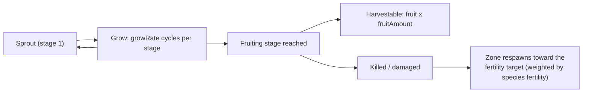

<!-- Generated by tools/generate from the live database (source: plantrules + $GameRoot/plantrules/*.txt (rule files), zones, entitydefaults (fruit names)).
     Do not edit by hand; regenerate instead. -->

# Plants

Plants grow over time through a sequence of stages; a plant produces (is harvestable) only once it reaches its fruiting stage. The zone maintains plant populations toward a **fertility target** per area; `spreading` biases new growth toward existing clusters of the same type. The full field reference — types, defaults, the growth state machine, and the rule-file format — is in [Plant fields](/formats/plant-fields/).

Field meanings: **growRate** = growth cycles a plant sits in each stage before advancing (higher = slower); **fertility** = how strongly the zone tries to keep this species present; **spreading** = preference for growing in groups; **killDistance** = minimum spacing between two plants of the same type (−1 = none);

## Harvestable plants

Species with a fruiting stage — the fruit is the harvestable yield (× = fruitAmount per fruiting stage).

| Plant | Grow rate | Fertility | Spreading | Kill distance | Max slope | Altitude band | Water band | Fruit (yield) | Max amount | Health (stages) | Player seeded |
|---|---|---|---|---|---|---|---|---|---|---|---|

## Scenery plants (not harvestable)

Species with no fruiting stage — zone scenery only (cover, landmarks, blocking).

| Plant | Grow rate | Fertility | Spreading | Kill distance | Max slope | Altitude band | Water band | Max amount | Health (stages) | Player seeded |
|---|---|---|---|---|---|---|---|---|---|---|
| bonsai | 0 | 0 | 0 | 0 | 0 | 0–0 | 0–0 | -1 | – | no |
| bush_a | 0 | 0 | 0 | 0 | 0 | 0–0 | 0–0 | -1 | – | no |
| bush_b | 0 | 0 | 0 | 0 | 0 | 0–0 | 0–0 | -1 | – | no |
| coppertree | 0 | 0 | 0 | 0 | 0 | 0–0 | 0–0 | -1 | – | no |
| devrinol | 0 | 0 | 0 | 0 | 0 | 0–0 | 0–0 | -1 | – | no |
| electroplant_hi | 0 | 0 | 0 | 0 | 0 | 0–0 | 0–0 | -1 | – | no |
| electroplant_lo | 0 | 0 | 0 | 0 | 0 | 0–0 | 0–0 | -1 | – | no |
| electroplant_lo_beta | 0 | 0 | 0 | 0 | 0 | 0–0 | 0–0 | -1 | – | no |
| electroplant_seeded_t1 | 0 | 0 | 0 | 0 | 0 | 0–0 | 0–0 | -1 | – | no |
| electroplant_seeded_t2 | 0 | 0 | 0 | 0 | 0 | 0–0 | 0–0 | -1 | – | no |
| electroplant_t0 | 0 | 0 | 0 | 0 | 0 | 0–0 | 0–0 | -1 | – | no |
| grass_a | 0 | 0 | 0 | 0 | 0 | 0–0 | 0–0 | -1 | – | no |
| grass_b | 0 | 0 | 0 | 0 | 0 | 0–0 | 0–0 | -1 | – | no |
| irontree_hi | 0 | 0 | 0 | 0 | 0 | 0–0 | 0–0 | -1 | – | no |
| irontree_lo | 0 | 0 | 0 | 0 | 0 | 0–0 | 0–0 | -1 | – | no |
| irontree_seeded_t1 | 0 | 0 | 0 | 0 | 0 | 0–0 | 0–0 | -1 | – | no |
| irontree_seeded_t2 | 0 | 0 | 0 | 0 | 0 | 0–0 | 0–0 | -1 | – | no |
| irontree_seeded_t3 | 0 | 0 | 0 | 0 | 0 | 0–0 | 0–0 | -1 | – | no |
| irontree_t0 | 0 | 0 | 0 | 0 | 0 | 0–0 | 0–0 | -1 | – | no |
| irontree_t1 | 0 | 0 | 0 | 0 | 0 | 0–0 | 0–0 | -1 | – | no |
| irontree_t2 | 0 | 0 | 0 | 0 | 0 | 0–0 | 0–0 | -1 | – | no |
| irontree_t3 | 0 | 0 | 0 | 0 | 0 | 0–0 | 0–0 | -1 | – | no |
| nanowheat | 0 | 0 | 0 | 0 | 0 | 0–0 | 0–0 | -1 | – | no |
| pinetree | 0 | 0 | 0 | 0 | 0 | 0–0 | 0–0 | -1 | – | no |
| poffeteg | 0 | 0 | 0 | 0 | 0 | 0–0 | 0–0 | -1 | – | no |
| quag | 0 | 0 | 0 | 0 | 0 | 0–0 | 0–0 | -1 | – | no |
| rango | 0 | 0 | 0 | 0 | 0 | 0–0 | 0–0 | -1 | – | no |
| rango_lowaltitude | 0 | 0 | 0 | 0 | 0 | 0–0 | 0–0 | -1 | – | no |
| reed | 0 | 0 | 0 | 0 | 0 | 0–0 | 0–0 | -1 | – | no |
| rustbush_hi | 0 | 0 | 0 | 0 | 0 | 0–0 | 0–0 | -1 | – | no |
| rustbush_lo | 0 | 0 | 0 | 0 | 0 | 0–0 | 0–0 | -1 | – | no |
| rustbush_seeded_t1 | 0 | 0 | 0 | 0 | 0 | 0–0 | 0–0 | -1 | – | no |
| rustbush_seeded_t2 | 0 | 0 | 0 | 0 | 0 | 0–0 | 0–0 | -1 | – | no |
| rustbush_seeded_t3 | 0 | 0 | 0 | 0 | 0 | 0–0 | 0–0 | -1 | – | no |
| rustbush_t0 | 0 | 0 | 0 | 0 | 0 | 0–0 | 0–0 | -1 | – | no |
| rustbush_t1 | 0 | 0 | 0 | 0 | 0 | 0–0 | 0–0 | -1 | – | no |
| rustbush_t2 | 0 | 0 | 0 | 0 | 0 | 0–0 | 0–0 | -1 | – | no |
| rustbush_t3 | 0 | 0 | 0 | 0 | 0 | 0–0 | 0–0 | -1 | – | no |
| slimeroot_hi | 0 | 0 | 0 | 0 | 0 | 0–0 | 0–0 | -1 | – | no |
| slimeroot_lo | 0 | 0 | 0 | 0 | 0 | 0–0 | 0–0 | -1 | – | no |
| slimeroot_seeded_t1 | 0 | 0 | 0 | 0 | 0 | 0–0 | 0–0 | -1 | – | no |
| slimeroot_seeded_t2 | 0 | 0 | 0 | 0 | 0 | 0–0 | 0–0 | -1 | – | no |
| slimeroot_seeded_t3 | 0 | 0 | 0 | 0 | 0 | 0–0 | 0–0 | -1 | – | no |
| slimeroot_t0 | 0 | 0 | 0 | 0 | 0 | 0–0 | 0–0 | -1 | – | no |
| slimeroot_t1 | 0 | 0 | 0 | 0 | 0 | 0–0 | 0–0 | -1 | – | no |
| slimeroot_t2 | 0 | 0 | 0 | 0 | 0 | 0–0 | 0–0 | -1 | – | no |
| slimeroot_t3 | 0 | 0 | 0 | 0 | 0 | 0–0 | 0–0 | -1 | – | no |
| titanplant | 0 | 0 | 0 | 0 | 0 | 0–0 | 0–0 | -1 | – | no |
| wall | 0 | 0 | 0 | 0 | 0 | 0–0 | 0–0 | -1 | – | no |

## Zones

Per-zone fertility (how full the ground is kept with plants), the plant ruleset the zone uses, and altitude scaling.

| Zone | Type | Protected | Fertility | Plant ruleset | Altitude scale | Enabled |
|---|---|---|---|---|---|---|
| New Virginia | 1 | yes | 20 | 0 | 1 | yes |
| Attalica | 1 | yes | 20 | 1 | 1 | yes |
| Daoden | 2 | no | 20 | 2 | 1 | yes |
| Domhalarn | 2 | no | 20 | 3 | 1 | yes |
| Hokkogaros | 2 | no | 20 | 4 | 1 | yes |
| Norhoop | 2 | no | 20 | 5 | 1 | yes |
| Tellesis | 1 | yes | 20 | 6 | 1 | yes |
| Shinjalar | 1 | yes | 20 | 7 | 1 | yes |
| Hershfield | 1 | yes | 20 | 0 | 1 | yes |
| Kentagura | 2 | no | 20 | 4 | 1 | yes |
| Alsbale | 2 | no | 20 | 5 | 1 | yes |
| Novastrov | 2 | no | 20 | 3 | 1 | yes |
| Omega | 4 | yes | 20 | 70 | 1 | yes |
| Davis Barrier | 2 | no | 20 | 5 | 1 | no |
| Gravehills | 2 | no | 20 | 5 | 1 | no |
| Emperth | 2 | no | 20 | 5 | 1 | no |
| Guthraw | 2 | no | 20 | 5 | 1 | no |
| Landers Bridge | 2 | no | 20 | 5 | 1 | no |
| Solarfield | 2 | no | 20 | 5 | 0.3 | no |
| Blackpoint | 2 | no | 20 | 5 | 1 | no |
| Greensward | 2 | no | 20 | 5 | 1 | no |
| Novaya Trava | 2 | no | 20 | 3 | 1 | no |
| Neuhorn | 2 | no | 20 | 3 | 1 | no |
| Kraslovsk | 2 | no | 20 | 3 | 0.3 | no |
| Langruhm | 2 | no | 20 | 3 | 1 | no |
| Berger's Island | 2 | no | 20 | 3 | 1 | no |
| Clandrais | 2 | no | 20 | 3 | 1 | no |
| Bleumon | 2 | no | 20 | 3 | 1 | no |
| Chalydor | 2 | no | 20 | 3 | 1 | no |
| Rhaoshan | 2 | no | 20 | 4 | 0.3 | no |
| Changowa | 2 | no | 20 | 4 | 1 | no |
| Mhenosha | 2 | no | 20 | 4 | 1 | no |
| Xiantor | 2 | no | 20 | 4 | 1 | no |
| Nirayon | 2 | no | 20 | 4 | 1 | no |
| Shuzhon | 2 | no | 20 | 4 | 1 | no |
| Imidero | 2 | no | 20 | 4 | 1 | no |
| Yuraion Ro | 2 | no | 20 | 4 | 1 | no |
| Virtual Training Grounds | 3 | yes | 20 | 0 | 1 | yes |
| New Virginia | 3 | yes | 20 | 0 | 1 | yes |
| New Virginia | 3 | yes | 20 | 0 | 1 | yes |
| zone_strghld_70 | 4 | yes | 20 | 70 | 1 | yes |
| zone_strghld_71 | 4 | yes | 20 | 71 | 1 | yes |
| zone_strghld_72 | 4 | yes | 20 | 72 | 1 | yes |
| zone_gamma_tc_z100 | 2 | no | 15 | 14 | 1 | yes |
| zone_gamma_tc_z101 | 2 | no | 15 | 14 | 1 | yes |
| zone_gamma_tc_z102 | 2 | no | 15 | 34 | 1 | yes |
| zone_gamma_tc_z103 | 2 | no | 15 | 34 | 1 | yes |
| zone_gamma_tc_z104 | 2 | no | 15 | 24 | 1 | yes |
| zone_gamma_tc_z105 | 2 | no | 15 | 24 | 1 | yes |
| zone_gamma_z106 | 2 | no | 15 | 22 | 1 | yes |
| zone_gamma_z107 | 2 | no | 15 | 33 | 1 | yes |
| zone_gamma_z108 | 2 | no | 15 | 32 | 1 | yes |
| zone_gamma_z109 | 2 | no | 15 | 31 | 1 | yes |
| zone_gamma_z110 | 2 | no | 15 | 20 | 1 | yes |
| zone_gamma_z111 | 2 | no | 15 | 21 | 1 | yes |
| zone_gamma_z112 | 2 | no | 15 | 21 | 1 | yes |
| zone_gamma_z113 | 2 | no | 15 | 11 | 1 | yes |
| zone_gamma_z114 | 2 | no | 15 | 10 | 1 | yes |
| zone_gamma_z115 | 2 | no | 15 | 11 | 1 | yes |
| zone_gamma_z116 | 2 | no | 15 | 31 | 1 | yes |
| zone_gamma_z117 | 2 | no | 15 | 31 | 1 | yes |
| zone_gamma_z118 | 2 | no | 15 | 32 | 1 | yes |
| zone_gamma_z119 | 2 | no | 15 | 30 | 1 | yes |
| zone_gamma_z120 | 2 | no | 15 | 31 | 1 | yes |
| zone_gamma_z121 | 2 | no | 15 | 12 | 1 | yes |
| zone_gamma_z122 | 2 | no | 15 | 13 | 1 | yes |
| zone_gamma_z123 | 2 | no | 15 | 12 | 1 | yes |
| zone_gamma_z124 | 2 | no | 15 | 12 | 1 | yes |
| zone_gamma_z125 | 2 | no | 15 | 11 | 1 | yes |
| zone_gamma_z126 | 2 | no | 15 | 12 | 1 | yes |
| zone_gamma_z127 | 2 | no | 15 | 12 | 1 | yes |
| zone_gamma_z128 | 2 | no | 15 | 23 | 1 | yes |
| zone_gamma_z129 | 2 | no | 15 | 22 | 1 | yes |
| zone_gamma_z130 | 2 | no | 15 | 21 | 1 | yes |
| zone_gamma_z131 | 2 | no | 15 | 20 | 1 | yes |
| zone_gamma_z132 | 2 | no | 15 | 21 | 1 | yes |
| zone_gamma_z133 | 2 | no | 15 | 22 | 1 | yes |
| zone_gamma_z134 | 2 | no | 15 | 23 | 1 | yes |
| zone_gamma_z135 | 2 | no | 15 | 22 | 1 | yes |
| zone_gamma_z136 | 2 | no | 15 | 22 | 1 | yes |
| zone_gamma_z137 | 2 | no | 15 | 31 | 1 | yes |
| zone_gamma_z138 | 2 | no | 15 | 32 | 1 | yes |
| zone_gamma_z139 | 2 | no | 15 | 32 | 1 | yes |
| zone_gamma_z140 | 2 | no | 15 | 33 | 1 | yes |

## Ruleset → species

| Ruleset | Zones | Species |
|---|---|---|
| 0 | New Virginia, Hershfield, Virtual Training Grounds | grass_a, grass_b, pinetree, bush_a, bush_b, rango, coppertree, reed, nanowheat, rustbush_lo, slimeroot_lo, quag, electroplant_lo, bonsai, irontree_lo |
| 1 | Attalica | bonsai, bush_a, bush_b, coppertree, grass_a, grass_b, nanowheat, pinetree, quag, rango, reed, devrinol, electroplant_hi, rustbush_hi, slimeroot_hi |
| 2 | Daoden | bonsai, bush_a, bush_b, coppertree, devrinol, electroplant_hi, grass_a, grass_b, irontree_hi, nanowheat, pinetree, poffeteg, quag, rango, reed, rustbush_hi, slimeroot_hi, titanplant, wall |
| 3 | Domhalarn, Novastrov, Novaya Trava, Neuhorn, Kraslovsk, Langruhm, Berger's Island, Clandrais, Bleumon, Chalydor | bush_a, bush_b, coppertree, electroplant_hi, grass_a, grass_b, irontree_hi, nanowheat, pinetree, quag, rango, reed, rustbush_hi, titanplant, wall, devrinol, electroplant_lo_beta |
| 4 | Hokkogaros, Kentagura, Rhaoshan, Changowa, Mhenosha, Xiantor, Nirayon, Shuzhon, Imidero, Yuraion Ro | poffeteg, bush_a, bush_b, coppertree, electroplant_hi, grass_a, grass_b, irontree_hi, nanowheat, pinetree, quag, rango, reed, slimeroot_hi, wall, devrinol, electroplant_lo_beta |
| 5 | Norhoop, Alsbale, Davis Barrier, Gravehills, Emperth, Guthraw, Landers Bridge, Solarfield, Blackpoint, Greensward | bonsai, bush_a, bush_b, coppertree, electroplant_hi, grass_a, grass_b, nanowheat, pinetree, quag, rango, reed, rustbush_hi, slimeroot_hi, wall, devrinol, electroplant_lo_beta |
| 6 | Tellesis | bush_a, bush_b, coppertree, grass_a, grass_b, pinetree, quag, rango, reed, titanplant, nanowheat, irontree_hi, electroplant_hi, rustbush_hi |
| 7 | Shinjalar | bush_a, bush_b, coppertree, grass_a, grass_b, nanowheat, pinetree, quag, rango, reed, poffeteg, electroplant_hi, irontree_hi, slimeroot_hi |
| 8 | – | bonsai, bush_a, bush_b, coppertree, devrinol, electroplant_hi, grass_a, grass_b, irontree_hi, nanowheat, pinetree, poffeteg, quag, rango, reed, rustbush_hi, slimeroot_hi, titanplant, wall |
| 10 | zone_gamma_z114 | electroplant_t0, slimeroot_t0, rustbush_t0, bush_a, bush_b, coppertree, devrinol, grass_a, grass_b, nanowheat, pinetree, poffeteg, quag, rango, reed |
| 11 | zone_gamma_z113, zone_gamma_z115, zone_gamma_z125 | slimeroot_t1, rustbush_t1, electroplant_seeded_t1, irontree_seeded_t1, bush_a, bush_b, coppertree, devrinol, grass_a, grass_b, nanowheat, pinetree, poffeteg, quag, rango, reed, wall |
| 12 | zone_gamma_z121, zone_gamma_z123, zone_gamma_z124, zone_gamma_z126, zone_gamma_z127 | slimeroot_t2, rustbush_t2, electroplant_seeded_t2, irontree_seeded_t2, bush_a, bush_b, coppertree, devrinol, grass_a, grass_b, nanowheat, pinetree, poffeteg, quag, rango, reed, wall |
| 13 | zone_gamma_z122 | slimeroot_t3, rustbush_t3, irontree_seeded_t3, bush_a, bush_b, coppertree, devrinol, grass_a, grass_b, nanowheat, pinetree, poffeteg, quag, rango, reed, wall |
| 14 | zone_gamma_tc_z100, zone_gamma_tc_z101 | bush_a, bush_b, coppertree, devrinol, grass_a, grass_b, nanowheat, pinetree, poffeteg, quag, rango, reed |
| 20 | zone_gamma_z110, zone_gamma_z131 | electroplant_t0, irontree_t0, rustbush_t0, bush_a, bush_b, coppertree, devrinol, grass_a, grass_b, nanowheat, pinetree, poffeteg, quag, rango, reed |
| 21 | zone_gamma_z111, zone_gamma_z112, zone_gamma_z130, zone_gamma_z132 | irontree_t1, rustbush_t1, electroplant_seeded_t1, slimeroot_seeded_t1, bush_a, bush_b, coppertree, devrinol, grass_a, grass_b, nanowheat, pinetree, poffeteg, quag, rango, reed, wall |
| 22 | zone_gamma_z106, zone_gamma_z129, zone_gamma_z133, zone_gamma_z135, zone_gamma_z136 | irontree_t2, rustbush_t2, electroplant_seeded_t2, slimeroot_seeded_t2, bush_a, bush_b, coppertree, devrinol, grass_a, grass_b, nanowheat, pinetree, poffeteg, quag, rango, reed, wall |
| 23 | zone_gamma_z128, zone_gamma_z134 | irontree_t3, rustbush_t3, slimeroot_seeded_t3, bush_a, bush_b, coppertree, devrinol, grass_a, grass_b, nanowheat, pinetree, poffeteg, quag, rango, reed, wall |
| 24 | zone_gamma_tc_z104, zone_gamma_tc_z105 | bush_a, bush_b, coppertree, devrinol, grass_a, grass_b, nanowheat, pinetree, poffeteg, quag, rango, reed |
| 30 | zone_gamma_z119 | electroplant_t0, irontree_t0, slimeroot_t0, bush_a, bush_b, coppertree, devrinol, grass_a, grass_b, nanowheat, pinetree, poffeteg, quag, rango, reed |
| 31 | zone_gamma_z109, zone_gamma_z116, zone_gamma_z117, zone_gamma_z120, zone_gamma_z137 | irontree_t1, slimeroot_t1, electroplant_seeded_t1, rustbush_seeded_t1, bush_a, bush_b, coppertree, devrinol, grass_a, grass_b, nanowheat, pinetree, poffeteg, quag, rango, reed, wall |
| 32 | zone_gamma_z108, zone_gamma_z118, zone_gamma_z138, zone_gamma_z139 | irontree_t2, slimeroot_t2, electroplant_seeded_t2, rustbush_seeded_t2, bush_a, bush_b, coppertree, devrinol, grass_a, grass_b, nanowheat, pinetree, poffeteg, quag, rango, reed, wall |
| 33 | zone_gamma_z107, zone_gamma_z140 | irontree_t3, slimeroot_t3, rustbush_seeded_t3, bush_a, bush_b, coppertree, devrinol, grass_a, grass_b, nanowheat, pinetree, poffeteg, quag, rango, reed, wall |
| 34 | zone_gamma_tc_z102, zone_gamma_tc_z103 | bush_a, bush_b, coppertree, devrinol, grass_a, grass_b, nanowheat, pinetree, poffeteg, quag, rango, reed |
| 70 | Omega, zone_strghld_70 | bush_a, bush_b, coppertree, grass_a, grass_b, nanowheat, pinetree, quag, rango_lowaltitude, titanplant |
| 71 | zone_strghld_71 | bush_a, bush_b, coppertree, grass_a, grass_b, nanowheat, pinetree, quag, rango_lowaltitude, titanplant |
| 72 | zone_strghld_72 | bush_a, bush_b, coppertree, grass_a, grass_b, nanowheat, pinetree, quag, rango_lowaltitude, titanplant |
