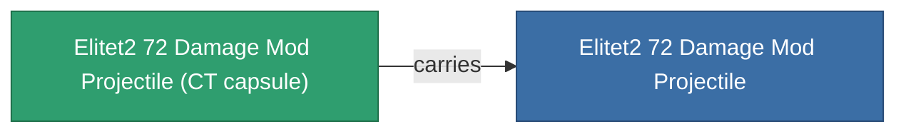

<!-- Generated by tools/generate from the live database (source: entitydefaults definition 6052, aggregatevalues via aggregatefields).
     Do not edit by hand; regenerate instead. -->

# Elitet2 72 Damage Mod Projectile

|  |  |
|---|---|
| Definice | `def_elitet2_72_damage_mod_projectile` |
| Třída | T2 (special) |
| Zdraví | 100 |
| Objem | 0.5 |
| Hmotnost | 75 |
| Kategorie | Modules / Enhancements |
| Poznámka | elite module |

## Statistiky

| Pole | Hodnota |
|---|---|
| cpu_usage | 13 |
| damage_projectile_modifier | 0.19 |
| powergrid_usage | 4 |
| projectile_falloff_modifier | 1.03 |
| projectile_optimal_range_modifier | 1.015 |

## Transportní kapsle

A transport capsule (CT) exists for this item — it is how the item moves between players and zones.

## Kde koupit

Fixed-price vendors that sell this item (see the [Item shop](/cs/content/shop/) for the full catalog).

| Vendor | Qty | Credits | UniCoin |
|---|---|---|---|
| Daoden outpost | ∞ | 250M | 10k |

<!-- production:generated -->
## Výroba

**Vyráběn z 2 komponentách** — sestavte komponenty pro jeho výrobu (celkový seznam najdete v [Receptury](/cs/content/recipes/)):

**Výkres:** [Elitet2 72 Damage Mod Projectile Cprg](/cs/content/items/elitet2-72-damage-mod-projectile-cprg/)

<svg class="prod-card-icon" aria-hidden="true"><use href="#mi-grid"/></svg><a class="prod-card-name" href="/cs/content/items/material-boss-z72/">Material Boss Z72</a>

potřebné: <b>300</b>

<svg class="prod-card-icon" aria-hidden="true"><use href="#mi-panel"/></svg><a class="prod-card-name" href="/cs/content/items/named1-damage-mod-projectile/">Diathel-Subperis firearm tuning</a>

potřebné: <b>1</b>

