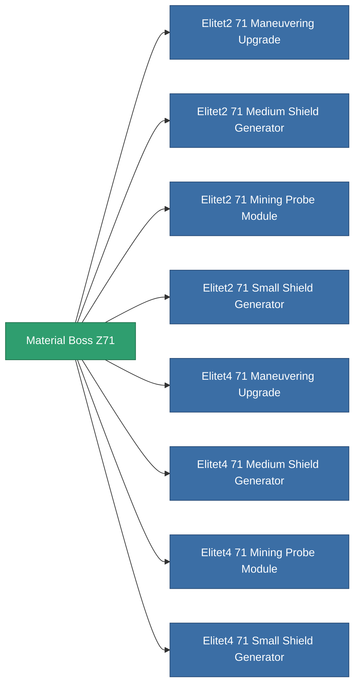

<!-- Generated by tools/generate from the live database (source: entitydefaults definition 6040, aggregatevalues via aggregatefields).
     Do not edit by hand; regenerate instead. -->

# Material Boss Z71

|  |  |
|---|---|
| Definice | `def_material_boss_z71` |
| Třída | – |
| Zdraví | 100 |
| Objem | 0.01 |
| Hmotnost | 0.5 |
| Kategorie | Materials |
| Poznámka | elite module material |

_Žádné statistiky — tento předmět nenese žádné agregované hodnoty._

<!-- production:generated -->
## Použito ve výrobě

**Komponentou 8 předmětů** — vše, co ho ve výrobě používá:

