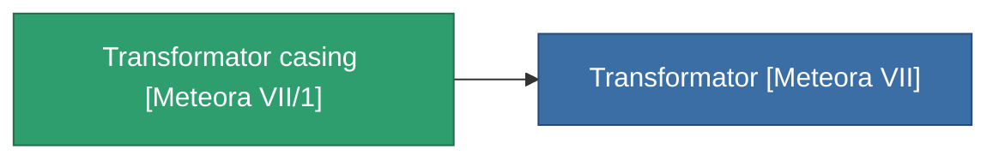

<!-- Generated by tools/generate from the live database (source: entitydefaults definition 4152, aggregatevalues via aggregatefields).
     Do not edit by hand; regenerate instead. -->

# Transformator casing [Meteora VII/1]

|  |  |
|---|---|
| Definice | `def_missionitem_ics_ii_level02_exp3_07_t03` |
| Třída | – |
| Zdraví | 100 |
| Objem | 0.01 |
| Hmotnost | 50 |
| Kategorie | Mission items |

_Žádné statistiky — tento předmět nenese žádné agregované hodnoty._

<!-- production:generated -->
## Použito ve výrobě

**Komponentou 1 předmětů** — vše, co ho ve výrobě používá:

