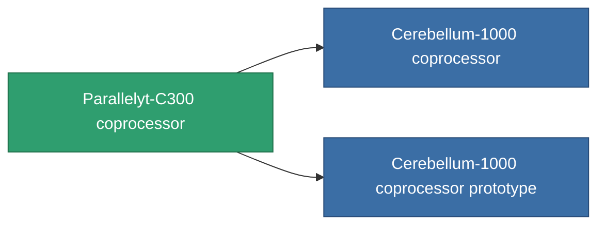

<!-- Generated by tools/generate from the live database (source: entitydefaults definition 783, aggregatevalues via aggregatefields).
     Do not edit by hand; regenerate instead. -->

# Parallelyt-C300 coprocessor

|  |  |
|---|---|
| Definice | `def_named1_cpu_upgrade` |
| Třída | T2 |
| Zdraví | 100 |
| Objem | 0.01 |
| Hmotnost | 0.2 |
| Kategorie | Modules / Enhancements |
| Tier line | [Standard coprocessor](/cs/content/items/standard-cpu-upgrade/) (T1) → **Parallelyt-C300 coprocessor** (T2) → [Cerebellum-1000 coprocessor](/cs/content/items/named2-cpu-upgrade/) (T3) → [Processyt-C1000 coprocessor](/cs/content/items/named3-cpu-upgrade/) (T4) |

## Statistiky

| Pole | Hodnota |
|---|---|
| cpu_max_modifier | 1.1 |
| cpu_usage | 0 |
| powergrid_usage | 2 |

<!-- production:generated -->
## Výroba

**Vyráběn z 4 komponentách, výzkumná úroveň 4** — sestavte komponenty pro jeho výrobu (celkový seznam najdete v [Receptury](/cs/content/recipes/)):

**Výkres:** [Parallelyt-C300 coprocessor CT](/content/items/named1-cpu-upgrade-cprg/)

<svg class="prod-card-icon" aria-hidden="true"><use href="#mi-grid"/></svg><a class="prod-card-name" href="/cs/content/items/axicol/">Cryoperine</a>

potřebné: <b>350</b>

<svg class="prod-card-icon" aria-hidden="true"><use href="#mi-crystal"/></svg><a class="prod-card-name" href="/cs/content/items/robotshard-common-basic/">Damaged common fragment</a>

potřebné: <b>30</b>

<svg class="prod-card-icon" aria-hidden="true"><use href="#mi-grid"/></svg><a class="prod-card-name" href="/cs/content/items/standard-cpu-upgrade/">Standard coprocessor</a>

potřebné: <b>1</b>

<svg class="prod-card-icon" aria-hidden="true"><use href="#mi-grid"/></svg><a class="prod-card-name" href="/cs/content/items/titanium/">Titanium</a>

potřebné: <b>50</b>

## Použito ve výrobě

**Komponentou 2 předmětů** — vše, co ho ve výrobě používá:

