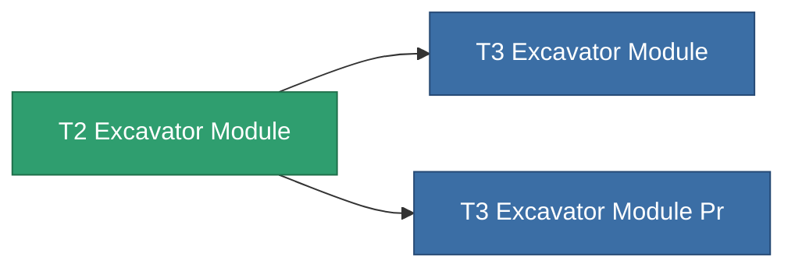

<!-- Generated by tools/generate from the live database (source: entitydefaults definition 8821, aggregatevalues via aggregatefields).
     Do not edit by hand; regenerate instead. -->

# T2 Excavator Module

|  |  |
|---|---|
| Definice | `def_named1_excavator_module` |
| Třída | T2 |
| Zdraví | 100 |
| Objem | 2.5 |
| Hmotnost | 1500 |
| Kategorie | Modules / Harvesting |
| Tier line | [Standard Excavator Module](/cs/content/items/standard-excavator-module/) (T1) → **T2 Excavator Module** (T2) → [T3 Excavator Module](/cs/content/items/named2-excavator-module/) (T3) → [T4 Excavator Module](/cs/content/items/named3-excavator-module/) (T4) |

## Statistiky

| Pole | Hodnota |
|---|---|
| core_usage | 135 |
| cpu_usage | 432 |
| cycle_time | 180k |
| effect_excavator_harvesting_amount_modifier | 1.3 |
| effect_excavator_mining_amount_modifier | 1.3 |
| effect_excavator_stealth_strength_modifier | -30 |
| powergrid_usage | 1.215k |

<!-- production:generated -->
## Výroba

**Vyráběn z 4 komponentách** — sestavte komponenty pro jeho výrobu (celkový seznam najdete v [Receptury](/cs/content/recipes/)):

**Výkres:** [T2 Excavator Module Cprg](/cs/content/items/named1-excavator-module-cprg/)

<svg class="prod-card-icon" aria-hidden="true"><use href="#mi-grid"/></svg><a class="prod-card-name" href="/cs/content/items/axicol/">Cryoperine</a>

potřebné: <b>600</b>

<svg class="prod-card-icon" aria-hidden="true"><use href="#mi-crystal"/></svg><a class="prod-card-name" href="/cs/content/items/robotshard-common-basic/">Damaged common fragment</a>

potřebné: <b>120</b>

<svg class="prod-card-icon" aria-hidden="true"><use href="#mi-panel"/></svg><a class="prod-card-name" href="/cs/content/items/standard-excavator-module/">Standard Excavator Module</a>

potřebné: <b>1</b>

<svg class="prod-card-icon" aria-hidden="true"><use href="#mi-grid"/></svg><a class="prod-card-name" href="/cs/content/items/titanium/">Titanium</a>

potřebné: <b>2.4k</b>

## Použito ve výrobě

**Komponentou 2 předmětů** — vše, co ho ve výrobě používá:

