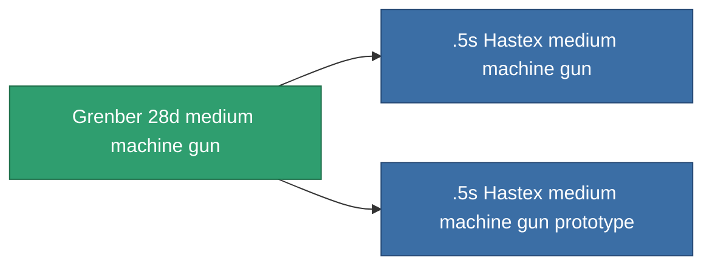

<!-- Generated by tools/generate from the live database (source: entitydefaults definition 843, aggregatevalues via aggregatefields).
     Do not edit by hand; regenerate instead. -->

# Grenber 28d medium machine gun

|  |  |
|---|---|
| Definice | `def_named1_medium_autocannon` |
| Třída | T2 |
| Zdraví | 100 |
| Objem | 1.2 |
| Hmotnost | 450 |
| Kategorie | Modules / Weapons |
| Tier line | [Standard medium machine gun](/cs/content/items/standard-medium-autocannon/) (T1) → **Grenber 28d medium machine gun** (T2) → [.5s Hastex medium machine gun](/cs/content/items/named2-medium-autocannon/) (T3) → [Torrex-G17 medium machine gun](/cs/content/items/named3-medium-autocannon/) (T4) |

## Statistiky

| Pole | Hodnota |
|---|---|
| accuracy | 17 |
| core_usage | 1 |
| cpu_usage | 8 |
| cycle_time | 4k |
| damage_modifier | 1.6 |
| falloff | 20 |
| least_optimal | 3 |
| optimal_range | 12.5 |
| powergrid_usage | 105 |

<!-- production:generated -->
## Výroba

**Vyráběn z 3 komponentách, výzkumná úroveň 4** — sestavte komponenty pro jeho výrobu (celkový seznam najdete v [Receptury](/cs/content/recipes/)):

**Výkres:** [Grenber 28d medium machine gun CT](/content/items/named1-medium-autocannon-cprg/)

<svg class="prod-card-icon" aria-hidden="true"><use href="#mi-grid"/></svg><a class="prod-card-name" href="/cs/content/items/axicoline/">Axicoline</a>

potřebné: <b>200</b>

<svg class="prod-card-icon" aria-hidden="true"><use href="#mi-grid"/></svg><a class="prod-card-name" href="/cs/content/items/standard-medium-autocannon/">Standard medium machine gun</a>

potřebné: <b>1</b>

<svg class="prod-card-icon" aria-hidden="true"><use href="#mi-grid"/></svg><a class="prod-card-name" href="/cs/content/items/titanium/">Titanium</a>

potřebné: <b>100</b>

## Použito ve výrobě

**Komponentou 2 předmětů** — vše, co ho ve výrobě používá:

