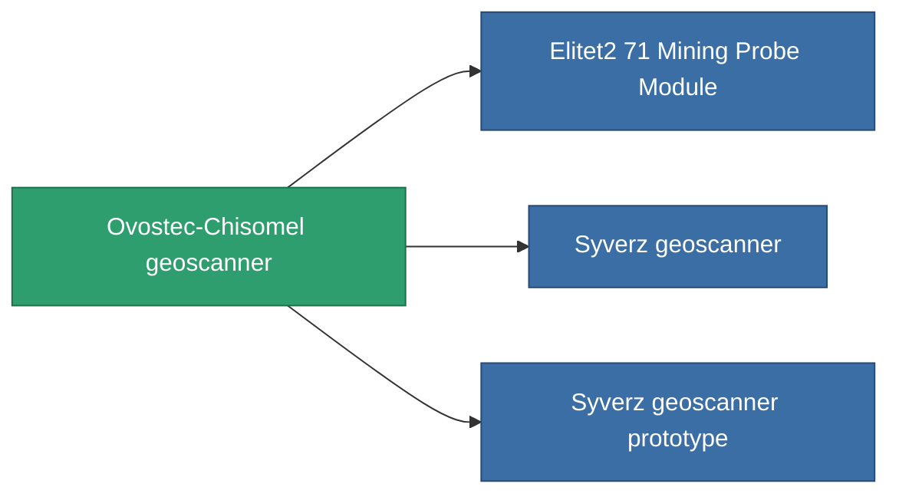

<!-- Generated by tools/generate from the live database (source: entitydefaults definition 780, aggregatevalues via aggregatefields).
     Do not edit by hand; regenerate instead. -->

# Ovostec-Chisomel geoscanner

|  |  |
|---|---|
| Definice | `def_named1_mining_probe_module` |
| Třída | T2 |
| Zdraví | 100 |
| Objem | 1 |
| Hmotnost | 180 |
| Kategorie | Modules / Enhancements |
| Tier line | [Standard geoscanner](/cs/content/items/standard-mining-probe-module/) (T1) → **Ovostec-Chisomel geoscanner** (T2) → [Syverz geoscanner](/cs/content/items/named2-mining-probe-module/) (T3) → [Eksplor-q3000 geoscanner](/cs/content/items/named3-mining-probe-module/) (T4) |

## Statistiky

| Pole | Hodnota |
|---|---|
| core_usage | 50 |
| cpu_usage | 40 |
| cycle_time | 15k |
| mining_probe_accuracy | 0.5 |
| powergrid_usage | 45 |

<!-- production:generated -->
## Výroba

**Vyráběn z 4 komponentách, výzkumná úroveň 2** — sestavte komponenty pro jeho výrobu (celkový seznam najdete v [Receptury](/cs/content/recipes/)):

**Výkres:** [Ovostec-Chisomel geoscanner CT](/cs/content/items/named1-mining-probe-module-cprg/)

<svg class="prod-card-icon" aria-hidden="true"><use href="#mi-grid"/></svg><a class="prod-card-name" href="/cs/content/items/axicol/">Cryoperine</a>

potřebné: <b>350</b>

<svg class="prod-card-icon" aria-hidden="true"><use href="#mi-crystal"/></svg><a class="prod-card-name" href="/cs/content/items/robotshard-common-basic/">Damaged common fragment</a>

potřebné: <b>30</b>

<svg class="prod-card-icon" aria-hidden="true"><use href="#mi-grid"/></svg><a class="prod-card-name" href="/cs/content/items/standard-mining-probe-module/">Standard geoscanner</a>

potřebné: <b>1</b>

<svg class="prod-card-icon" aria-hidden="true"><use href="#mi-grid"/></svg><a class="prod-card-name" href="/cs/content/items/titanium/">Titanium</a>

potřebné: <b>50</b>

## Použito ve výrobě

**Komponentou 3 předmětů** — vše, co ho ve výrobě používá:

