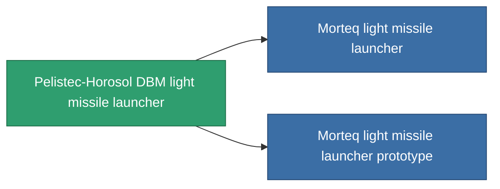

<!-- Generated by tools/generate from the live database (source: entitydefaults definition 849, aggregatevalues via aggregatefields).
     Do not edit by hand; regenerate instead. -->

# Pelistec-Horosol DBM light missile launcher

|  |  |
|---|---|
| Definice | `def_named1_rocket_launcher` |
| Třída | T2 |
| Zdraví | 100 |
| Objem | 1 |
| Hmotnost | 225 |
| Kategorie | Modules / Weapons |
| Tier line | [Standard light missile launcher](/cs/content/items/standard-rocket-launcher/) (T1) → **Pelistec-Horosol DBM light missile launcher** (T2) → [Morteq light missile launcher](/cs/content/items/named2-rocket-launcher/) (T3) → [Pelistec-TR110 light missile launcher](/cs/content/items/named3-rocket-launcher/) (T4) |

## Statistiky

| Pole | Hodnota |
|---|---|
| accuracy | 1 |
| core_usage | 1 |
| cpu_usage | 28 |
| cycle_time | 7.5k |
| damage_modifier | 1 |
| powergrid_usage | 22 |

<!-- production:generated -->
## Výroba

**Vyráběn z 6 komponentách, výzkumná úroveň 3** — sestavte komponenty pro jeho výrobu (celkový seznam najdete v [Receptury](/cs/content/recipes/)):

**Výkres:** [Pelistec-Horosol DBM light missile launcher CT](/cs/content/items/named1-rocket-launcher-cprg/)

<svg class="prod-card-icon" aria-hidden="true"><use href="#mi-grid"/></svg><a class="prod-card-name" href="/cs/content/items/axicoline/">Axicoline</a>

potřebné: <b>50</b>

<svg class="prod-card-icon" aria-hidden="true"><use href="#mi-grid"/></svg><a class="prod-card-name" href="/cs/content/items/phlobotil/">Phlobotil</a>

potřebné: <b>50</b>

<svg class="prod-card-icon" aria-hidden="true"><use href="#mi-crystal"/></svg><a class="prod-card-name" href="/cs/content/items/robotshard-common-basic/">Damaged common fragment</a>

potřebné: <b>15</b>

<svg class="prod-card-icon" aria-hidden="true"><use href="#mi-crystal"/></svg><a class="prod-card-name" href="/cs/content/items/robotshard-pelistal-basic/">Damaged pelistal fragment</a>

potřebné: <b>15</b>

<svg class="prod-card-icon" aria-hidden="true"><use href="#mi-star"/></svg><a class="prod-card-name" href="/cs/content/items/standard-rocket-launcher/">Standard light missile launcher</a>

potřebné: <b>1</b>

<svg class="prod-card-icon" aria-hidden="true"><use href="#mi-grid"/></svg><a class="prod-card-name" href="/cs/content/items/titanium/">Titanium</a>

potřebné: <b>50</b>

## Použito ve výrobě

**Komponentou 2 předmětů** — vše, co ho ve výrobě používá:

