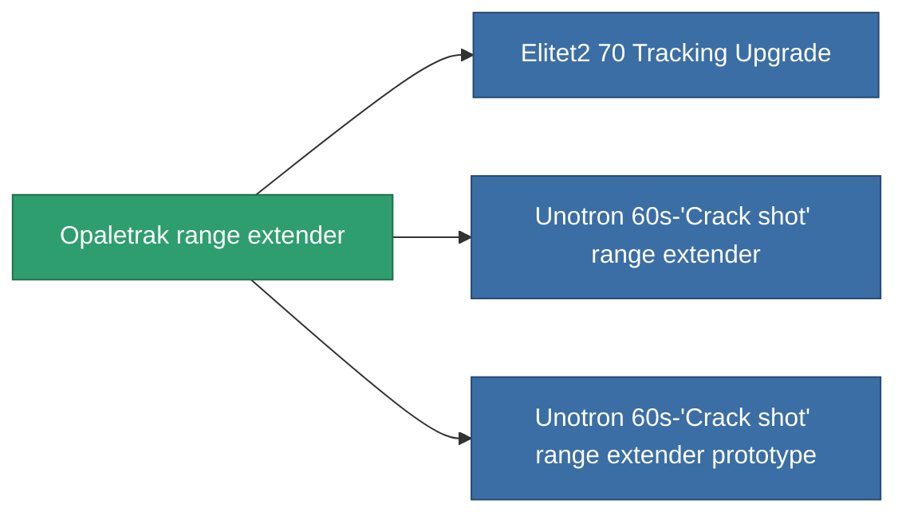

<!-- Generated by tools/generate from the live database (source: entitydefaults definition 936, aggregatevalues via aggregatefields).
     Do not edit by hand; regenerate instead. -->

# Opaletrak range extender

|  |  |
|---|---|
| Definice | `def_named1_tracking_upgrade` |
| Třída | T2 |
| Zdraví | 100 |
| Objem | 0.1 |
| Hmotnost | 45 |
| Kategorie | Modules / Enhancements |
| Tier line | [Standard range extender](/cs/content/items/standard-tracking-upgrade/) (T1) → **Opaletrak range extender** (T2) → [Unotron 60s-'Crack shot' range extender](/cs/content/items/named2-tracking-upgrade/) (T3) → [ATCS-gh50 range extender](/cs/content/items/named3-tracking-upgrade/) (T4) |

## Statistiky

| Pole | Hodnota |
|---|---|
| cpu_usage | 33 |
| optimal_range_modifier | 1.1 |
| powergrid_usage | 90 |

<!-- production:generated -->
## Výroba

**Vyráběn z 5 komponentách, výzkumná úroveň 4** — sestavte komponenty pro jeho výrobu (celkový seznam najdete v [Receptury](/cs/content/recipes/)):

**Výkres:** [Opaletrak range extender CT](/content/items/named1-tracking-upgrade-cprg/)

<svg class="prod-card-icon" aria-hidden="true"><use href="#mi-grid"/></svg><a class="prod-card-name" href="/cs/content/items/axicol/">Cryoperine</a>

potřebné: <b>300</b>

<svg class="prod-card-icon" aria-hidden="true"><use href="#mi-grid"/></svg><a class="prod-card-name" href="/cs/content/items/axicoline/">Axicoline</a>

potřebné: <b>150</b>

<svg class="prod-card-icon" aria-hidden="true"><use href="#mi-crystal"/></svg><a class="prod-card-name" href="/cs/content/items/robotshard-common-basic/">Damaged common fragment</a>

potřebné: <b>30</b>

<svg class="prod-card-icon" aria-hidden="true"><use href="#mi-grid"/></svg><a class="prod-card-name" href="/cs/content/items/standard-tracking-upgrade/">Standard range extender</a>

potřebné: <b>1</b>

<svg class="prod-card-icon" aria-hidden="true"><use href="#mi-grid"/></svg><a class="prod-card-name" href="/cs/content/items/titanium/">Titanium</a>

potřebné: <b>100</b>

## Použito ve výrobě

**Komponentou 3 předmětů** — vše, co ho ve výrobě používá:

