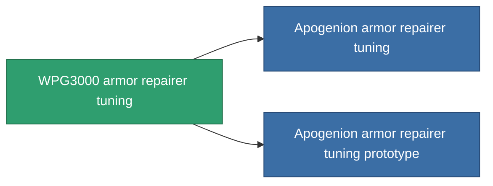

<!-- Generated by tools/generate from the live database (source: entitydefaults definition 1064, aggregatevalues via aggregatefields).
     Do not edit by hand; regenerate instead. -->

# WPG3000 armor repairer tuning

|  |  |
|---|---|
| Definice | `def_named2_armor_repairer_upgrade` |
| Třída | T3 |
| Zdraví | 100 |
| Objem | 0.5 |
| Hmotnost | 300 |
| Kategorie | Modules / Repair |
| Tier line | [Standard armor repairer tuning](/cs/content/items/standard-armor-repairer-upgrade/) (T1) → [Diaptes armor repairer tuning](/cs/content/items/named1-armor-repairer-upgrade/) (T2) → **WPG3000 armor repairer tuning** (T3) → [Apogenion armor repairer tuning](/cs/content/items/named3-armor-repairer-upgrade/) (T4) |

## Statistiky

| Pole | Hodnota |
|---|---|
| armor_repair_amount_modifier | 1.12 |
| armor_repair_cycle_time_modifier | 0.936 |
| cpu_usage | 37 |
| powergrid_usage | 27 |

<!-- production:generated -->
## Výroba

**Vyráběn z 10 komponentách, výzkumná úroveň 5** — sestavte komponenty pro jeho výrobu (celkový seznam najdete v [Receptury](/cs/content/recipes/)):

**Výkres:** [WPG3000 armor repairer tuning CT](/cs/content/items/named2-armor-repairer-upgrade-cprg/)

<svg class="prod-card-icon" aria-hidden="true"><use href="#mi-grid"/></svg><a class="prod-card-name" href="/cs/content/items/alligior/">Alligior</a>

potřebné: <b>150</b>

<svg class="prod-card-icon" aria-hidden="true"><use href="#mi-grid"/></svg><a class="prod-card-name" href="/cs/content/items/chollonin/">Chollonin</a>

potřebné: <b>50</b>

<svg class="prod-card-icon" aria-hidden="true"><use href="#mi-grid"/></svg><a class="prod-card-name" href="/cs/content/items/espitium/">Espitium</a>

potřebné: <b>50</b>

<svg class="prod-card-icon" aria-hidden="true"><use href="#mi-tree"/></svg><a class="prod-card-name" href="/cs/content/items/named1-armor-repairer-upgrade/">Diaptes armor repairer tuning</a>

potřebné: <b>1</b>

<svg class="prod-card-icon" aria-hidden="true"><use href="#mi-crystal"/></svg><a class="prod-card-name" href="/cs/content/items/robotshard-common-advanced/">Functional common fragment</a>

potřebné: <b>10</b>

<svg class="prod-card-icon" aria-hidden="true"><use href="#mi-crystal"/></svg><a class="prod-card-name" href="/cs/content/items/robotshard-common-basic/">Damaged common fragment</a>

potřebné: <b>10</b>

<svg class="prod-card-icon" aria-hidden="true"><use href="#mi-crystal"/></svg><a class="prod-card-name" href="/cs/content/items/robotshard-nuimqol-advanced/">Functional nuimqol fragment</a>

potřebné: <b>10</b>

<svg class="prod-card-icon" aria-hidden="true"><use href="#mi-crystal"/></svg><a class="prod-card-name" href="/cs/content/items/robotshard-nuimqol-basic/">Damaged nuimqol fragment</a>

potřebné: <b>10</b>

<svg class="prod-card-icon" aria-hidden="true"><use href="#mi-grid"/></svg><a class="prod-card-name" href="/cs/content/items/statichnol/">Statichnol</a>

potřebné: <b>150</b>

<svg class="prod-card-icon" aria-hidden="true"><use href="#mi-grid"/></svg><a class="prod-card-name" href="/cs/content/items/titanium/">Titanium</a>

potřebné: <b>100</b>

## Použito ve výrobě

**Komponentou 2 předmětů** — vše, co ho ve výrobě používá:

