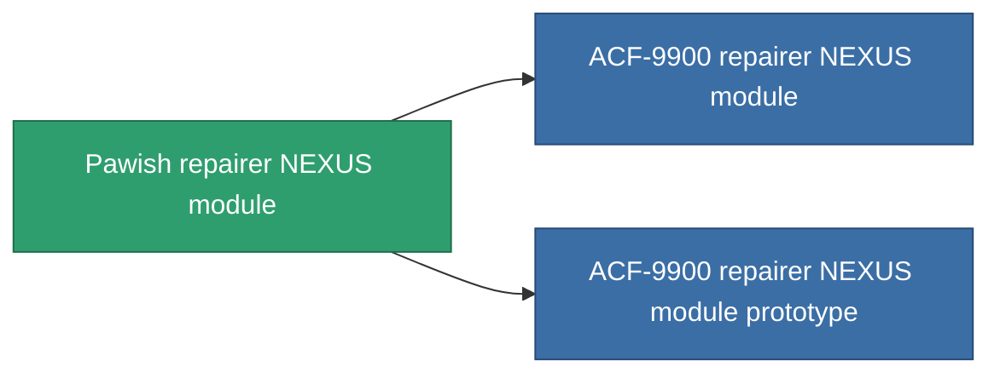

<!-- Generated by tools/generate from the live database (source: entitydefaults definition 2593, aggregatevalues via aggregatefields).
     Do not edit by hand; regenerate instead. -->

# Pawish repairer NEXUS module

|  |  |
|---|---|
| Definice | `def_named2_gang_assist_maintance_module` |
| Třída | T3 |
| Zdraví | 100 |
| Objem | 0.2 |
| Hmotnost | 50 |
| Kategorie | Modules / Enhancements |
| Tier line | [Standard repairer NEXUS module](/cs/content/items/standard-gang-assist-maintance-module/) (T1) → [Diogan repairer NEXUS module](/cs/content/items/named1-gang-assist-maintance-module/) (T2) → **Pawish repairer NEXUS module** (T3) → [ACF-9900 repairer NEXUS module](/cs/content/items/named3-gang-assist-maintance-module/) (T4) |
| Poznámka | repaired ammountot novel |

## Statistiky

| Pole | Hodnota |
|---|---|
| core_usage | 36 |
| cpu_usage | 88 |
| cycle_time | 10k |
| default_effect_range | 100 |
| effect_repair_amount_modifier | 1.05 |
| powergrid_usage | 36 |

<!-- production:generated -->
## Výroba

**Vyráběn z 10 komponentách, výzkumná úroveň 6** — sestavte komponenty pro jeho výrobu (celkový seznam najdete v [Receptury](/cs/content/recipes/)):

**Výkres:** [Pawish repairer NEXUS module CT](/cs/content/items/named2-gang-assist-maintance-module-cprg/)

<svg class="prod-card-icon" aria-hidden="true"><use href="#mi-grid"/></svg><a class="prod-card-name" href="/cs/content/items/alligior/">Alligior</a>

potřebné: <b>150</b>

<svg class="prod-card-icon" aria-hidden="true"><use href="#mi-grid"/></svg><a class="prod-card-name" href="/cs/content/items/chollonin/">Chollonin</a>

potřebné: <b>150</b>

<svg class="prod-card-icon" aria-hidden="true"><use href="#mi-grid"/></svg><a class="prod-card-name" href="/cs/content/items/espitium/">Espitium</a>

potřebné: <b>150</b>

<svg class="prod-card-icon" aria-hidden="true"><use href="#mi-tree"/></svg><a class="prod-card-name" href="/cs/content/items/named1-gang-assist-maintance-module/">Diogan repairer NEXUS module</a>

potřebné: <b>1</b>

<svg class="prod-card-icon" aria-hidden="true"><use href="#mi-crystal"/></svg><a class="prod-card-name" href="/cs/content/items/robotshard-nuimqol-advanced/">Functional nuimqol fragment</a>

potřebné: <b>10</b>

<svg class="prod-card-icon" aria-hidden="true"><use href="#mi-crystal"/></svg><a class="prod-card-name" href="/cs/content/items/robotshard-nuimqol-basic/">Damaged nuimqol fragment</a>

potřebné: <b>10</b>

<svg class="prod-card-icon" aria-hidden="true"><use href="#mi-crystal"/></svg><a class="prod-card-name" href="/cs/content/items/robotshard-pelistal-advanced/">Functional pelistal fragment</a>

potřebné: <b>10</b>

<svg class="prod-card-icon" aria-hidden="true"><use href="#mi-crystal"/></svg><a class="prod-card-name" href="/cs/content/items/robotshard-pelistal-basic/">Damaged pelistal fragment</a>

potřebné: <b>10</b>

<svg class="prod-card-icon" aria-hidden="true"><use href="#mi-grid"/></svg><a class="prod-card-name" href="/cs/content/items/statichnol/">Statichnol</a>

potřebné: <b>150</b>

<svg class="prod-card-icon" aria-hidden="true"><use href="#mi-grid"/></svg><a class="prod-card-name" href="/cs/content/items/titanium/">Titanium</a>

potřebné: <b>50</b>

## Použito ve výrobě

**Komponentou 2 předmětů** — vše, co ho ve výrobě používá:

