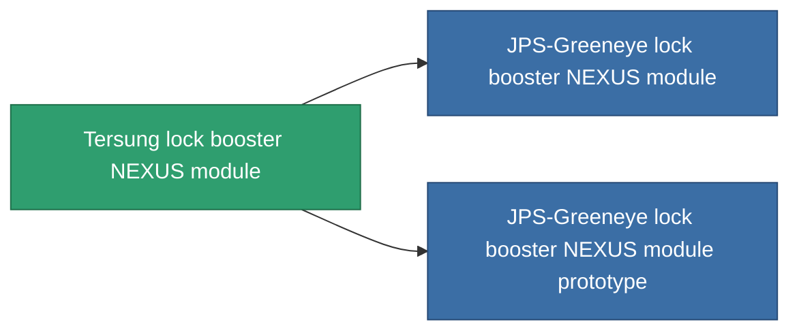

<!-- Generated by tools/generate from the live database (source: entitydefaults definition 2587, aggregatevalues via aggregatefields).
     Do not edit by hand; regenerate instead. -->

# Tersung lock booster NEXUS module

|  |  |
|---|---|
| Definice | `def_named2_gang_assist_shared_dataprocessing_module` |
| Třída | T3 |
| Zdraví | 100 |
| Objem | 0.2 |
| Hmotnost | 50 |
| Kategorie | Modules / Enhancements |
| Tier line | [Standard lock booster NEXUS module](/cs/content/items/standard-gang-assist-shared-dataprocessing-module/) (T1) → [JPS-Redeye lock booster NEXUS module](/cs/content/items/named1-gang-assist-shared-dataprocessing-module/) (T2) → **Tersung lock booster NEXUS module** (T3) → [JPS-Greeneye lock booster NEXUS module](/cs/content/items/named3-gang-assist-shared-dataprocessing-module/) (T4) |
| Poznámka | locking timet csokkent |

## Statistiky

| Pole | Hodnota |
|---|---|
| core_usage | 36 |
| cpu_usage | 88 |
| cycle_time | 10k |
| default_effect_range | 100 |
| effect_locking_time_modifier | 0.95 |
| powergrid_usage | 36 |

<!-- production:generated -->
## Výroba

**Vyráběn z 8 komponentách, výzkumná úroveň 6** — sestavte komponenty pro jeho výrobu (celkový seznam najdete v [Receptury](/cs/content/recipes/)):

**Výkres:** [Tersung lock booster NEXUS module CT](/content/items/named2-gang-assist-shared-dataprocessing-module-cprg/)

<svg class="prod-card-icon" aria-hidden="true"><use href="#mi-grid"/></svg><a class="prod-card-name" href="/cs/content/items/espitium/">Espitium</a>

potřebné: <b>250</b>

<svg class="prod-card-icon" aria-hidden="true"><use href="#mi-grid"/></svg><a class="prod-card-name" href="/cs/content/items/hydrobenol/">Hydrobenol</a>

potřebné: <b>50</b>

<svg class="prod-card-icon" aria-hidden="true"><use href="#mi-panel"/></svg><a class="prod-card-name" href="/cs/content/items/named1-gang-assist-shared-dataprocessing-module/">JPS-Redeye lock booster NEXUS module</a>

potřebné: <b>1</b>

<svg class="prod-card-icon" aria-hidden="true"><use href="#mi-grid"/></svg><a class="prod-card-name" href="/cs/content/items/phlobotil/">Phlobotil</a>

potřebné: <b>50</b>

<svg class="prod-card-icon" aria-hidden="true"><use href="#mi-crystal"/></svg><a class="prod-card-name" href="/cs/content/items/robotshard-common-advanced/">Functional common fragment</a>

potřebné: <b>20</b>

<svg class="prod-card-icon" aria-hidden="true"><use href="#mi-crystal"/></svg><a class="prod-card-name" href="/cs/content/items/robotshard-common-basic/">Damaged common fragment</a>

potřebné: <b>20</b>

<svg class="prod-card-icon" aria-hidden="true"><use href="#mi-grid"/></svg><a class="prod-card-name" href="/cs/content/items/titanium/">Titanium</a>

potřebné: <b>50</b>

<svg class="prod-card-icon" aria-hidden="true"><use href="#mi-grid"/></svg><a class="prod-card-name" href="/cs/content/items/vitricyl/">Vitricyl</a>

potřebné: <b>250</b>

## Použito ve výrobě

**Komponentou 2 předmětů** — vše, co ho ve výrobě používá:

