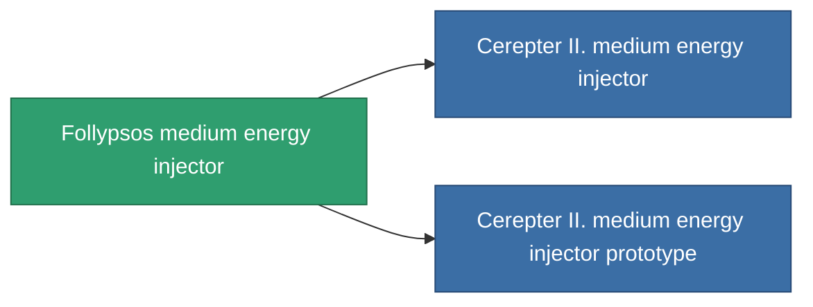

<!-- Generated by tools/generate from the live database (source: entitydefaults definition 826, aggregatevalues via aggregatefields).
     Do not edit by hand; regenerate instead. -->

# Follypsos medium energy injector

|  |  |
|---|---|
| Definice | `def_named2_medium_core_booster` |
| Třída | T3 |
| Zdraví | 100 |
| Objem | 1 |
| Hmotnost | 200 |
| Kategorie | Modules / Enhancements |
| Tier line | [Standard medium energy injector](/cs/content/items/standard-medium-core-booster/) (T1) → [Shoxit Parter I. medium energy injector](/cs/content/items/named1-medium-core-booster/) (T2) → **Follypsos medium energy injector** (T3) → [Cerepter II. medium energy injector](/cs/content/items/named3-medium-core-booster/) (T4) |

## Statistiky

| Pole | Hodnota |
|---|---|
| core_usage | 0 |
| cpu_usage | 25 |
| cycle_time | 10k |
| powergrid_usage | 275 |

<!-- production:generated -->
## Výroba

**Vyráběn z 6 komponentách, výzkumná úroveň 6** — sestavte komponenty pro jeho výrobu (celkový seznam najdete v [Receptury](/cs/content/recipes/)):

**Výkres:** [Follypsos medium energy injector CT](/cs/content/items/named2-medium-core-booster-cprg/)

<svg class="prod-card-icon" aria-hidden="true"><use href="#mi-grid"/></svg><a class="prod-card-name" href="/cs/content/items/axicol/">Cryoperine</a>

potřebné: <b>100</b>

<svg class="prod-card-icon" aria-hidden="true"><use href="#mi-grid"/></svg><a class="prod-card-name" href="/cs/content/items/espitium/">Espitium</a>

potřebné: <b>100</b>

<svg class="prod-card-icon" aria-hidden="true"><use href="#mi-grid"/></svg><a class="prod-card-name" href="/cs/content/items/named1-medium-core-booster/">Shoxit Parter I. medium energy injector</a>

potřebné: <b>1</b>

<svg class="prod-card-icon" aria-hidden="true"><use href="#mi-crystal"/></svg><a class="prod-card-name" href="/cs/content/items/robotshard-common-advanced/">Functional common fragment</a>

potřebné: <b>40</b>

<svg class="prod-card-icon" aria-hidden="true"><use href="#mi-crystal"/></svg><a class="prod-card-name" href="/cs/content/items/robotshard-common-basic/">Damaged common fragment</a>

potřebné: <b>40</b>

<svg class="prod-card-icon" aria-hidden="true"><use href="#mi-grid"/></svg><a class="prod-card-name" href="/cs/content/items/titanium/">Titanium</a>

potřebné: <b>200</b>

## Použito ve výrobě

**Komponentou 2 předmětů** — vše, co ho ve výrobě používá:

