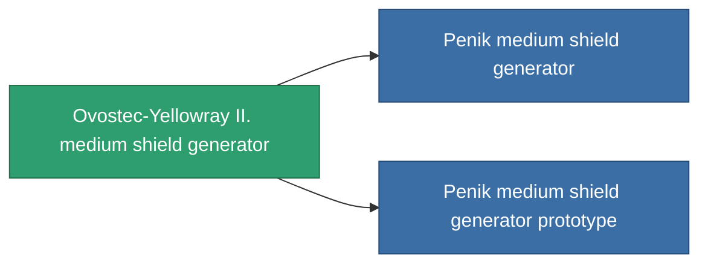

<!-- Generated by tools/generate from the live database (source: entitydefaults definition 727, aggregatevalues via aggregatefields).
     Do not edit by hand; regenerate instead. -->

# Ovostec-Yellowray II. medium shield generator

|  |  |
|---|---|
| Definice | `def_named2_medium_shield_generator` |
| Třída | T3 |
| Zdraví | 100 |
| Objem | 0.5 |
| Hmotnost | 440 |
| Kategorie | Modules / Shield |
| Tier line | [Standard medium shield generator](/cs/content/items/standard-medium-shield-generator/) (T1) → [Parsvaal-IIX medium shield generator](/cs/content/items/named1-medium-shield-generator/) (T2) → **Ovostec-Yellowray II. medium shield generator** (T3) → [Penik medium shield generator](/cs/content/items/named3-medium-shield-generator/) (T4) |

## Statistiky

| Pole | Hodnota |
|---|---|
| core_usage | 12.5 |
| cpu_usage | 67 |
| cycle_time | 7.75k |
| powergrid_usage | 270 |
| shield_absorbtion | 2.2 |
| shield_radius | 12 |

<!-- production:generated -->
## Výroba

**Vyráběn z 8 komponentách, výzkumná úroveň 6** — sestavte komponenty pro jeho výrobu (celkový seznam najdete v [Receptury](/cs/content/recipes/)):

**Výkres:** [Ovostec-Yellowray II. medium shield generator CT](/cs/content/items/named2-medium-shield-generator-cprg/)

<svg class="prod-card-icon" aria-hidden="true"><use href="#mi-grid"/></svg><a class="prod-card-name" href="/cs/content/items/alligior/">Alligior</a>

potřebné: <b>400</b>

<svg class="prod-card-icon" aria-hidden="true"><use href="#mi-grid"/></svg><a class="prod-card-name" href="/cs/content/items/espitium/">Espitium</a>

potřebné: <b>200</b>

<svg class="prod-card-icon" aria-hidden="true"><use href="#mi-grid"/></svg><a class="prod-card-name" href="/cs/content/items/isopropentol/">Isopropentol</a>

potřebné: <b>400</b>

<svg class="prod-card-icon" aria-hidden="true"><use href="#mi-tree"/></svg><a class="prod-card-name" href="/cs/content/items/named1-medium-shield-generator/">Parsvaal-IIX medium shield generator</a>

potřebné: <b>1</b>

<svg class="prod-card-icon" aria-hidden="true"><use href="#mi-crystal"/></svg><a class="prod-card-name" href="/cs/content/items/robotshard-common-advanced/">Functional common fragment</a>

potřebné: <b>40</b>

<svg class="prod-card-icon" aria-hidden="true"><use href="#mi-crystal"/></svg><a class="prod-card-name" href="/cs/content/items/robotshard-common-basic/">Damaged common fragment</a>

potřebné: <b>40</b>

<svg class="prod-card-icon" aria-hidden="true"><use href="#mi-grid"/></svg><a class="prod-card-name" href="/cs/content/items/titanium/">Titanium</a>

potřebné: <b>200</b>

<svg class="prod-card-icon" aria-hidden="true"><use href="#mi-grid"/></svg><a class="prod-card-name" href="/cs/content/items/vitricyl/">Vitricyl</a>

potřebné: <b>200</b>

## Použito ve výrobě

**Komponentou 2 předmětů** — vše, co ho ve výrobě používá:

