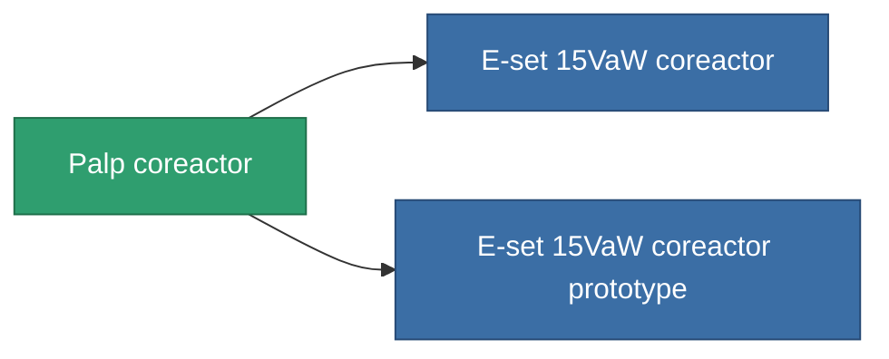

<!-- Generated by tools/generate from the live database (source: entitydefaults definition 766, aggregatevalues via aggregatefields).
     Do not edit by hand; regenerate instead. -->

# Palp coreactor

|  |  |
|---|---|
| Definice | `def_named2_powergrid_upgrades` |
| Třída | T3 |
| Zdraví | 100 |
| Objem | 0.5 |
| Hmotnost | 100 |
| Kategorie | Modules / Power |
| Tier line | [Standard coreactor](/cs/content/items/standard-powergrid-upgrades/) (T1) → [Y-type 'Connector' coreactor](/cs/content/items/named1-powergrid-upgrades/) (T2) → **Palp coreactor** (T3) → [E-set 15VaW coreactor](/cs/content/items/named3-powergrid-upgrades/) (T4) |

## Statistiky

| Pole | Hodnota |
|---|---|
| cpu_usage | 37 |
| powergrid_max_modifier | 1.15 |

<!-- production:generated -->
## Výroba

**Vyráběn z 6 komponentách, výzkumná úroveň 5** — sestavte komponenty pro jeho výrobu (celkový seznam najdete v [Receptury](/cs/content/recipes/)):

**Výkres:** [Palp coreactor CT](/cs/content/items/named2-powergrid-upgrades-cprg/)

<svg class="prod-card-icon" aria-hidden="true"><use href="#mi-grid"/></svg><a class="prod-card-name" href="/cs/content/items/axicol/">Cryoperine</a>

potřebné: <b>150</b>

<svg class="prod-card-icon" aria-hidden="true"><use href="#mi-grid"/></svg><a class="prod-card-name" href="/cs/content/items/espitium/">Espitium</a>

potřebné: <b>150</b>

<svg class="prod-card-icon" aria-hidden="true"><use href="#mi-crystal"/></svg><a class="prod-card-name" href="/cs/content/items/named1-powergrid-upgrades/">Y-type 'Connector' coreactor</a>

potřebné: <b>1</b>

<svg class="prod-card-icon" aria-hidden="true"><use href="#mi-crystal"/></svg><a class="prod-card-name" href="/cs/content/items/robotshard-common-advanced/">Functional common fragment</a>

potřebné: <b>20</b>

<svg class="prod-card-icon" aria-hidden="true"><use href="#mi-crystal"/></svg><a class="prod-card-name" href="/cs/content/items/robotshard-common-basic/">Damaged common fragment</a>

potřebné: <b>20</b>

<svg class="prod-card-icon" aria-hidden="true"><use href="#mi-grid"/></svg><a class="prod-card-name" href="/cs/content/items/titanium/">Titanium</a>

potřebné: <b>200</b>

## Použito ve výrobě

**Komponentou 2 předmětů** — vše, co ho ve výrobě používá:

