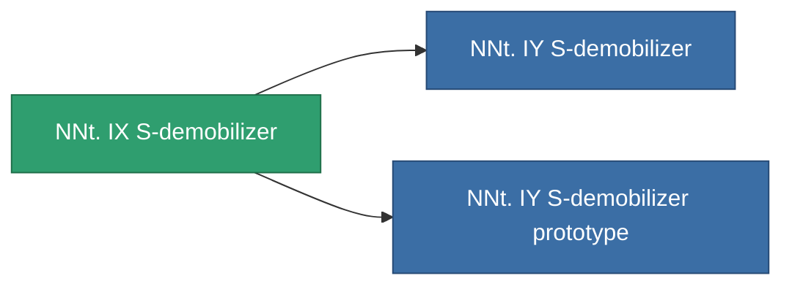

<!-- Generated by tools/generate from the live database (source: entitydefaults definition 787, aggregatevalues via aggregatefields).
     Do not edit by hand; regenerate instead. -->

# NNt. IX S-demobilizer

|  |  |
|---|---|
| Definice | `def_named2_webber` |
| Třída | T3 |
| Zdraví | 100 |
| Objem | 0.5 |
| Hmotnost | 100 |
| Kategorie | Modules / Enhancements |
| Tier line | [Standard S-demobilizer](/cs/content/items/standard-webber/) (T1) → [Arachnid-type S-demobilizer](/cs/content/items/named1-webber/) (T2) → **NNt. IX S-demobilizer** (T3) → [NNt. IY S-demobilizer](/cs/content/items/named3-webber/) (T4) |

## Statistiky

| Pole | Hodnota |
|---|---|
| core_usage | 18 |
| cpu_usage | 47 |
| cycle_time | 5k |
| effect_massivness_speed_max_modifier | 0.6 |
| falloff | 0 |
| optimal_range | 12 |
| powergrid_usage | 15 |

<!-- production:generated -->
## Výroba

**Vyráběn z 8 komponentách, výzkumná úroveň 5** — sestavte komponenty pro jeho výrobu (celkový seznam najdete v [Receptury](/cs/content/recipes/)):

**Výkres:** [NNt. IX S-demobilizer CT](/cs/content/items/named2-webber-cprg/)

<svg class="prod-card-icon" aria-hidden="true"><use href="#mi-grid"/></svg><a class="prod-card-name" href="/cs/content/items/axicol/">Cryoperine</a>

potřebné: <b>175</b>

<svg class="prod-card-icon" aria-hidden="true"><use href="#mi-grid"/></svg><a class="prod-card-name" href="/cs/content/items/axicoline/">Axicoline</a>

potřebné: <b>50</b>

<svg class="prod-card-icon" aria-hidden="true"><use href="#mi-grid"/></svg><a class="prod-card-name" href="/cs/content/items/espitium/">Espitium</a>

potřebné: <b>175</b>

<svg class="prod-card-icon" aria-hidden="true"><use href="#mi-grid"/></svg><a class="prod-card-name" href="/cs/content/items/hydrobenol/">Hydrobenol</a>

potřebné: <b>50</b>

<svg class="prod-card-icon" aria-hidden="true"><use href="#mi-grid"/></svg><a class="prod-card-name" href="/cs/content/items/named1-webber/">Arachnid-type S-demobilizer</a>

potřebné: <b>1</b>

<svg class="prod-card-icon" aria-hidden="true"><use href="#mi-crystal"/></svg><a class="prod-card-name" href="/cs/content/items/robotshard-common-advanced/">Functional common fragment</a>

potřebné: <b>20</b>

<svg class="prod-card-icon" aria-hidden="true"><use href="#mi-crystal"/></svg><a class="prod-card-name" href="/cs/content/items/robotshard-common-basic/">Damaged common fragment</a>

potřebné: <b>20</b>

<svg class="prod-card-icon" aria-hidden="true"><use href="#mi-grid"/></svg><a class="prod-card-name" href="/cs/content/items/titanium/">Titanium</a>

potřebné: <b>100</b>

## Použito ve výrobě

**Komponentou 2 předmětů** — vše, co ho ve výrobě používá:

