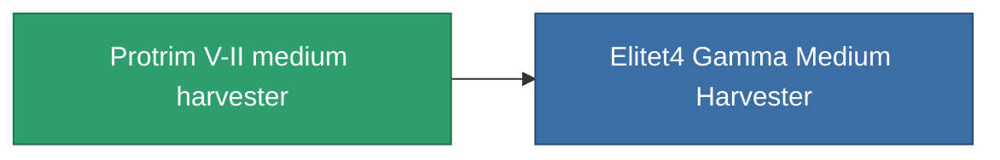

<!-- Generated by tools/generate from the live database (source: entitydefaults definition 812, aggregatevalues via aggregatefields).
     Do not edit by hand; regenerate instead. -->

# Protrim V-II medium harvester

|  |  |
|---|---|
| Definice | `def_named3_medium_harvester` |
| Třída | T4 |
| Zdraví | 100 |
| Objem | 1.5 |
| Hmotnost | 1000 |
| Kategorie | Modules / Harvesting |
| Tier line | [Standard medium harvester](/cs/content/items/standard-medium-harvester/) (T1) → [MHA 900-'Sap' medium harvester](/cs/content/items/named1-medium-harvester/) (T2) → [Cultivator-XM medium harvester](/cs/content/items/named2-medium-harvester/) (T3) → **Protrim V-II medium harvester** (T4) |

## Statistiky

| Pole | Hodnota |
|---|---|
| core_usage | 65 |
| cpu_usage | 55 |
| cycle_time | 10k |
| optimal_range | 3 |
| powergrid_usage | 165 |

<!-- production:generated -->
## Výroba

**Vyráběn z 8 komponentách, výzkumná úroveň 6** — sestavte komponenty pro jeho výrobu (celkový seznam najdete v [Receptury](/cs/content/recipes/)):

**Výkres:** [Protrim V-II medium harvester CT](/content/items/named3-medium-harvester-cprg/)

<svg class="prod-card-icon" aria-hidden="true"><use href="#mi-grid"/></svg><a class="prod-card-name" href="/cs/content/items/axicol/">Cryoperine</a>

potřebné: <b>100</b>

<svg class="prod-card-icon" aria-hidden="true"><use href="#mi-grid"/></svg><a class="prod-card-name" href="/cs/content/items/espitium/">Espitium</a>

potřebné: <b>100</b>

<svg class="prod-card-icon" aria-hidden="true"><use href="#mi-grid"/></svg><a class="prod-card-name" href="/cs/content/items/named2-medium-harvester/">Cultivator-XM medium harvester</a>

potřebné: <b>1</b>

<svg class="prod-card-icon" aria-hidden="true"><use href="#mi-crystal"/></svg><a class="prod-card-name" href="/cs/content/items/robotshard-common-advanced/">Functional common fragment</a>

potřebné: <b>60</b>

<svg class="prod-card-icon" aria-hidden="true"><use href="#mi-crystal"/></svg><a class="prod-card-name" href="/cs/content/items/robotshard-common-basic/">Damaged common fragment</a>

potřebné: <b>30</b>

<svg class="prod-card-icon" aria-hidden="true"><use href="#mi-crystal"/></svg><a class="prod-card-name" href="/cs/content/items/robotshard-common-expert/">Perfect common fragment</a>

potřebné: <b>90</b>

<svg class="prod-card-icon" aria-hidden="true"><use href="#mi-grid"/></svg><a class="prod-card-name" href="/cs/content/items/titanium/">Titanium</a>

potřebné: <b>300</b>

<svg class="prod-card-icon" aria-hidden="true"><use href="#mi-grid"/></svg><a class="prod-card-name" href="/cs/content/items/unimetal/">Briochit</a>

potřebné: <b>300</b>

## Použito ve výrobě

**Komponentou 1 předmětů** — vše, co ho ve výrobě používá:

