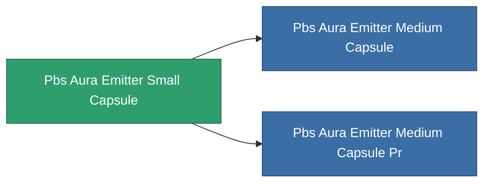

<!-- Generated by tools/generate from the live database (source: entitydefaults definition 5192, aggregatevalues via aggregatefields).
     Do not edit by hand; regenerate instead. -->

# Pbs Aura Emitter Small Capsule

|  |  |
|---|---|
| Definice | `def_pbs_aura_emitter_small_capsule` |
| Třída | T1 |
| Zdraví | 100 |
| Objem | 10 |
| Hmotnost | 10000 |
| Kategorie | Special & other / Miscellaneous |

## Statistiky

| Pole | Hodnota |
|---|---|
| armor_max | 50k |
| core_max | 37.5k |
| resist_chemical | 30 |
| resist_explosive | 30 |
| resist_kinetic | 30 |
| resist_thermal | 30 |
| signature_radius | 20 |
| stealth_strength | 50 |

<!-- production:generated -->
## Výroba

**Vyráběn z 6 komponentách** — sestavte komponenty pro jeho výrobu (celkový seznam najdete v [Receptury](/cs/content/recipes/)):

**Výkres:** [Standard Aura emitter foundation CT](/content/items/pbs-aura-emitter-small-capsule-cprg/)

<svg class="prod-card-icon" aria-hidden="true"><use href="#mi-grid"/></svg><a class="prod-card-name" href="/cs/content/items/axicol/">Cryoperine</a>

potřebné: <b>500</b>

<svg class="prod-card-icon" aria-hidden="true"><use href="#mi-grid"/></svg><a class="prod-card-name" href="/cs/content/items/axicoline/">Axicoline</a>

potřebné: <b>250</b>

<svg class="prod-card-icon" aria-hidden="true"><use href="#mi-grid"/></svg><a class="prod-card-name" href="/cs/content/items/espitium/">Espitium</a>

potřebné: <b>500</b>

<svg class="prod-card-icon" aria-hidden="true"><use href="#mi-grid"/></svg><a class="prod-card-name" href="/cs/content/items/hydrobenol/">Hydrobenol</a>

potřebné: <b>250</b>

<svg class="prod-card-icon" aria-hidden="true"><use href="#mi-grid"/></svg><a class="prod-card-name" href="/cs/content/items/titanium/">Titanium</a>

potřebné: <b>250</b>

<svg class="prod-card-icon" aria-hidden="true"><use href="#mi-grid"/></svg><a class="prod-card-name" href="/cs/content/items/unimetal/">Briochit</a>

potřebné: <b>250</b>

## Použito ve výrobě

**Komponentou 2 předmětů** — vše, co ho ve výrobě používá:

