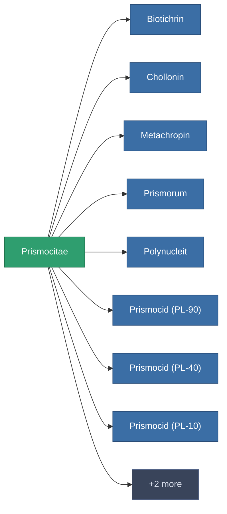

<!-- Generated by tools/generate from the live database (source: entitydefaults definition 177, aggregatevalues via aggregatefields).
     Do not edit by hand; regenerate instead. -->

# Prismocitae

|  |  |
|---|---|
| Definice | `def_prismocitae` |
| Třída | – |
| Zdraví | 100 |
| Objem | 0 |
| Hmotnost | 0.01 |
| Kategorie | Materials |

_Žádné statistiky — tento předmět nenese žádné agregované hodnoty._

<!-- production:generated -->
## Použito ve výrobě

**Komponentou 10 předmětů** — ukázka toho, co se s ním dá vyrobit (celkový seznam je v [Receptury](/cs/content/recipes/)).

