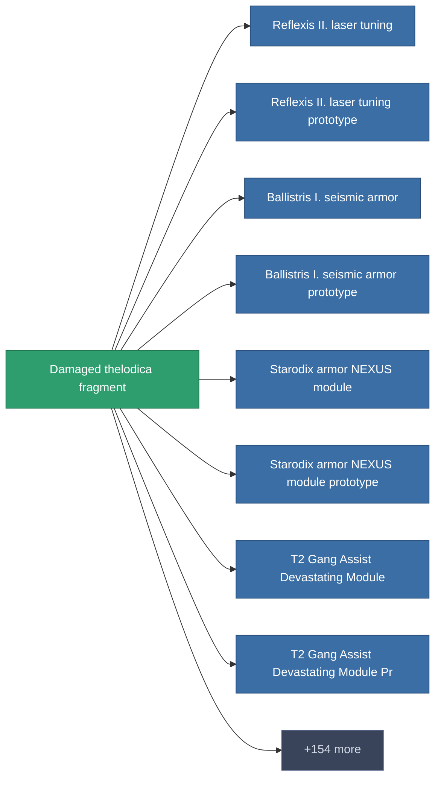

<!-- Generated by tools/generate from the live database (source: entitydefaults definition 1983, aggregatevalues via aggregatefields).
     Do not edit by hand; regenerate instead. -->

# Damaged thelodica fragment

|  |  |
|---|---|
| Definice | `def_robotshard_thelodica_basic` |
| Třída | – |
| Zdraví | 100 |
| Objem | 0.01 |
| Hmotnost | 1 |
| Kategorie | Materials |

_Žádné statistiky — tento předmět nenese žádné agregované hodnoty._

<!-- production:generated -->
## Výroba

**Vyráběn z 3 komponentách** — sestavte komponenty pro jeho výrobu (celkový seznam najdete v [Receptury](/cs/content/recipes/)):

<svg class="prod-card-icon" aria-hidden="true"><use href="#mi-grid"/></svg><a class="prod-card-name" href="/cs/content/items/metachropin/">Metachropin</a>

potřebné: <b>1</b>

<svg class="prod-card-icon" aria-hidden="true"><use href="#mi-grid"/></svg><a class="prod-card-name" href="/cs/content/items/polynucleit/">Polynucleit</a>

potřebné: <b>1</b>

<svg class="prod-card-icon" aria-hidden="true"><use href="#mi-grid"/></svg><a class="prod-card-name" href="/cs/content/items/prilumium/">Prilumium</a>

potřebné: <b>1</b>

## Použito ve výrobě

**Komponentou 162 předmětů** — ukázka toho, co se s ním dá vyrobit (celkový seznam je v [Receptury](/cs/content/recipes/)).

