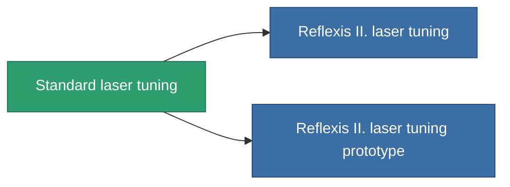

<!-- Generated by tools/generate from the live database (source: entitydefaults definition 911, aggregatevalues via aggregatefields).
     Do not edit by hand; regenerate instead. -->

# Standard laser tuning

|  |  |
|---|---|
| Definice | `def_standard_damage_mod_laser` |
| Třída | T1 |
| Zdraví | 100 |
| Objem | 0.5 |
| Hmotnost | 100 |
| Kategorie | Modules / Weapons |
| Tier line | **Standard laser tuning** (T1) → [Reflexis II. laser tuning](/cs/content/items/named1-damage-mod-laser/) (T2) → [Kauska Optibrace laser tuning](/cs/content/items/named2-damage-mod-laser/) (T3) → [Oqulus laser tuning](/cs/content/items/named3-damage-mod-laser/) (T4) |

## Statistiky

| Pole | Hodnota |
|---|---|
| cpu_usage | 20 |
| damage_laser_modifier | 0.15 |
| powergrid_usage | 10 |

<!-- production:generated -->
## Výroba

**Vyráběn z 5 komponentách, výzkumná úroveň 3** — sestavte komponenty pro jeho výrobu (celkový seznam najdete v [Receptury](/cs/content/recipes/)):

**Výkres:** [Standard laser tuning CT](/cs/content/items/standard-damage-mod-laser-cprg/)

<svg class="prod-card-icon" aria-hidden="true"><use href="#mi-grid"/></svg><a class="prod-card-name" href="/cs/content/items/axicol/">Cryoperine</a>

potřebné: <b>100</b>

<svg class="prod-card-icon" aria-hidden="true"><use href="#mi-grid"/></svg><a class="prod-card-name" href="/cs/content/items/axicoline/">Axicoline</a>

potřebné: <b>50</b>

<svg class="prod-card-icon" aria-hidden="true"><use href="#mi-grid"/></svg><a class="prod-card-name" href="/cs/content/items/polynucleit/">Polynucleit</a>

potřebné: <b>50</b>

<svg class="prod-card-icon" aria-hidden="true"><use href="#mi-grid"/></svg><a class="prod-card-name" href="/cs/content/items/prilumium/">Prilumium</a>

potřebné: <b>100</b>

<svg class="prod-card-icon" aria-hidden="true"><use href="#mi-grid"/></svg><a class="prod-card-name" href="/cs/content/items/titanium/">Titanium</a>

potřebné: <b>50</b>

## Použito ve výrobě

**Komponentou 2 předmětů** — vše, co ho ve výrobě používá:

