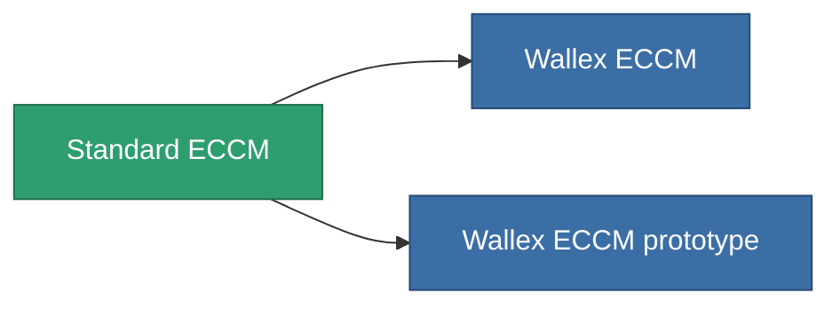

<!-- Generated by tools/generate from the live database (source: entitydefaults definition 52, aggregatevalues via aggregatefields).
     Do not edit by hand; regenerate instead. -->

# Standard ECCM

|  |  |
|---|---|
| Definice | `def_standard_eccm` |
| Třída | T1 |
| Zdraví | 100 |
| Objem | 0.5 |
| Hmotnost | 100 |
| Kategorie | Modules / Enhancements |
| Tier line | **Standard ECCM** (T1) → [Wallex ECCM](/cs/content/items/named1-eccm/) (T2) → [Deshrud-QW ECCM](/cs/content/items/named2-eccm/) (T3) → [Braviar ECCM](/cs/content/items/named3-eccm/) (T4) |

## Statistiky

| Pole | Hodnota |
|---|---|
| cpu_usage | 25 |
| powergrid_usage | 15 |
| sensor_strength_modifier | 50 |

<!-- production:generated -->
## Výroba

**Vyráběn z 3 komponentách, výzkumná úroveň 2** — sestavte komponenty pro jeho výrobu (celkový seznam najdete v [Receptury](/cs/content/recipes/)):

**Výkres:** [Standard ECCM CT](/content/items/standard-eccm-cprg/)

<svg class="prod-card-icon" aria-hidden="true"><use href="#mi-grid"/></svg><a class="prod-card-name" href="/cs/content/items/axicol/">Cryoperine</a>

potřebné: <b>150</b>

<svg class="prod-card-icon" aria-hidden="true"><use href="#mi-grid"/></svg><a class="prod-card-name" href="/cs/content/items/plasteosine/">Plasteosine</a>

potřebné: <b>50</b>

<svg class="prod-card-icon" aria-hidden="true"><use href="#mi-grid"/></svg><a class="prod-card-name" href="/cs/content/items/titanium/">Titanium</a>

potřebné: <b>50</b>

## Použito ve výrobě

**Komponentou 2 předmětů** — vše, co ho ve výrobě používá:

