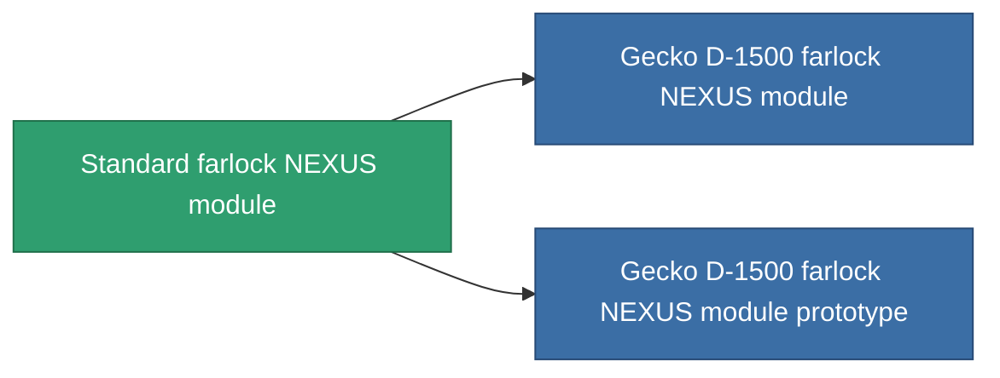

<!-- Generated by tools/generate from the live database (source: entitydefaults definition 874, aggregatevalues via aggregatefields).
     Do not edit by hand; regenerate instead. -->

# Standard farlock NEXUS module

|  |  |
|---|---|
| Definice | `def_standard_gang_assist_information_module` |
| Třída | T1 |
| Zdraví | 100 |
| Objem | 0.2 |
| Hmotnost | 10 |
| Kategorie | Modules / Enhancements |
| Tier line | **Standard farlock NEXUS module** (T1) → [Gecko D-1500 farlock NEXUS module](/cs/content/items/named1-gang-assist-information-module/) (T2) → [Martimal farlock NEXUS module](/cs/content/items/named2-gang-assist-information-module/) (T3) → [Gecko M-2000 farlock NEXUS module](/cs/content/items/named3-gang-assist-information-module/) (T4) |
| Poznámka | locking range 1.0%  /ext lvl |

## Statistiky

| Pole | Hodnota |
|---|---|
| core_usage | 35 |
| cpu_usage | 85 |
| cycle_time | 10k |
| default_effect_range | 100 |
| effect_locking_range_modifier | 1.02 |
| powergrid_usage | 35 |

<!-- production:generated -->
## Výroba

**Vyráběn z 3 komponentách, výzkumná úroveň 4** — sestavte komponenty pro jeho výrobu (celkový seznam najdete v [Receptury](/cs/content/recipes/)):

**Výkres:** [Standard farlock NEXUS module CT](/content/items/standard-gang-assist-information-module-cprg/)

<svg class="prod-card-icon" aria-hidden="true"><use href="#mi-grid"/></svg><a class="prod-card-name" href="/cs/content/items/axicol/">Cryoperine</a>

potřebné: <b>300</b>

<svg class="prod-card-icon" aria-hidden="true"><use href="#mi-grid"/></svg><a class="prod-card-name" href="/cs/content/items/prilumium/">Prilumium</a>

potřebné: <b>300</b>

<svg class="prod-card-icon" aria-hidden="true"><use href="#mi-grid"/></svg><a class="prod-card-name" href="/cs/content/items/titanium/">Titanium</a>

potřebné: <b>50</b>

## Použito ve výrobě

**Komponentou 2 předmětů** — vše, co ho ve výrobě používá:

