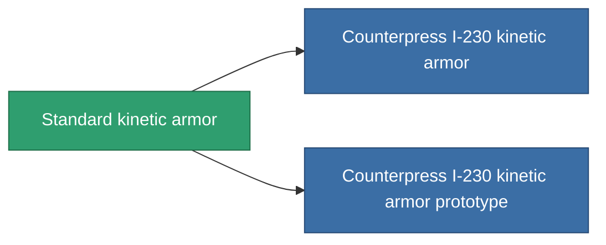

<!-- Generated by tools/generate from the live database (source: entitydefaults definition 26, aggregatevalues via aggregatefields).
     Do not edit by hand; regenerate instead. -->

# Standard kinetic armor

|  |  |
|---|---|
| Definice | `def_standard_kin_armor_hardener` |
| Třída | T1 |
| Zdraví | 100 |
| Objem | 1 |
| Hmotnost | 100 |
| Kategorie | Modules / Armor |
| Tier line | **Standard kinetic armor** (T1) → [Counterpress I-230 kinetic armor](/cs/content/items/named1-kin-armor-hardener/) (T2) → [Apparod Defragger kinetic armor](/cs/content/items/named2-kin-armor-hardener/) (T3) → [Grampier-VK kinetic armor](/cs/content/items/named3-kin-armor-hardener/) (T4) |

## Statistiky

| Pole | Hodnota |
|---|---|
| core_usage | 13 |
| cpu_usage | 25 |
| cycle_time | 10k |
| effect_resist_kinetic | 100 |
| powergrid_usage | 5 |
| resist_kinetic | 25 |

<!-- production:generated -->
## Výroba

**Vyráběn z 5 komponentách, výzkumná úroveň 3** — sestavte komponenty pro jeho výrobu (celkový seznam najdete v [Receptury](/cs/content/recipes/)):

**Výkres:** [Standard kinetic armor CT](/content/items/standard-kin-armor-hardener-cprg/)

<svg class="prod-card-icon" aria-hidden="true"><use href="#mi-grid"/></svg><a class="prod-card-name" href="/cs/content/items/axicol/">Cryoperine</a>

potřebné: <b>50</b>

<svg class="prod-card-icon" aria-hidden="true"><use href="#mi-grid"/></svg><a class="prod-card-name" href="/cs/content/items/metachropin/">Metachropin</a>

potřebné: <b>125</b>

<svg class="prod-card-icon" aria-hidden="true"><use href="#mi-grid"/></svg><a class="prod-card-name" href="/cs/content/items/plasteosine/">Plasteosine</a>

potřebné: <b>125</b>

<svg class="prod-card-icon" aria-hidden="true"><use href="#mi-grid"/></svg><a class="prod-card-name" href="/cs/content/items/prilumium/">Prilumium</a>

potřebné: <b>50</b>

<svg class="prod-card-icon" aria-hidden="true"><use href="#mi-grid"/></svg><a class="prod-card-name" href="/cs/content/items/titanium/">Titanium</a>

potřebné: <b>100</b>

## Použito ve výrobě

**Komponentou 2 předmětů** — vše, co ho ve výrobě používá:

