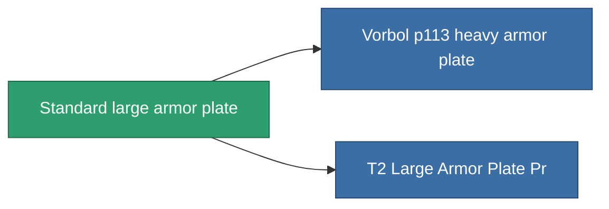

<!-- Generated by tools/generate from the live database (source: entitydefaults definition 17, aggregatevalues via aggregatefields).
     Do not edit by hand; regenerate instead. -->

# Standard large armor plate

|  |  |
|---|---|
| Definice | `def_standard_large_armor_plate` |
| Třída | T1 |
| Zdraví | 100 |
| Objem | 4 |
| Hmotnost | 9000 |
| Kategorie | Modules / Armor |
| Tier line | **Standard large armor plate** (T1) → [Vorbol p113 heavy armor plate](/cs/content/items/named1-large-armor-plate/) (T2) → [Invigor III. heavy armor plate](/cs/content/items/named2-large-armor-plate/) (T3) → [Halc heavy armor plate](/cs/content/items/named3-large-armor-plate/) (T4) |

## Statistiky

| Pole | Hodnota |
|---|---|
| armor_max | 4.05k |
| cpu_usage | 60 |
| massiveness | 0.144 |
| powergrid_usage | 1.05k |
| signature_radius | 3 |

<!-- production:generated -->
## Výroba

**Vyráběn z 3 komponentách** — sestavte komponenty pro jeho výrobu (celkový seznam najdete v [Receptury](/cs/content/recipes/)):

**Výkres:** [Standard Large Armor Plate Cprg](/content/items/standard-large-armor-plate-cprg/)

<svg class="prod-card-icon" aria-hidden="true"><use href="#mi-grid"/></svg><a class="prod-card-name" href="/cs/content/items/plasteosine/">Plasteosine</a>

potřebné: <b>1.1k</b>

<svg class="prod-card-icon" aria-hidden="true"><use href="#mi-grid"/></svg><a class="prod-card-name" href="/cs/content/items/specimen-sap-item-flux/">Specimen Sap Item Flux</a>

potřebné: <b>15</b>

<svg class="prod-card-icon" aria-hidden="true"><use href="#mi-grid"/></svg><a class="prod-card-name" href="/cs/content/items/titanium/">Titanium</a>

potřebné: <b>750</b>

## Použito ve výrobě

**Komponentou 2 předmětů** — vše, co ho ve výrobě používá:

