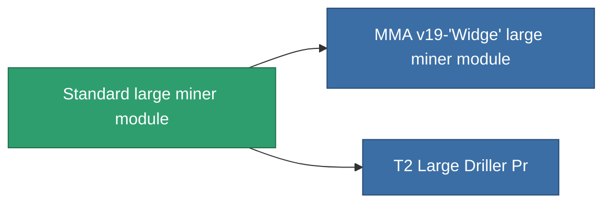

<!-- Generated by tools/generate from the live database (source: entitydefaults definition 8678, aggregatevalues via aggregatefields).
     Do not edit by hand; regenerate instead. -->

# Standard large miner module

|  |  |
|---|---|
| Definice | `def_standard_large_driller` |
| Třída | T1 |
| Zdraví | 100 |
| Objem | 2.5 |
| Hmotnost | 2000 |
| Kategorie | Modules / Enhancements |
| Tier line | **Standard large miner module** (T1) → [MMA v19-'Widge' large miner module](/cs/content/items/named1-large-driller/) (T2) → [Sublimator Hi-D large miner module](/cs/content/items/named2-large-driller/) (T3) → [Pellex large miner module](/cs/content/items/named3-large-driller/) (T4) |

## Statistiky

| Pole | Hodnota |
|---|---|
| core_usage | 165 |
| cpu_usage | 450 |
| cycle_time | 12k |
| powergrid_usage | 1.35k |

<!-- production:generated -->
## Výroba

**Vyráběn z 2 komponentách, výzkumná úroveň 5** — sestavte komponenty pro jeho výrobu (celkový seznam najdete v [Receptury](/cs/content/recipes/)):

**Výkres:** [Standard Large Driller Cprg](/content/items/standard-large-driller-cprg/)

<svg class="prod-card-icon" aria-hidden="true"><use href="#mi-grid"/></svg><a class="prod-card-name" href="/cs/content/items/axicol/">Cryoperine</a>

potřebné: <b>1.6k</b>

<svg class="prod-card-icon" aria-hidden="true"><use href="#mi-grid"/></svg><a class="prod-card-name" href="/cs/content/items/titanium/">Titanium</a>

potřebné: <b>2.4k</b>

## Použito ve výrobě

**Komponentou 2 předmětů** — vše, co ho ve výrobě používá:

