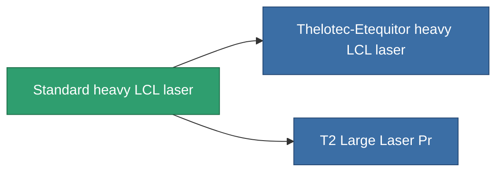

<!-- Generated by tools/generate from the live database (source: entitydefaults definition 59, aggregatevalues via aggregatefields).
     Do not edit by hand; regenerate instead. -->

# Standard heavy LCL laser

|  |  |
|---|---|
| Definice | `def_standard_large_laser` |
| Třída | T1 |
| Zdraví | 100 |
| Objem | 1.5 |
| Hmotnost | 1000 |
| Kategorie | Modules / Weapons |
| Tier line | **Standard heavy LCL laser** (T1) → [Thelotec-Etequitor heavy LCL laser](/cs/content/items/named1-large-laser/) (T2) → [Thelotec-Apocalyptor heavy LCL laser](/cs/content/items/named2-large-laser/) (T3) → [Kauska Heatpin II. heavy LCL laser](/cs/content/items/named3-large-laser/) (T4) |

## Statistiky

| Pole | Hodnota |
|---|---|
| accuracy | 34.5 |
| core_usage | 11.76 |
| cpu_usage | 62.5 |
| cycle_time | 5k |
| damage_modifier | 1.91 |
| falloff | 10 |
| optimal_range | 22.5 |
| powergrid_usage | 350 |

<!-- production:generated -->
## Výroba

**Vyráběn z 4 komponentách** — sestavte komponenty pro jeho výrobu (celkový seznam najdete v [Receptury](/cs/content/recipes/)):

**Výkres:** [Standard Large Laser Cprg](/content/items/standard-large-laser-cprg/)

<svg class="prod-card-icon" aria-hidden="true"><use href="#mi-grid"/></svg><a class="prod-card-name" href="/cs/content/items/axicoline/">Axicoline</a>

potřebné: <b>150</b>

<svg class="prod-card-icon" aria-hidden="true"><use href="#mi-grid"/></svg><a class="prod-card-name" href="/cs/content/items/polynucleit/">Polynucleit</a>

potřebné: <b>150</b>

<svg class="prod-card-icon" aria-hidden="true"><use href="#mi-grid"/></svg><a class="prod-card-name" href="/cs/content/items/specimen-sap-item-flux/">Specimen Sap Item Flux</a>

potřebné: <b>10</b>

<svg class="prod-card-icon" aria-hidden="true"><use href="#mi-grid"/></svg><a class="prod-card-name" href="/cs/content/items/titanium/">Titanium</a>

potřebné: <b>150</b>

## Použito ve výrobě

**Komponentou 2 předmětů** — vše, co ho ve výrobě používá:

