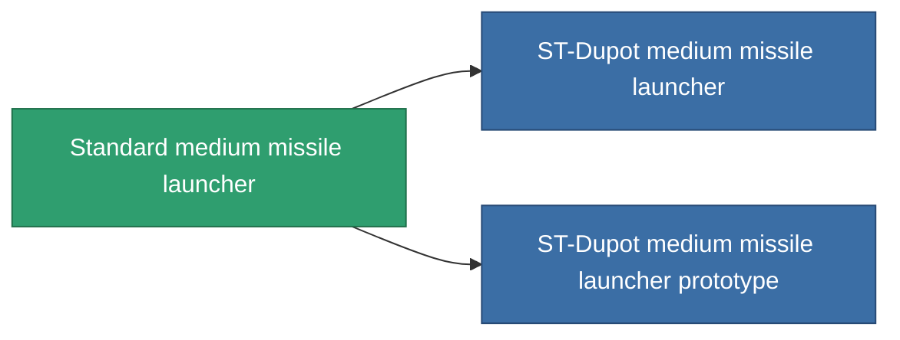

<!-- Generated by tools/generate from the live database (source: entitydefaults definition 64, aggregatevalues via aggregatefields).
     Do not edit by hand; regenerate instead. -->

# Standard medium missile launcher

|  |  |
|---|---|
| Definice | `def_standard_missile_launcher` |
| Třída | T1 |
| Zdraví | 100 |
| Objem | 2 |
| Hmotnost | 500 |
| Kategorie | Modules / Weapons |
| Tier line | **Standard medium missile launcher** (T1) → [ST-Dupot medium missile launcher](/cs/content/items/named1-missile-launcher/) (T2) → [Vollert medium missile launcher](/cs/content/items/named2-missile-launcher/) (T3) → [Pelistec-TR250 medium missile launcher](/cs/content/items/named3-missile-launcher/) (T4) |

## Statistiky

| Pole | Hodnota |
|---|---|
| accuracy | 1 |
| core_usage | 2 |
| cpu_usage | 40 |
| cycle_time | 14k |
| damage_modifier | 1 |
| powergrid_usage | 150 |

<!-- production:generated -->
## Výroba

**Vyráběn z 3 komponentách, výzkumná úroveň 4** — sestavte komponenty pro jeho výrobu (celkový seznam najdete v [Receptury](/cs/content/recipes/)):

**Výkres:** [Standard medium missile launcher CT](/content/items/standard-missile-launcher-cprg/)

<svg class="prod-card-icon" aria-hidden="true"><use href="#mi-grid"/></svg><a class="prod-card-name" href="/cs/content/items/axicoline/">Axicoline</a>

potřebné: <b>100</b>

<svg class="prod-card-icon" aria-hidden="true"><use href="#mi-grid"/></svg><a class="prod-card-name" href="/cs/content/items/phlobotil/">Phlobotil</a>

potřebné: <b>100</b>

<svg class="prod-card-icon" aria-hidden="true"><use href="#mi-grid"/></svg><a class="prod-card-name" href="/cs/content/items/titanium/">Titanium</a>

potřebné: <b>100</b>

## Použito ve výrobě

**Komponentou 2 předmětů** — vše, co ho ve výrobě používá:

