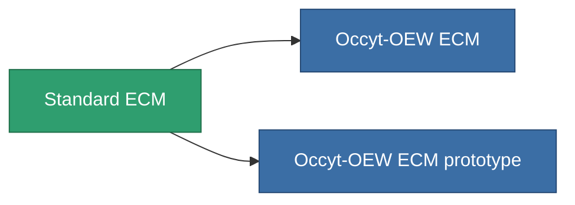

<!-- Generated by tools/generate from the live database (source: entitydefaults definition 50, aggregatevalues via aggregatefields).
     Do not edit by hand; regenerate instead. -->

# Standard ECM

|  |  |
|---|---|
| Definice | `def_standard_sensor_jammer` |
| Třída | T1 |
| Zdraví | 100 |
| Objem | 0.5 |
| Hmotnost | 150 |
| Kategorie | Modules / Sensors & scanning |
| Tier line | **Standard ECM** (T1) → [Occyt-OEW ECM](/cs/content/items/named1-sensor-jammer/) (T2) → [Wavoslur ECM](/cs/content/items/named2-sensor-jammer/) (T3) → [Tenion ECM](/cs/content/items/named3-sensor-jammer/) (T4) |

## Statistiky

| Pole | Hodnota |
|---|---|
| core_usage | 75 |
| cpu_usage | 55 |
| cycle_time | 10k |
| ecm_strength | 30 |
| falloff | 0 |
| optimal_range | 30 |
| powergrid_usage | 25 |

<!-- production:generated -->
## Výroba

**Vyráběn z 5 komponentách, výzkumná úroveň 3** — sestavte komponenty pro jeho výrobu (celkový seznam najdete v [Receptury](/cs/content/recipes/)):

**Výkres:** [Standard ECM CT](/content/items/standard-sensor-jammer-cprg/)

<svg class="prod-card-icon" aria-hidden="true"><use href="#mi-grid"/></svg><a class="prod-card-name" href="/cs/content/items/axicol/">Cryoperine</a>

potřebné: <b>100</b>

<svg class="prod-card-icon" aria-hidden="true"><use href="#mi-grid"/></svg><a class="prod-card-name" href="/cs/content/items/axicoline/">Axicoline</a>

potřebné: <b>50</b>

<svg class="prod-card-icon" aria-hidden="true"><use href="#mi-grid"/></svg><a class="prod-card-name" href="/cs/content/items/chollonin/">Chollonin</a>

potřebné: <b>100</b>

<svg class="prod-card-icon" aria-hidden="true"><use href="#mi-grid"/></svg><a class="prod-card-name" href="/cs/content/items/polynitrocol/">Polynitrocol</a>

potřebné: <b>50</b>

<svg class="prod-card-icon" aria-hidden="true"><use href="#mi-grid"/></svg><a class="prod-card-name" href="/cs/content/items/titanium/">Titanium</a>

potřebné: <b>50</b>

## Použito ve výrobě

**Komponentou 2 předmětů** — vše, co ho ve výrobě používá:

