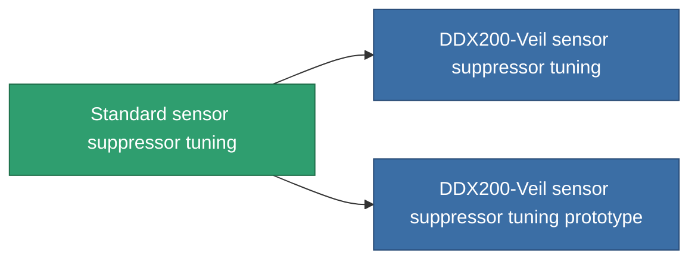

<!-- Generated by tools/generate from the live database (source: entitydefaults definition 4579, aggregatevalues via aggregatefields).
     Do not edit by hand; regenerate instead. -->

# Standard sensor suppressor tuning

|  |  |
|---|---|
| Definice | `def_standard_sensor_supressor_booster` |
| Třída | T1 |
| Zdraví | 100 |
| Objem | 0.5 |
| Hmotnost | 150 |
| Kategorie | Modules / Sensors & scanning |
| Tier line | **Standard sensor suppressor tuning** (T1) → [DDX200-Veil sensor suppressor tuning](/cs/content/items/named1-sensor-supressor-booster/) (T2) → [Radiocor sensor suppressor tuning](/cs/content/items/named2-sensor-supressor-booster/) (T3) → [DDX700-Mist sensor suppressor tuning](/cs/content/items/named3-sensor-supressor-booster/) (T4) |

## Statistiky

| Pole | Hodnota |
|---|---|
| core_usage_sensor_dampener_modifier | 1.1 |
| cpu_usage | 55 |
| effect_enhancer_sensor_dampener_locking_range_modifier | 0.95 |
| effect_enhancer_sensor_dampener_locking_time_modifier | 1.15 |
| powergrid_usage | 20 |

<!-- production:generated -->
## Výroba

**Vyráběn z 3 komponentách, výzkumná úroveň 5** — sestavte komponenty pro jeho výrobu (celkový seznam najdete v [Receptury](/cs/content/recipes/)):

**Výkres:** [Standard sensor suppressor tuning CT](/cs/content/items/standard-sensor-supressor-booster-cprg/)

<svg class="prod-card-icon" aria-hidden="true"><use href="#mi-grid"/></svg><a class="prod-card-name" href="/cs/content/items/axicol/">Cryoperine</a>

potřebné: <b>150</b>

<svg class="prod-card-icon" aria-hidden="true"><use href="#mi-grid"/></svg><a class="prod-card-name" href="/cs/content/items/prilumium/">Prilumium</a>

potřebné: <b>150</b>

<svg class="prod-card-icon" aria-hidden="true"><use href="#mi-grid"/></svg><a class="prod-card-name" href="/cs/content/items/titanium/">Titanium</a>

potřebné: <b>50</b>

## Použito ve výrobě

**Komponentou 2 předmětů** — vše, co ho ve výrobě používá:

