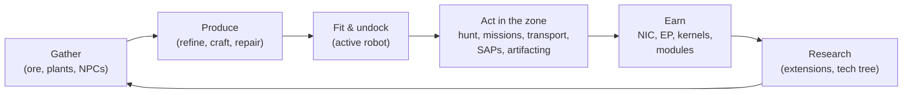

# Co můžete ve hře dělat

Každá akce hráče, uspořádaná podle systémů. Název příkazu je serverový identifikátor — klient tyto akce prezentuje ve svém vlastním rozhraní. Popisy jednotlivých akcí najdete na stránkách jednotlivých systémů.

Hra v jedné smyčce: vydělávejte a utrácejte, abyste se posunuli po žebříčku tierů.

## Systémy

| Systém | Stránka | Co pokrývá |
|---|---|---|
| Začínáme | [getting-started](/cs/features/getting-started/) | vytváření/výběr postav, první robot, základy účtu |
| Pohyb | [movement](/cs/features/movement/) | zóny, dokování, fronta, teleporty, spark skoky, brány |
| Sběr | [gathering](/cs/features/gathering/) | skenování, sběr, shromažďování zdrojů |
| Boj | [combat](/cs/features/combat/) | boje, typy poškození, rušení, poplaky, zprávy o zabití, SOS |
| NPC & PVE lov | [npcs](/cs/features/npcs/) | hodnosti a frakce NPC, slabiny, typy spawnů, TAPy, taktiky |
| Prozkoumávání | [exploration](/cs/features/exploration/) | artefakty a relikvie |
| Roboti & výbava | [robots](/cs/features/robots/) | výběr robotů, moduly, munice, předvolby, odstíny |
| Moduly & výbava | [modules](/cs/features/modules/) | rodiny modulů a obecná pravidla výbavy |
| Sparky | [sparks](/cs/features/sparks/) | autorizace sparků, přepínání, bonusy schopností |
| Výzkum | [research](/cs/features/research/) | rozšíření (strom dovedností), EP, technologický strom |
| Postava | [character](/cs/features/character/) | okno postavy: záložka rozšíření (strom dovedností) a sparky |
| Produkce | [production](/cs/features/production/) | produkční linky, rafinace, oprava, přepracování, prototypy, CPRG |
| Trh & obchod | [market](/cs/features/market/) | tržní objednávky, přímé obchody, obchod s předměty, kredity |
| Skupiny | [groups](/cs/features/groups/) | korporace, aliance, gangu (flotily) |
| Výkonové základny | [pbs](/cs/features/pbs/) | PBS struktury, teritoria, spojení |
| Mise | [missions](/cs/features/missions/) | terénní mise, agenti, terminály |
| Doprava | [transport](/cs/features/transport/) | přeprava předmětů mezi základnami |
| Předměty & inventář | [items](/cs/features/items/) | kontejnery, skládání, názvy předmětů, vyměnitelné položky, goodie packy |
| Sociální | [social](/cs/features/social/) | e-mail, kanály, přátelé, standing, žluté stránky, zprávy, ankety |
| Intruze | [intrusion](/cs/features/intrusion/) | režim útoku na NPC lokace |
| Předmostí & SAP | [outposts](/cs/features/outposts/) | vlastnictví předmostí, stabilita, čtyři typy SAP |
| Proximity sondy | [probes](/cs/features/probes/) | sondy pro dohled zón |
| Server & reference | [server](/cs/features/server/) | informace o serveru, žebříčky, referenční data, nákupy |
| FAQ | [faq](/cs/features/faq/) | tutoriál, volba frakce, první kroky, žargón |
| Lore | [lore](/cs/features/lore/) | setting: Nia, Niané, Syndikát |
| Nastavení klienta & PC | [client-setup](/cs/features/client-setup/) | spuštění klienta, multi-boxing, škálování UI |

### Reference

| Stránka | Co pokrývá |
|---|---|
| [Přehled UI klienta](/cs/features/ui/) | Rozhraní ve stylu EVE: horní lišta, tlačítko Deploy/Dock, kategorie akcí, panel stavu po odpojení a konvence používané v této wiki |

Tabulky statistik entit najdete v generované sekci [Content](/content/).

## Úplný seznam akcí

### Začínáme & účet

| Akce | Příkaz |
|---|---|
| Vytvořit postavu | `characterCreate` |
| Vybrat (hrát jako) postavu | `characterSelect` |
| Smazat postavu | `characterDelete` |
| Přejmenovat postavu | `characterRename` |
| Zkontrolovat, zda je jméno volné | `characterCheckNick` |
| Požádat o úvodního robota | `requestStarterRobot` |
| Požádat o úvodní box | `requestInfiniteBox` |
| Data nastavení nové postavy | `characterWizardData` |
| Zobrazit můj profil | `characterGetMyProfile` |
| Zobrazit profily jiných postav | `characterGetProfiles` |
| Hledat postavy | `characterSearch` |
| Vypsat postavy | `characterList` |
| Získat/nastavit nastavení postavy | `characterSettingsGet`, `characterSettingsSet` |
| Nastavit avatar | `characterSetAvatar` |
| Nastavit zprávu o náladě | `characterSetMoodmessage` |
| Nastavit soukromou poznámku na postavu | `characterSetNote` / `characterGetNote` |
| Nastavit / zrušit domovskou základnu | `characterSetHomeBase`, `characterClearHomeBase` |
| Převést kredity mezi vlastními postavami | `characterTransferCredit` |
| Blokovat/povolit obchody na postavě | `characterSetBlockTrades` |
| Změnit e-mail / heslo účtu | `changeSessionEmail`, `changeSessionPassword` |
| Zobrazit historii EP za aktivitu | `accountEpForActivityHistory` |
| Zobrazit historii transakcí účtu | `accountGetTransactionHistory` | |
| Odhlásit se / správa připojení | `signOut`, `connectionStart`, `connectionEnd`, `ping`, `quit`, `isOnline`, `transferData`, `welcome` |
| Kdo je online | `getCharactersOnline`, `getAccountsWithCharacters` |
| Historie postav | `characterNickHistory`, `characterCorporationHistory`, `characterTransactionHistory`, `characterListNpcDeath` |

### Pohyb & zóny

| Akce | Příkaz |
|---|---|
| Zdokovat na základně / PBS | `dock` |
| Odpojit se | `undock` |
| Vynutit dokování (havárie) | `forceDock` |
| Zkontrolovat frontu do zóny | `zoneGetQueueInfo` |
| Nastavit preferenci délky fronty | `zoneSetQueueLength` |
| Zrušit čekání ve frontě | `zoneCancelEnterQueue` |
| Získat informace o zóně | `getZoneInfo` |
| Vypsat sektory zóny | `zoneSectorList` |
| Vypsat budovy zóny | `zoneGetBuildings` |
| Odeslat SOS (volání o pomoc) | `zoneSOS` |
| Vypsat dostupné teleporty | `teleportList` |
| Použít teleport | `teleportUse` |
| Teleportovat na objekt v zóně | `teleportToZoneObject` |
| Vypsat teleportní kanály | `teleportGetChannelList` |
| Dotaz na světové teleportní kanály | `teleportQueryWorldChannels` |
| Vypsat náboje sparků | `sparkList` |
| Změnit aktivní spark | `sparkChange` |
| Odebrat spark | `sparkRemove` |
| Odemknout spark | `sparkUnlock` |
| Vypsat / nastavit / použít / smazat teleporty sparků | `sparkTeleportList`, `sparkTeleportSet`, `sparkTeleportUse`, `sparkTeleportDelete` |
| Přejmenovat bránu | `gateSetName` |
| Informace o základně / vlastnictví / zařízení / moje předměty na základně | `baseGetInfo`, `baseGetOwnershipInfo`, `baseListFacilities`, `baseGetMyItems` |
| Nastavit práva dokování na základně | `baseSetDockingRights` |

### Sběr & skenování

| Akce | Příkaz |
|---|---|
| Skenovat zónu (sken rudy/rostliny/deployable) | `zoneUploadScanResult` |
| Vypsat moje výsledky minerálního skenu | `mineralScanResultList` |
| Vytvořit předmět z výsledku skenu | `mineralScanResultCreateItem` |
| Smazat výsledek skenu | `mineralScanResultDelete` |
| Přesunout výsledky skenu mezi kontejnery | `mineralScanResultMove` |
| Nahrajit skenovací data z předmětu | `mineralScanResultUploadFromItem` |
| Počítat předměty v zóně (kontrola viditelnosti) | `itemCountOnZone`, `itemCount` |
| Kiosk: zobrazit / odeslat předměty | `kioskInfo`, `kioskSubmitItem` |
| Použít předmět (obecné — včetně sběratelných) | `useItem` |

### Boj

| Akce | Příkaz |
|---|---|
| Spustit / zrušit bojový poplach | `alarmStart` (ukončení poplachu řídí server) |
| Zobrazit moje zprávy o zabití | `getMyKillReports` |
| Zobrazit moje žebříčky | `getMyHighScores` |
| Zobrazit žebříčky serveru | `getHighScores` |

### Roboti & výbava

| Akce | Příkaz |
|---|---|
| Vybrat aktivního robota | `selectActiveRobot` |
| Vyprázdit robota (odložit vše) | `robotEmpty` |
| Získat informace o robotovi | `getRobotInfo` |
| Získat informace o výbavě robota | `getRobotFittingInfo` |
| Vybavit modul | `equipModule` |
| Odebrat modul | `removeModule` |
| Vyměnit moduly | `changeModule` |
| Vybavit munici | `equipAmmo` |
| Vyměnit munici | `changeAmmo` |
| Odložit munici | `unEquipAmmo` |
| Nastavit odstín robota | `setRobotTint` |
| Uložit / vypsat / aplikovat / smazat předvolby výbavy | `fittingPresetSave`, `fittingPresetList`, `fittingPresetApply`, `fittingPresetDelete` |

### Výzkum (rozšíření & technologický strom)

| Akce | Příkaz |
|---|---|
| Vypsat kategorie rozšíření | `extensionCategoryList` |
| Získat všechna rozšíření | `extensionGetAll` |
| Vypsat naučená rozšíření | `extensionLearntList` |
| Vypsat předpoklady | `extensionPrerequireList` |
| Koupit rozšíření body | `extensionBuyForPoints` |
| Koupit EP boost | `extensionBuyEpBoost` |
| Získat dostupné body | `extensionGetAvailablePoints` |
| Získat parametry bodů | `extensionGetPointParameters` |
| Historie rozšíření | `extensionHistory` |
| Odebrat jednu úroveň rozšíření | `extensionRemoveLevel` |
| Resetovat rozšíření postavy | `extensionResetCharacter` |
| Uvolnit zamčené EP | `extensionFreeLockedEp` |
| Zobrazit denní log EP za aktivitu | `epForActivityDailyLog` |
| Získat úrovně výzkumu | `getResearchLevels` |
| Technologický strom: výzkum uzlu | `techTreeResearch` |
| Technologický strom: odemknutí uzlu | `techTreeUnlock` |
| Technologický strom: darovat | `techTreeDonate` |
| Technologický strom: informace / logy | `techTreeInfo`, `techTreeGetLogs` |

### Produkce

| Akce | Příkaz |
|---|---|
| Vypsat produkční linky | `productionLineList` |
| Spustit linku | `productionLineStart` |
| Kalibrovat linku | `productionLineCalibrate` |
| Nastavit kolo na lince | `productionLineSetRounds` |
| Smazat linku | `productionLineDelete` |
| Dotaz na další kolo linky | `productionQueryLineNextRound` |
| Zrušit produkci | `productionCancel` |
| Rafinace (dotaz + spuštění) | `productionRefine`, `productionRefineQuery` |
| Oprava (dotaz + spuštění) | `productionRepair`, `productionRepairQuery` |
| Přepracování (dotaz + spuštění) | `productionReprocess`, `productionReprocessQuery` |
| Výzkum komponent (dotaz + spuštění) | `productionResearch`, `productionResearchQuery` |
| Prototyp (spuštění + dotaz) | `productionPrototypeStart`, `productionPrototypeQuery` |
| Sloučení výzkumných kitů (spuštění + dotaz) | `productionMergeResearchKitsMulti`, `productionMergeResearchKitsMultiQuery` |
| Vytvoření CPRG (spuštění + dotaz) | `productionCPRGForge`, `productionCPRGForgeQuery` |
| Informace o CPRG | `productionCPRGInfo` |
| Získat CPRG z linky (získání + dotaz) | `productionGetCPRGFromLine`, `productionGetCPRGFromLineQuery` |
| Produkční pojištění: koupit / vypsat / dotaz / smazat | `productionInsuranceBuy`, `productionInsuranceList`, `productionInsuranceQuery`, `productionInsuranceDelete` |
| Vypsat produkční komponenty | `productionComponentsList` |
| Informace / popis zařízení | `productionFacilityInfo`, `productionFacilityDescription` |
| Co je v průběhu (moje / korporace) | `productionInProgress`, `productionInProgressCorporation` |
| Historie produkce | `productionHistory` |
| Informace o produkčním serveru | `productionServerInfo` |

### Trh & obchod

| Akce | Příkaz |
|---|---|
| Vytvořit prodejní objednávku | `marketCreateSellOrder` |
| Vytvořit nákupní objednávku | `marketCreateBuyOrder` |
| Upravit objednávku | `marketModifyOrder` |
| Zrušit předmět / objednávku | `marketCancelItem` |
| Koupit předmět přímo | `marketBuyItem` |
| Vypsat tržní předměty | `marketItemList` |
| Vypsat předměty dostupné pro mě | `marketAvailableItems` |
| Vypsat předměty v rozsahu | `marketItemsInRange` |
| Vypsat moje tržní předměty | `marketGetMyItems` |
| Informace o trhu | `marketGetInfo` |
| Průměrné ceny (trh / definice / globální) | `marketGetAveragePrices`, `marketGetDefinitionAveragePrice`, `marketGlobalAveragePrices` |
| Změnit tržní daň / zobrazit log daně | `marketTaxChange`, `marketTaxLogList` |
| Zahájit obchod | `tradeBegin` |
| Nastavit / stáhnout mou nabídku | `tradeSetOffer`, `tradeRetractOffer` |
| Přijmout obchod | `tradeAccept` |
| Zrušit obchod | `tradeCancel` |
| Obchod dokončen / stav | `tradeFinished`, `tradeState` |
| Obchod s předměty: vypsat / koupit | `itemShopList`, `itemShopBuy` |
| Převést kredity na jinou postavu | `characterTransferCredit` |

### Skupiny (korporace, aliance, gangu)

| Akce | Příkaz |
|---|---|
| Vytvořit korporaci | `corporationCreate` |
| Žádat o vstup / pozvat do korporace | `corporationApply`, `corporationCharacterInvite` |
| Přijmout žádost / vypsat žádosti | `corporationAcceptApplication`, `corporationListApplications` |
| Moje žádosti: vypsat / smazat | `corporationListMyApplications`, `corporationDeleteMyApplication` |
| Smazat žádost (důstojník) | `corporationDeleteApplication` |
| Odpovědět na pozvánku | `corporationInviteReply` |
| Opustit / zrušit odchod | `corporationLeave`, `corporationCancelLeave` |
| Odebrat člena / nastavit roli člena | `corporationRemoveMember`, `corporationSetMemberRole` |
| Zbavit se všech svých rolí | `corporationDropRoles` |
| Nastavit členy na neutrální | `corporationSetMembersNeutral` |
| Informace o korporaci / moje informace / hledat | `corporationInfo`, `corporationGetMyInfo`, `corporationSearch` |
| Standing / reputace korporace | `corporationGetMyStandings`, `corporationGetReputation` |
| Darovat / vyplatit z korporace | `corporationDonate`, `corporationPayOut` |
| Převést kredity korporace | `corporationTransfer` |
| Přejmenovat / nastavit barvu / nastavit informace | `corporationRename`, `corporationSetColor`, `corporationSetInfo` |
| Získat delegáty | `corporationGetDelegates` |
| Stav převzetí CEO / přihlásit se jako kandidát na CEO | `corporationCEOTakeOverStatus`, `corporationVolunteerForCEO` |
| Hlasy korporace: spustit / nastavit téma / vypsat / hlasovat / smazat | `corporationVoteStart`, `corporationVoteSetTopic`, `corporationVoteList`, `corporationVoteCast`, `corporationVoteDelete` |
| Uzávěrková tabule: spustit / vypsat / nové položky / vložit / moderovat / smazat | `corporationBulletinStart`, `corporationBulletinList`, `corporationBulletinNewEntries`, `corporationBulletinEntry`, `corporationBulletinModerate`, `corporationBulletinDelete`, `corporationBulletinEntryDelete`, `corporationBulletinDetails` |
| Hangár: pronajmout / zaplatit nájem / cena nájmu / uzavřít | `corporationRentHangar`, `corporationHangarPayRent`, `corporationHangarRentPrice`, `corporationHangarClose` |
| Hangár: vypsat (vše / na základně) | `corporationHangarListAll`, `corporationHangarListOnBase` |
| Hangár: složky (vytvořit / smazat) | `corporationHangarFolderCreate`, `corporationHangarFolderDelete` |
| Hangár: nastavit přístup / nastavit název | `corporationHangarSetAccess`, `corporationHangarSetName` |
| Logy hangáru: vypsat / nastavit / vymazat | `corporationHangarLogList`, `corporationHangarLogSet`, `corporationHangarLogClear` |
| Dokumenty korporace: konfigurace / vytvořit / vypsat / otevřít / smazat / převést / pronajmout / monitorovat / přestat monitorovat / aktualizovat text / registr vypsat / registr nastavit | `corporationDocumentConfig`, `corporationDocumentCreate`, `corporationDocumentList`, `corporationDocumentOpen`, `corporationDocumentDelete`, `corporationDocumentTransfer`, `corporationDocumentRent`, `corporationDocumentMonitor`, `corporationDocumentUnmonitor`, `corporationDocumentUpdateBody`, `corporationDocumentRegisterList`, `corporationDocumentRegisterSet` |
| Historie: log / role členů / role korporace / role / jméno / transakce | `corporationLogHistory`, `corporationMemberRoleHistory`, `corporationRoleHistory`, `corporationNameHistory`, `corporationTransactionHistory` |
| Informace o alianci / výchozí / historie rolí | `allianceGetMyInfo`, `allianceGetDefaults`, `allianceRoleHistory` |
| Gang (flotila): vytvořit / smazat / informace | `gangCreate`, `gangDelete`, `gangInfo` |
| Gang: pozvat / odpovědět / vyhodit / opustit | `gangInvite`, `gangInviteReply`, `gangKick`, `gangLeave` |
| Gang: nastavit lídra / nastavit roli | `gangSetLeader`, `gangSetRole` |

### Výkonové základny (PBS) & teritoria

| Akce | Příkaz |
|---|---|
| Získat PBS síť | `PBSGetNetwork` |
| Informace o PBS uzlu | `PBSNodeInfo` |
| Přejmenovat PBS uzel | `PBSRenameNode` |
| Vytvořit / rozbít PBS spojení | `PBSMakeConnection`, `PBSBreakConnection` |
| Nastavit váhu spojení | `PBSSetConnectionWeight` |
| Nastavit online stav PBS | `PBSSetOnline` |
| Nastavit efekt PBS | `PBSSetEffect` |
| Zkontrolovat nasazení (můžu zde nasadit?) | `PBSCheckDeployment` |
| Vypsat moje teritoria | `PBSGetTerritories` |
| Nastavit viditelnost teritoria | `PBSSetTerritoryVisibility` |
| Nastavit limit standingu | `PBSSetStandingLimit` |
| Nastavit offset posílení | `PBSSetReinforceOffset` |
| Získat / nastavit informace o náhradě | `PBSGetReimburseInfo`, `PBSSetReimburseInfo` |
| Napájet PBS předměty | `PBSFeedableInfo`, `PBSFeedItems` |
| Nastavit demontáž základny | `PBSSetBaseDeconstruct` |
| PBS logy | `PBSGetLog` |

### Mise

| Akce | Příkaz |
|---|---|
| Spustit misi | `missionStart` |
| Spustit misi z zóny | `missionStartFromZone` |
| Přerušit misi | `missionAbort` |
| Dodát (dodání mise) | `missionDeliver` |
| Data mise / možnosti / zásoby | `missionData`, `missionGetOptions`, `missionGetSupply` |
| Vypsat agenty mise | `missionListAgents` |
| Vypsat moje probíhající mise | `missionListRunning` |
| Log mise | `missionLogList` |
| Přidat účastníka k misi | `missionPlayerAddsParticipant` |
| Informace o terénním terminálu | `fieldTerminalInfo` |

### Doprava (přeprava předmětů)

| Akce | Příkaz |
|---|---|
| Odeslat přepravu | `transportAssignmentSubmit` |
| Převzít přepravu (jako přepravce) | `transportAssignmentTake` |
| Vypsat přepravy | `transportAssignmentList` |
| Vypsat obsah přepravy | `transportAssignmentListContent` |
| Informace o kontejneru přepravy | `transportAssignmentContainerInfo` |
| Dodat přepravu | `transportAssignmentDeliver` |
| Vyzvednout svou přepravu | `transportAssignmentRetrieve` |
| Zrušit / vzdát se přepravy | `transportAssignmentCancel`, `transportAssignmentGiveUp` |
| Je přeprava v běhu? | `transportAssignmentRunning` |
| Log přepravy | `transportAssignmentLog` |

### Předměty & inventář

| Akce | Příkaz |
|---|---|
| Vypsat kontejner | `listContainer` |
| Zabalit předměty (do tašky/boxu) | `packItems` |
| Rozbalit předměty | `unpackItems` |
| Složit předměty dohromady | `stackItems`, `stackTo`, `stackSelection` |
| Rozložit množství | `unStackAmount` |
| Přesunout předměty mezi kontejnery | `relocateItems` |
| Vyhodit předměty | `trashItems` |
| Přejmenovat předmět | `setItemName` |
| Použít předmět | `useItem` |
| Použít loterií předmět | `useLotteryItem` |
| Vyměnitelné položky: vypsat / vyměnit / aktivovat | `redeemableItemList`, `redeemableItemRedeem`, `redeemableItemActivate` |
| Goodie packy: vypsat / vyměnit | `goodiePackList`, `goodiePackRedeem` |
| Otevřít dárek | `giftOpen` |
| Nahradit předmět | `ReimburseItem` |

### Sociální

| Akce | Příkaz |
|---|---|
| E-mail: vypsat / otevřít / odeslat / smazat / počet nových / použité složky / přesunout do složky / smazat složku | `mailList`, `mailOpen`, `mailSend`, `mailDelete`, `mailNewCount`, `mailUsedFolders`, `mailMoveToFolder`, `mailDeleteFolder` |
| Hromadný e-mail (korporace): odeslat / vypsat / otevřít / smazat / počet nových | `massMailSend`, `massMailList`, `massMailOpen`, `massMailDelete`, `massMailNewCount` |
| Přátelé: odeslat / odpovědět / potvrdit / smazat / zablokovat / vypsat | `socialFriendRequest`, `socialFriendRequestReply`, `socialConfirmPendingFriendRequest`, `socialDeleteFriend`, `socialBlockFriend`, `socialGetMyList` |
| Chat kanály: vytvořit / připojit se / opustit / mluvit | `channelCreate`, `channelJoin`, `channelLeave`, `channelTalk` |
| Kanály: vypsat (vše / moje) | `channelList`, `channelMyList`, `channelListAll` |
| Kanály: vyhodit / zabanovat / odbanovat / role / ztlumit / heslo / téma / notifikace | `channelKick`, `channelBan`, `channelRemoveBan`, `channelModifyMemberRole`, `channelGlobalMute`, `channelGetMutedCharacters`, `channelGetBannedMembers`, `channelSetPassword`, `channelSetTopic`, `channelNotification` |
| Přímý chat | `chat` |
| Standing: vypsat / historie | `standingList`, `standingHistory` |
| Nastavit standing (kde je povoleno) | `setStanding` |
| Výchozí standing (aliance / korporace) | `getStandingForDefaultAlliances`, `getStandingForDefaultCorporations` |
| Žluté stránky: získat / odeslat / smazat / hledat | `yellowPagesGet`, `yellowPagesSubmit`, `yellowPagesDelete`, `yellowPagesSearch` |
| Zprávy: kategorie / vypsat / počet nových | `newsCategory`, `getNews`, `freshNewsCount` |
| Ankety: zobrazit / odpovědět | `pollGet`, `pollAnswer` |

### Intruze

| Akce | Příkaz |
|---|---|
| Odeslat SAP předmět | `intrusionSAPSubmitItem` |
| Získat informace o SAP předmětu | `intrusionSAPGetItemInfo`, `intrusionSAPItemInfo` |
| Nastavit obranný práh | `intrusionSetDefenseThreshold` |
| Nastavit bonus efektu lokace | `intrusionSiteSetEffectBonus` |
| Vylepšit zařízení | `intrusionUpgradeFacility` |
| Informace o lokaci | `getIntrusionSiteInfo` |
| Logy: moje / veřejné / moje lokace / stabilita | `getIntrusionLog`, `getIntrusionPublicLog`, `getIntrusionMySitesLog`, `getIntrusionStabilityLog` |
| Práhy bonusu stability | `getStabilityBonusThresholds` |
| Nastavit zprávu lokace | `setIntrusionSiteMessage` |

### Proximity sondy

| Akce | Příkaz |
|---|---|
| Vypsat moje sondy | `proximityProbeList` |
| Informace o registraci sondy | `proximityProbeGetRegistrationInfo` |
| Nastavit registraci na sondu | `proximityProbeRegisterSet` |
| Odebrat registraci sondy | `proximityProbeRemove` |
| Přejmenovat sondu | `proximityProbeSetName` |

### Server & reference

| Akce | Příkaz |
|---|---|
| Informace o serveru | `serverInfoGet`, `systemInfo` |
| Žebříčky (server / moje) | `getHighScores`, `getMyHighScores` |
| Seznam prasklin | `getRifts` |
| Referenční data: efekty / enumy / výchozí hodnoty entit / agregační pole / konfigurace definice / vzdálenosti | `getEffects`, `getEnums`, `getEntityDefaults`, `getAggregateFields`, `getDefinitionConfigUnits`, `getDistances` |
| Souhrn předmětů (referenční data klienta) | `getItemSummary` |
| Vypsat příkazy serveru (referenční data klienta) | `getCommands` |
| Obchod: vypsat produkty / spustit / dokončit transakci | `steamGetProducts`, `steamStartTransaction`, `steamFinishTransaction` |