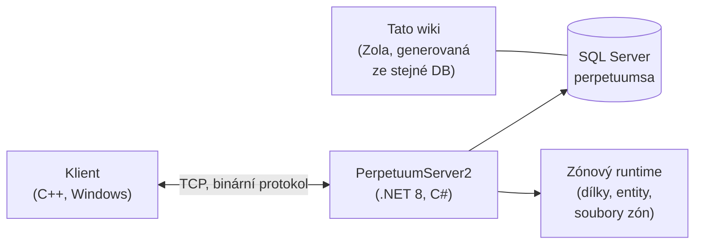

# Domov pro vývojáře

Vysokourovňový přehled o tom, jak hra funguje, z pohledu vývojáře/devops.
Specializované podrobné stránky jsou v přípravě — zatím slouží tato stránka jako orientace.

## Komponenty

- **Klient** — herní klient Perpetuum (Windows; viz [Klient a nastavení PC](/cs/features/client-setup/) pro spuštění, včetně Linuxu). Komunikuje se serverem přes binární TCP protokol; každá akce hráče je pojmenovaný *příkaz* (stejné názvy, které tato wiki používá v [inventáři akcí](/cs/features/#uplny-seznam-akci)).
- **Server (PerpetuumServer2)** — kódbáze v C#/.NET 8. Jeden proces spouští celý server: vrstvu připojení, herní logiku (roboti, zóny, mise, trh, výroba, výzkum) a zónový runtime, který tiká dílkový svět každé zóny (terén, entity, teleporty).
- **Databáze** — SQL Server, databáze `perpetuumsa`. Statický herní obsah (výchozí hodnoty entit, recepty, rozšíření, technologický strom, obchod, popisy teleportů) a veškerý dynamický stav (postavy, roboti, kontejnery, trh, stav zón).
- **Soubory zón** — zóny jsou mřížky dílků (vrstva nadmořské výšky + vrstva kontroly, 2 bajty/dílek) distribuované v archivech `.gbf` a editovatelné pro každou zónu; viz [formát souborů zón](/cs/formats/zone-files/).
- **Referenční data** — klient stahuje statistické tabulky ze serveru při spuštění (viz [Server a referenční data](/cs/features/server/)).

## Spuštění

- Server běží v Docker Compose vedle SQL Serveru (projekt `perpetuumserver2`); kontejner DB je ten, ze kterého čte generátor této wiki.
- Statický obsah se validuje proti souborům pravidel **plantrules**; C# generátor wiki (`make generate`) běží ve stejném ekosystému a čte stejnou databázi, takže každá generovaná tabulka na tomto webu odráží živá data serveru.
- Mapy teleportů zón na této wiki jsou vykresleny ze stejných vrstev nadmořské výšky, které používá samotná hra.

## Kam dál

- **[Formáty](/cs/formats/)** — vývojářská referenční příručka: jak je každé statistické pole uloženo (sloupec DB, klíč v souboru pravidel, bajt binární vrstvy) a konzumováno, s praktickými příklady.
- **[Server a referenční data](/cs/features/server/)** — metasystémy: informace o serveru, žebříčky, referenční data, která klient stahuje, a herní obchod.

> Další vývojářské stránky (protokol, životní cyklus zón, nasazení) jsou plánovány — tato stránka je jejich výchozím bodem.