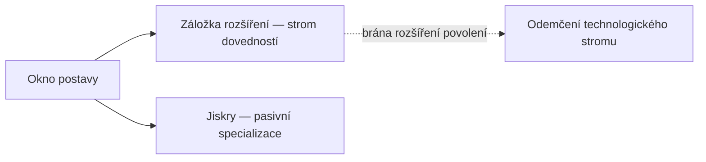

# Postava

V **okně postavy** (horní lišta → **Postava**, vlevo nahoře) se nachází progrese vaší postavy: profil, kredity, **rozšíření** (dovednosti) a nastavení.
Vše na této stránce se vztahuje k jednotlivé postavě — účet může obsahovat více postav, každá se svým vlastním stromem. Umístění v uživatelském rozhraní naleznete v [přehledu uživatelského rozhraní klienta](/cs/features/ui/).

## Rozšíření

Záložka **rozšíření** představuje strom dovedností postavy: úrovně dovedností pro každou postavu, které odemykají herní obsah a ladí atributy — nejdůležitější jsou **rozšíření povolení** nutná k pilotování třídy robotů. 1. úroveň stojí kredity, každá další úroveň stojí body rozšíření (EP) a předpoklady určují cestu.

- [Hlavní kategorie](/content/extensions/#categories) — 15 kategorií na jedno podání:
  které kategorie odemykají které (kliknutím na políčko přejdete na její karty)
- [Rozšíření podle kategorií](/content/extensions/#table) — každé rozšíření:
  hodnost, cena, bonus, předpoklady
- Jak fungují EP a technologický strom: [Výzkum](/cs/features/research/)

## Jiskry

Vaše **jiskra** je specializace nanobotů nainstalovaná na postavě — po celou dobu její aktivity
se její bonusy aplikují na každého robota, kterého pilotujete. Přepínání jisker má svou cenu;
autorizace určuje přístup k vyšším liniím. Podrobnosti v [Jiskry](/cs/features/sparks/).