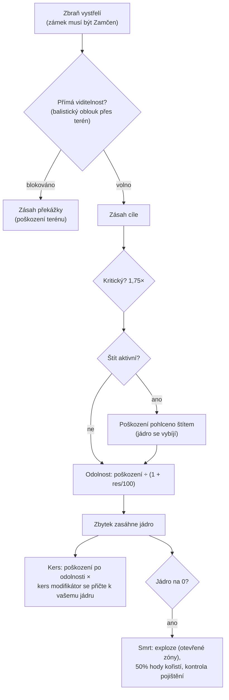

# Boj

Boj probíhá **v zónách** s vaším aktivním robotem. Bojujete proti jiným hráčům (PvP),
NPC a nepřátelským strukturám. Tato stránka pokrývá mechaniky potvrzené na
serverové straně; podrobné interakce poškození a výbavy najdete pod [roboti a výbava](/cs/features/robots/).

> Umístění v UI sleduje [přehled uživatelského rozhraní](/cs/features/ui/): **štít/brnění/trup a
> energie** vašeho robota jsou zobrazeny na panelu stavu mimo dok. Cílení a ovládání
> zbraní v boji zatím nejsou podrobně zdokumentovány.

## Vstup do boje

- Bojovat můžete pouze ve stavu **vyloděný** — jste svým aktivním robotem.
- Výstřel útočnou zbraní na jiného hráče v otevřené (PvP) zóně nastaví
  **PvP značku** na útočníkovi. Odpověď výstřelem nebo použití podpůrného modulu na
  hráči, který už značku má, nastaví značku i na vás. Značka trvá **5 minut**
  (definice `effect_pvp`, 300 000 ms) a obnovuje se s každým novým aktem agrese.
- Zatímco je značka aktivní:
  - **nemůžete používat teleporty** (včetně mobilních) a
  - **nemůžete se běžně zalodit** — jediný způsob, jak se dostat ven, je
    **vynucené zalodění**, které značka záměrně nezablokuje.

## S čím můžete bojovat

- **Roboti jiných hráčů** (PvP).
- **NPC** — zónová NPC jsou organizována do **hejen** (skupiny se sdíleným chováním).
- **Nepřátelské struktury / nasaditelné objekty** v zóně.

## Když je váš robot zničen

Váš robot je **zničen** a na místě, kde zahynul, se objeví **kontejner s kořistí**. Kořist se
hodí pro každý předmět zvlášť, každý hod s 50% šancí:

| Co | Osud |
|---|---|
| Každý nasazený **modul** | 50% šance, že spadne **poškozený** (opravitelný); jinak zničen |
| Náboje naložené v každém modulu | 50% šance, že spadnou (pouze pokud modul spadl) |
| **Náklad** (balíky/krabice) | obsah spadne jako kořist, balík samotný je zničen |
| Další **skladovatelné předměty** v nákladu | 50% šance, že spadnou, s náhodně sníženým množstvím (zbytek je zničen) |
| Vaše **barva/tón** | 50% šance, že spadne jako předmět barvy |
| **Robot samotný** | zničen — pokud neměl aktivní **pojištění**, v jeho případě je odměna vyplacena v kreditech (robot je stále pryč) |

**Pojištění** (koupíte v pojišťovně základny, zaloděný — viz
[výroba → pojištění](/cs/features/production/)) pokrývá robota po dobu **15 dní** (plus
dny z bonusového prodloužení). Každý robot má obsahem definovaný **poplatek** a **odměnu**
(tabulka `insuranceprices` — 67 definic robotů); poplatek lze snížit bonusovým prodloužením
a zaplatit z firemní peněženky. Začátečníkové roboty nelze pojišťovat. Můžete mít
pojištění na 1 + (bonusové prodloužení) robotech.

Po zabití zůstáváte **bez aktivního robota**. Abyste se vrátili do hry, můžete:

- **vybrat jiného robota**, kterého vlastníte a který má požadovaná rozšíření povolení, nebo
- **požádat o začátečníkový robot** ve stavu zaloděný — ale po zabití je krátká blokáda:
  **3 minuty, pokud vás zabil hráč, 1 minuta, pokud NPC**. Pokud vás zabilo **NPC**,
  základna vám při návratu automaticky také poskytne **zdarma začátečníkový robot**.

## Útěk

Když se boj zhorší:

- **Vynucené zalodění** — nouzový východ. Okamžitě vás vytáhne z zóny a zalodí na
  hlavní základně (TMA), i uprostřed boje.
- **SOS** — alternativní východ: zalodí vás na aktuální základně po běžném
  (7sekundovém) zpoždění vylodění.

Oba jsou vaše pojistné sítě; vynucené zalodění je tlačítko „za chvilku umřu".

## Zamčení, dosah a zásah

- **Nejprve zamkněte.** Zbraně střílejí pouze na *zamčené* cíle — a to až po
  dokončení zamčení. Zamčení cíle trvá **čas zamčení** vašeho robota (stat v ms);
  výstřel během probíhajícího zamčení je zamítnut. Můžete držet několik zámků
  najednou (omezeno statem **maximální počet zamčených cílů**), ale pouze jeden je
  *primární* a některé zbraně střílejí pouze na primární cíl.
- **Optimální dosah + pokles.** Uvnitř **optimálního dosahu** zbraně způsobujete plné
  poškození. Za ním poškození hladce klesá po vzdálenosti **poklesu** —
  přibližně poloviční poškození v polovině poklesu, nula na jeho okraji. Za
  optimální dosah + pokles nezpůsobujete žádné poškození vůbec.
- **Poloměr výbuchu vs. velikost cíle.** Pušky nemohou „minout": stat **přesnost**
  pušky funguje jako poloměr výbuchu a cíl, jehož **signatura** je menší,
  dostane úměrně méně poškození. Střely *mohou* minout úplně (šance na minutí
  pochází ze statů přesnosti střel robota), ale když zasáhnou, explodují
  svým **poloměrem výbuchu** — a stejně jako u pušek dostane malý cíl méně
  z výbuchu.
- **Kritické zásahy.** Každý výstřel hodí vaši **šanci na kritický zásah**; krit
  vynásobí celý zásah 1,75× a každý zásah se navíc náhodně liší o ±10%.
- **Přímá viditelnost.** Výstřely letí přímou čarou a terén, překážky a
  rostliny je blokují. Střely letí obloukem a mohou překonat nízké krytí — ale oblouk
  je omezený, takže vysoký terén stále blokuje.
- **Váš vlastní štít blokuje vaše vlastní zbraně.** Zatímco je váš štít aktivní,
  vaše zbraně nebudou střílet.

### Typy poškození

Náboj nese poškození: každý náboj má hodnotu pro jeden nebo více typů poškození —
obvykle jeden dominantní typ plus menší sekundární (náboje do střel jsou výbušné
plus kinetické nebo chemické, laserové krystaly tepelné plus chemické, náboje do drátenic
kinetické plus tepelné). Typy:

| Typ | Poznámky |
|---|---|
| **Chemické** | Běžná složka nábojů do pušek a laserů |
| **Kinetické** | Drátenice, projektilové a střelové náboje |
| **Tepelné** | Lasery, některé projektilové náboje |
| **Výbušné** | Střely |
| **Toxické** | Některé náboje do pušek; poškozuje pouze rostliny a terén |
| **Elektrické** | Speciální efekty (např. scorcher) — **proniká štíty** |

Příchozí poškození se snižuje podle typu podle **odolnosti** cíle k danému typu:
odolnost 50% snižuje poškození o 50/(50+100) ≈ 33%. Odolnosti se aplikují pouze na to,
co *projde* štítem — štít pohltí první a je placen z energie štítu: čím tvrdší zásah,
tím více energie stojí. Moduly **Kers** umožňují, aby část poškození daného typu
spálila energii štítu přímo i po odolnosti. [Adaptivní slitina](/cs/features/modules/#rodiny-modulu)
přerozděluje vaše odolnosti směrem k tomu, co vás skutečně zasahuje.

## Detekce, maskování a rychlost

- **Detekce vs. maskování.** Cíl můžete vidět v dosahu, který roste s vaším statem
  **detekce** a klesá se statem **maskování** cíle — přibližně 100 m × detekce ÷ maskování.
  Jednotka, která vás zamkla, je vám vždy viditelná, bez ohledu na její maskování.
  Skrytné moduly dočasně zvyšují vaše vlastní maskování (viz [moduly](/cs/features/modules/));
  miny používají samostatný dosah detekce.
- **Blob.** Některé jednotky a struktury emitují *blob* pole. Zatímco stojíte v dosahu
  emitujícího zařízení, úroveň blobu na vaší jednotce stoupá; mezi vašimi dvěma prahovými
  hodnotami blobu **zvyšuje váš čas zamčení** (až 6× základní hodnotu) a
  **snižuje váš dosah zamčení a sílu senzorů** (až na polovinu).
- **Rychlost.** Maximální rychlost klesá s hmotností: rychlost = základní × (designová hmotnost ÷ skutečná
  hmotnost) — každý další tun modulu, brnění a nákladu, který nasadíte, vás zpomalí.
- **Demobilizace („demob").** Efekt webberu zpomalí maximální rychlost cíle.
  Jak silně zasáhne, závisí na **hmotnostním faktoru** cíle — těžší jednotky
  jsou demobilizovány tvrději, takže velké pomalé cíle to cítí nejvíc.

## Poplachy

**Poplach** je spuštěn v zóně **poplachovým přepínačem** (misí související
struktura). Po spuštění:

- Běží po pevně danou **dobu poplachu** (nastaveno misí; výchozí je krátká).
- Musíte **zůstat v dosahu přepínače** po celou dobu — kontroluje se každé
  pár sekund a odchýlení zruší poplach.
- Můžete mít pouze **jeden poplach běžící najednou**.

Poplachy jsou vázány na obsah misí — viz [mise](/cs/features/missions/).

## Zprávy o zabití

Vaše bojová historie je k dispozici jako **zprávy o zabití**:

- Filtr podle **časového okna**.
- Filtr podle **role**: jako **oběť**, **útočník** nebo **zabiják**.

Používejte je k přezkoumání, jak jste zahynuli nebo koho jste zničili.

## Nejvyšší skóre

- **Serverové nejvyšší skóre** — nejlepší výsledky napříč serverem.
- **Moje nejvyšší skóre** — vaše osobní rekordy.

## Praktické poznámky

- **Nezahynejte lehkomyslně** — zničený robot znamená prostoj, zatímco se přebudováváte
  nebo žádáte o nový.
- **Vynucené zalodění je okamžité** — pokud jste v nevýhodě, dostanete se na TMA hned; přebudovat se můžete později.
- **PvP zablokuje teleporty** — plánujte své úniky; z boje se nemůžete teleportovat.
- **Poplachy jsou signál** — aktivní poplach znamená, že v dané oblasti běží misní událost.

<!--
Developer notes: rewritten 2026 from backend sources; no community-wiki text reused.
Verified against:
- Locking: Zones/Locking/LockHandler.cs (locking time in ms from
  AggregateField.locking_time; MaxLockedTargetsProperty; one primary lock;
  lock states Inprogress -> Locked), Zones/Locking/Locks/Lock.cs,
  Zones/Locking/LockValidator.cs (dead/not-lockable/out-of-range validation);
  ZoneSession.cs (weapons take an existing lock id; firing a weapon whose lock is
  not fully Locked raises LockIsInProgress — there is NO auto-lock on fire).
- Damage: Modules/Weapons/Damage.cs (CalculateDamages: crit = attacker.
  CriticalHitChance, CRITICALHIT_MOD 1.75, random 0.9-1.1; falloff =
  cos(x*PI)/2+0.5 with x=(distance-optimal)/falloff; zero beyond optimal+falloff;
  explosion modifier = target.SignatureRadius/explosionRadius clamped 0..1;
  toxic excluded from unit damage), Modules/Weapons/WeaponAmmo.cs (damage values
  per type live on the ammo: damage_chemical/thermal/kinetic/explosive/toxic;
  firearm adds damage_toxic to plants).
- Weapons: Modules/Weapons/FirearmWeaponModule.cs (CheckAccuracy always false —
  firearms never miss; WithExplosionRadius(Accuracy) — accuracy IS the blast
  radius), Modules/Weapons/MissileWeaponModule.cs (miss when rnd >
  robot.MissileHitChance; missile_miss property), WeaponModule.cs (shield active
  => ShieldIsActive error; LOS check before firing).
- Resistances: Units/Unit.cs GetResistByDamageType = resist/(resist+100);
  Zones/DamageProcessors/DamageProcessor.cs (shield absorbs first, paid from
  core: coreDamage = damage * AbsorbtionModifier; Electric damage penetrates as
  coreDamage; kers = damage * type kers modifier, scaled by
  (sin(core/coreMax*PI)/2)+0.5, added to target core);
  EffectModules/ShieldGeneratorModule.cs (AbsorbtionModifier =
  max(SigRadius/shieldRadius,1)/shieldAbsorbtion).
- Damage types: Modules/Weapons/DamageType.cs — Chemical, Kinetic, Thermal,
  Explosive, Toxic, Electric (no "seismic"; missile damage is Explosive).
  Electric is only produced by ScorcherModule.cs in this backend.
- Detection: Units/Unit.Visibility.cs (IsDetected: range = 100/max(1,
  target.StealthStrength)*max(1, DetectionStrength); locked-on-you always
  visible; mine detection range separate); stealth_strength property includes
  effect_stealth_strength_modifier (stealth modules raise masking).
- Speed: Units/UnitProperties/SpeedMaxProperty.cs (speed_max * Mass/ActualMass;
  dreadnought => 0.05; massiveness/drone/highway effect modifiers).
- Demob: Modules/EffectModules/WebberModule.cs (effect_demobilizer; effect
  property = module value + target.Massiveness, clamped at 1.0 — heavier targets
  get the full effect; longrange webbers additionally require LOS; accuracy
  check via optimal-range modifier).
- Blob: Zones/Blobs/BlobHandler.cs (emitters raise blob level inside
  BlobEmissionRadius; between blob_level_low/high the multiplier scales:
  locking_time modifier -5, i.e. lock time x(1+5*m) — up to 6x base at full blob, max_targeting_range *0.5,
  sensor_strength *0.5).
- LOS: Zones/LineOfSight.cs (raycast vs terrain blocks incl. Plant flag;
  ballistic arc for missiles: max amplitude 16 m over 40 m);
  Zones/Terrains/BlockingFlags.cs (Obstacle/Plant/Decor/Island block).
Corrections vs ingested page: "seismic" damage type does not exist (explosive
does); "firearms lose damage instead of missing" verified (accuracy = explosion
radius); auto-lock on fire NOT in backend (lock must be created and completed
first); "interference" (emission/minimum/peak, emitters, anomaly degradation)
has NO equivalent in this backend — only a comment in Services/RiftSystem/Rift.cs
— section removed; shield "absorbs" is core-energy based, and Electric damage
penetrates it.
Developer files: Zones/Locking/*; Zones/Locks via Zones/Locking/Locks/*;
Modules/Weapons/*.cs; Zones/DamageProcessors/*.cs; Units/Unit.Visibility.cs;
Units/Unit.cs; Units/UnitProperties/SpeedMaxProperty.cs;
Modules/EffectModules/ShieldGeneratorModule.cs, WebberModule.cs,
StealthModule.cs; Modules/ScorcherModule.cs; Zones/Blobs/*.cs;
Zones/LineOfSight.cs; Zones/ZoneSession.cs (lock/fire packet handling).
Previously verified (kept as-is): PvP flag = effect_pvp 300000 ms
(effect_pvp definition), raised by attack/aggro/support (Player.cs
ApplyPvPEffect); blocks teleport + normal dock (CantDockThisState), ForceDock.cs
has no PvP check; death loot 50% rolls (Player.cs OnUnitDeath,
Services/Looting/LootHelper.cs DROP_CHANCE 0.5); insurance (InsuraceFacility.cs,
InsuranceHelper.cs, insuranceprices 67 defs); starter-robot lock 3 min PvP /
1 min NPC; alarms (Zone/AlarmStart.cs, AlarmSwitch.cs); kill reports
(GetMyKillReports.cs); high scores (GetHighScores.cs / GetMyHighScores.cs).
-->