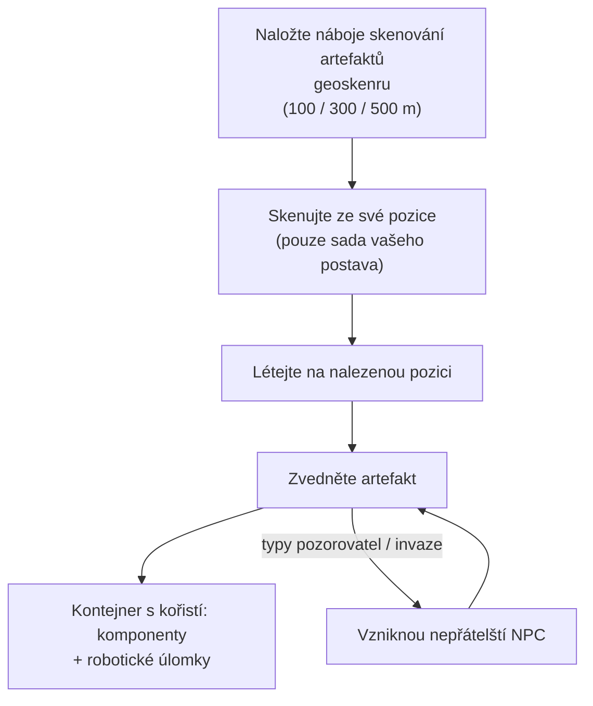

# Průzkum (artefakty a relikvie)

Průzkum je hledání skryté hodnoty v terénu — silná solo aktivita na jakékoli úrovni. Existuje ve dvou formách: **artefakty**, které jsou osobní a skryté, a **relikvie**, které jsou otevřené a sporné.

## Sbírání artefaktů

Artefakty jsou body, které existují **pro každého postava zvlášť**: server udržuje samostatnou sadu artefaktů pro každého postava na každém ostrově, takže co najdete, patří pouze vám. Jsou neviditelné, dokud je nenaskenujete.

1. Naložte **náboje skenování artefaktů** do modulu geoskenru. Existují tři stupně nábojů s různým dosahem skenování (100 / 300 / 500 m).
2. Skenujte z pozice svého robota — skenr vrátí pozice artefaktů v dosahu (statistika přesnosti geoskenru zúží hlášenou pozici).
3. Dolétejte na nalezenou pozici a zvedněte artefakt; na místě se objeví **kontejner s kořistí**.

Dvě věci dělají ze sbírání artefaktů i bojovou aktivitu, ne jen sběrovou:

- Některé typy artefaktů **spawnují NPC spolu s vámi** — varianty „pozorovatel" a „invaze" přivolají nepřátele v okamžiku, kdy je artefakt nalezen, takže pilotujte něco, co umí bojovat.
- Kořist je náhodná podle typu artefaktu: komponenty modulů (brnění, hardenery, generátory, opravné moduly…) a **robotické úlomky** — specifické suroviny pro výzkum a výrobu jednotlivých frakcí, což dělá ze sbírání artefaktů jádro průmyslové kariéry.

Typy artefaktů jsou rozděleny do úrovní (úroveň 1–3, více kořisti na vyšších úrovních) a existují v neutrálních a frakčních variantách.

## Lov relikvií

Relikvie jsou **open-world**: zóna je spawnuje na náhodných pozicích (v přibližně 90minutovém cyklu respawnu s náhodným rozptylem), jsou viditelné objekty s paprskem a ten, kdo je zvedne první, získá kořist. Kořist je hod NIC plus **robotické úlomky**, škálovaná podle úrovně relikvie a hodnotové kategorie ostrova — stejné úlomky, které produkuje i sbírání artefaktů.

Typy relikvií jsou rozděleny do úrovní podle ostrova (úrovně 1–3, s různými hodnotami EP podle úrovně) a existují v neutrálních, frakčních a průmyslových variantách. Některé relikvie jsou spjaty s [dopadovými základnami](/cs/features/outposts/) — aktivita SAP spawnuje vlastní relikvie, které žijí až 12 hodin — a na ostrovech s otevřeným PvP se spawnovací body nacházejí na sporném území, takže očekávejte setkání s dalšími lovci.

## Mise za to také platí

[Mise](/cs/features/missions/) mohou také předložit práci s artefakty, kde jste placeni přímo a zboží putuje zaměstnavateli místo do vašeho inventáře.

<!--
Napsáno od nuly na základě serverového backendu, 2026-09-27:
Zones/Artifacts/Repositories/ZoneArtifactRepository.cs (řádky artefaktů
pro jednotlivé postavy), Zones/Scanning/Scanners/Scanner.Artifact.cs
(dosah skenování + přesnost), Zones/Artifacts/Generators/Loot/
(náhodná kořist podle typu), Services/Relics/RelicManagers/ZoneRelicManager.cs
(respawn cca 1,5 h + náhodné okno) a SAPRelic.cs (doba života 12 h),
tabulky artifacttypes/artifactloot/relictypes/relicloot,
ammo_artifact_scan_a/b/c (dosahy skenování 100/300/500).
Starší verze této stránky byla přebрана z komunitního wiki Open Perpetuum
(perpetuum.miraheze.org) a byla plně přepsána z backendových zdrojů;
žádný text nebyl znovu použit.
-->