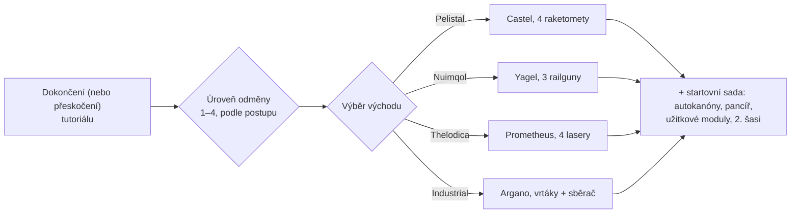

# FAQ

## Mohu přeskočit tutoriál?

Tréninkovou zónu můžete opustit předčasně, ale přijdete o odměnu, kterou
získáte za její dokončení. Když postava opustí tutoriál, server:

- vyplatí **počáteční NIC** plus bonus **za úroveň odměny**, kterou jste v
  tutoriálu získali (jsou čtyři úrovně odměn),
- přesune vás do **výchozí korporace** pro rasu a školu, kterou jste si zvolili,
- udělí vám **počáteční rozšíření** (dovednosti) a vaši **jiskru**,
- vytvoří vašeho **startovního robota**, zakotví vás na dokovací základně New Virginia a
  nastaví ji jako vaši **domovskou základnu** — místo, kde se znovu objevíte při
  zničení vašeho robota,
- uloží vaše **předměty odměny** do veřejného kontejneru na této dokovací základně a
  pošle vám uvítací zprávu.

## Jak dokončím tutoriál?

Plňte cíle postupně; klientův **Kontrolní seznam nováčka** (Rookie Checklist v nabídce
Nápověda na horní liště) je sleduje a lze jej připnout na spodní lištu. To, jak daleko
se dostanete, určuje vaši úroveň odměny, která rozhoduje o tom, jaké stupně odměn
při odchodu obdržíte — odchod na úrovni 1 získá pouze první stupeň, plné dokončení
získá všechny čtyři.

## Co mi jednotlivé východy poskytnou?

Vaše volba určuje tři věci: **startovního robota**, kterého budete pilotovat, **předměty
odměny**, které obdržíte, a **výchozí korporaci s počátečními dovednostmi**, které získáte.
Vše ostatní — jakoukoli dovednost, jakéhokoli robota, výstroj jakékoli frakce — lze natrénovat
a koupit později za EP a NIC, takže tato volba je startovní sadou, nikoli trvalým omezením.

| Východ | Startovní robot (vybavený) | Téma odměny |
|---|---|---|
| **Pelistal** | Castel — čtyři odpalovače raket | rakety + autokanóny |
| **Nuimqol** | Yagel — tři railguny | munice do railgunu + autokanóny |
| **Thelodica** | Prometheus — čtyři lasery | laserové krystaly + autokanóny |
| **Industrial** | Argano — dva vrtáky, sběrač, těžební sonda | munice pro těžbu, sklizeň a skenování artefaktů |

Každý východ obsahuje také sadu malých autokanónů s municí, pancíř a
užitkové moduly (opravář pancíře, posilovač senzorů nebo reduktor hmotnosti, dobíječ
jádra, modifikátory poškození), druhé (prázdné) šasi a na nejvyšších úrovních odměn
kapsli nástěnné bomby (wall-bomb).

## Co mám dělat, jakmile jsem venku?

Téměř jakákoli aktivita vynáší EP pro dovednosti a NIC pro výbavu:

- Těžte rudu, sklízejte rostliny, hledejte artefakty — a prodávejte kořist na [trzích](/cs/features/market/).
- Střílejte NPC a prodávejte [kořist](/cs/features/npcs/).
- Shromažďujte nebo nakupujte materiály a [vyrábějte](/cs/features/production/) věci.
- Plňte [mise](/cs/features/missions/) — cokoli nabízené u terminálu nebo
  předsunuté základny můžete ve světě dokončit sami.

Jste nováčkem v otevřeném PvP světě? Přečtěte si nejprve [poznámky k přežití v Začínáme](/cs/features/getting-started/#survival).

## Mohu se znovu vrátit do tréninkové zóny?

Ne. Tréninková zóna je určena pro nové postavy a po jejím opuštění do ní již není
možný návrat. Kontrolní seznam nováčka zůstává dostupný v nabídce Nápověda, pokud si
chcete znovu přečíst cíle, a vždy si můžete vytvořit další postavu a nechat ji v
tutoriálu jako testovací pískoviště.

## Zkratky

Běžné zkratky v chatu, nabídkách na trhu a sestavách (fitech). Většina termínů má svou
vlastní stránku (odkazovanou tam, kde je to užitečné) — názvy předmětů najdete ve vyhledávání na webu.

| Zkratka | Význam |
|---|---|
| **EP** | [Rozšiřovací body (Extension Points)](/cs/features/research/#ep-sources) — měna dovedností na úrovni účtu utrácená za vylepšování [rozšíření](/cs/features/character/#extensions) (pravidla získávání jsou na [stránce výzkumu](/cs/features/research/#ep-sources)). |
| **NIC** | Nianský kredit (Nian Credit) — herní měna (zůstatek `credit` vaší postavy). |
| **CT** | [CPRG — Kalibrační program](/cs/features/production/#cprg-calibration-programs) — program, podle kterého je výrobní linka kalibrována před zahájením výroby (jeden na položku, s materiálovou/časovou efektivitou). |
| **Proto** | Prototypový předmět — vyšší varianta modulu/robota, vyrobená v [prototypovém zařízení](/cs/features/production/#the-item-lifecycle-the-circular-process) (spotřebovává vzorek předchozí úrovně; viz [postup úrovní](/cs/features/production/#tier-progression)). |
| **LWF** | Odlehčený rám (Lightweight frame) — pancéřový modul snižující hmotnost (klient je pojmenovává „… lightweight frame“, např. *Niani lightweight frame*). Způsobuje, že robot je lehčí, za cenu slabšího pancíře. |
| **TP / tele** | [Teleport](/cs/features/movement/) — rychlé cestování mezi pevnými body nebo k rozmístěnému mobilnímu teleportačnímu zařízení. |
| **SAP** | Bod přístupu ke službám (Service Access Point) — aktivita pro [stabilitu](/cs/features/outposts/) předsunuté základny. |
| **Stab** | Stabilizátor zbraně (Weapon Stabilizer) — zvyšuje přesnost zásahu zbraně. |
| **Demob** | Demobilizér (Demobilizer) — modul, který zpomaluje jiného robota (a jeho moduly). |
| **EWar** | Moduly elektronického boje (Electronic Warfare) (rušení, potlačení senzorů, maskování). |
| **EnWar** | Moduly energetického boje (Energy Warfare) (vstřikovače jádra, odčerpávače, neutralizátory, přenosy). |
| **Tuning** | Název klienta pro rozšiřující moduly, které vylepšují jiné moduly — modifikátory poškození pro zbraně, *průmyslové ladění* pro těžaře a sběrače, ladění opravářů pancíře atd. |
| **MK2** | Vylepšená varianta robota (šasi `_mk2`) — vyšší kapacity, vlastní výzkumná linie. |

Třídy robotů odpovídají rozdělení v herním klientovi — viz poznámka v části
[Třídy robotů](/cs/content/robots/#robot-classes).

<!--
Written from scratch against the server backend, 2026-09-27:
Zones/Teleporting/Strategies/TrainingExitStrategy.cs (exit rewards, NIC,
corporation, extensions, spark, starter robot, home base, reward items),
Zones/Training/Reward/TrainingReward*.cs + trainingrewards/robottemplates
(reward levels 1-4, per-race starter packs and items),
Robots/Robot.Properties.cs (race ids 1=Pelistal, 2=Nuimqol, 3=Thelodica, 5=industrial).
An earlier version of this page was adapted from the Open Perpetuum
community wiki (perpetuum.miraheze.org) and has been fully rewritten from
backend sources; no text was reused.
-->
