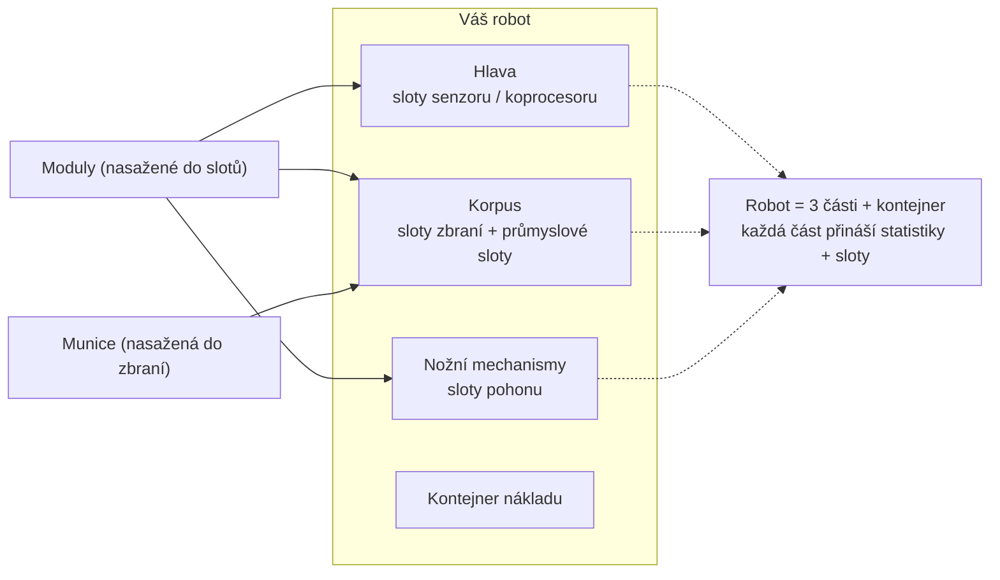

# Vybavení

Vybavení znamená nakládání **modulů** do slotů komponent robotu a **munice** do vašich
zbraní. Všechno vybavení je možné **pouze v dokovacím režimu** — v zóně vybavení
provést nelze.

> Umístění v uživatelském rozhraní odpovídá [přehledu uživatelského rozhraní klienta](/cs/features/ui/)
> (kategorie **Vybavení** na horní liště). Mechaniky níže jsou potvrzeny na serveru.

## Vybavení modulů

Robot má několik **komponent** (zbraň, štít, brnění, pohon, senzor atd.), z nichž každá
má sadu **slotů**.

- **Nasadit modul** — vzít modul z kontejneru a nasažit ho do konkrétního slotu
  komponenty. Typ modulu musí být platný pro daný slot na dané třídě robotu.
  Pokud je slot obsazený, stávající modul se vrátí do kontejneru.
- **Vyměnit moduly** — přesunout modul mezi dvěma sloty téže komponenty.
- **Odebrat modul** — vyjmout modul ze slotu zpět do kontejneru.

Server po každé změně znovu odvozuje statistiky robotu (moduly ovlivňují hodnoty
zobrazené na panelu stavu mimo dokovací režim — viz [boj](/cs/features/combat/)).

## Vybavení munice

- **Nasadit munici** — nasažit kompatibilní položku munice do aktivního (zbraňového) modulu.
  Modul musí **přijímat daný typ munice** a nasaží se až po **kapacitu munice** modulu.
  Dříve nasažená munice se nejprve vrátí do kontejneru.
- **Změnit munici** — vyměnit nasaženou munici za jiný kompatibilní typ.
- **Odebrat munici** — vrátit nasaženou munici do kontejneru.

## Předvolby vybavení

**Předvolba** je uložené vybavení, které můžete rychle znovu aplikovat:

- **Uložit** — uložit aktuální vybavení robotu pod názvem.
- **Seznam** — zobrazit vaše uložené předvolby.
- **Aplikovat** — nasažit předvolbu na (jiný) robot z kontejneru.
- **Smazat** — odstranit uloženou předvolbu.

Předvolby jsou praktické pro přebalení po bitvě nebo při přepínání mezi rolami.

## Praktické poznámky

- **V zóně vybavení provést nelze** — vše zde vyžaduje dokovací režim.
- **Nejprve rozšíření aktivátoru** — bez vyvinuté třídy robotu ji nelze vybrat ani pilotovat.
- **Munice musí odpovídat zbrani** — nekompatibilní definice munice je odmítnuta.
- **Zabalení roboti nemohou být použiti** — robot rozbalte, než ho vyberete nebo vybavíte.
- **Používejte předvolby pro rychlé přebalení** — uložte ověřené vybavení a poté ho aplikujte po ztrátách.

## Kategorie slotů

Komponenty robotu (hlava, korpus, nožní mechanismy) poskytují **sloty** a každý slot nese sadu
kategoriálních příznaků. Modul do slotu pasuje pouze tehdy, pokud jsou jeho vlastní příznaky
**podmnožinou** příznaků slotu. Kategorie příznaků jsou:

`small`, `medium`, `large`, `turret`, `missile`, `melee`, `industrial`,
`ew_and_engineering`, `specialized` (specializovaný slot přijímá pouze specializované
moduly), kromě toho konstrukční sloty `head` / `chassis` / `leg`.

Moduly mohou být také omezeny na konkrétní roboty a některé nesou příznak **unikátní**,
což znamená, že najednou může být nasažen pouze jeden modul daného typu. Statistické efekty
jednotlivých modulů najdete v generované [tabulce robotů](/content/robots/).