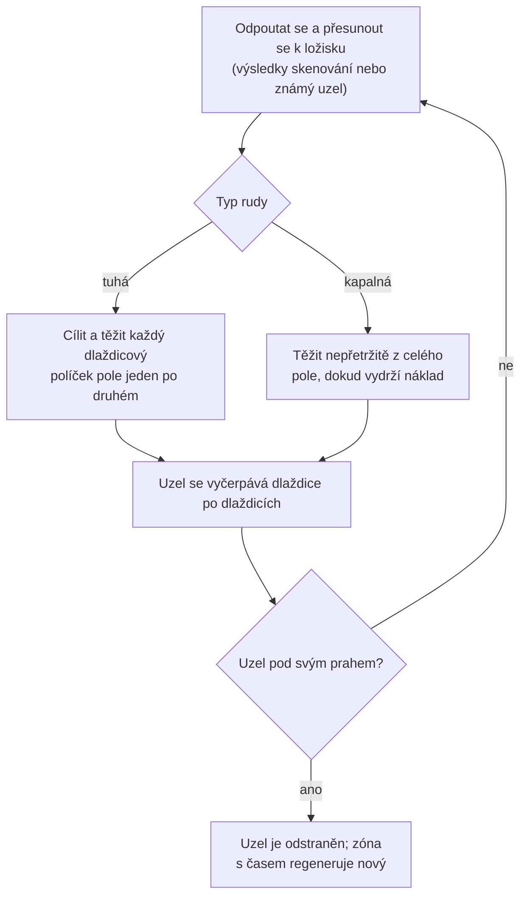
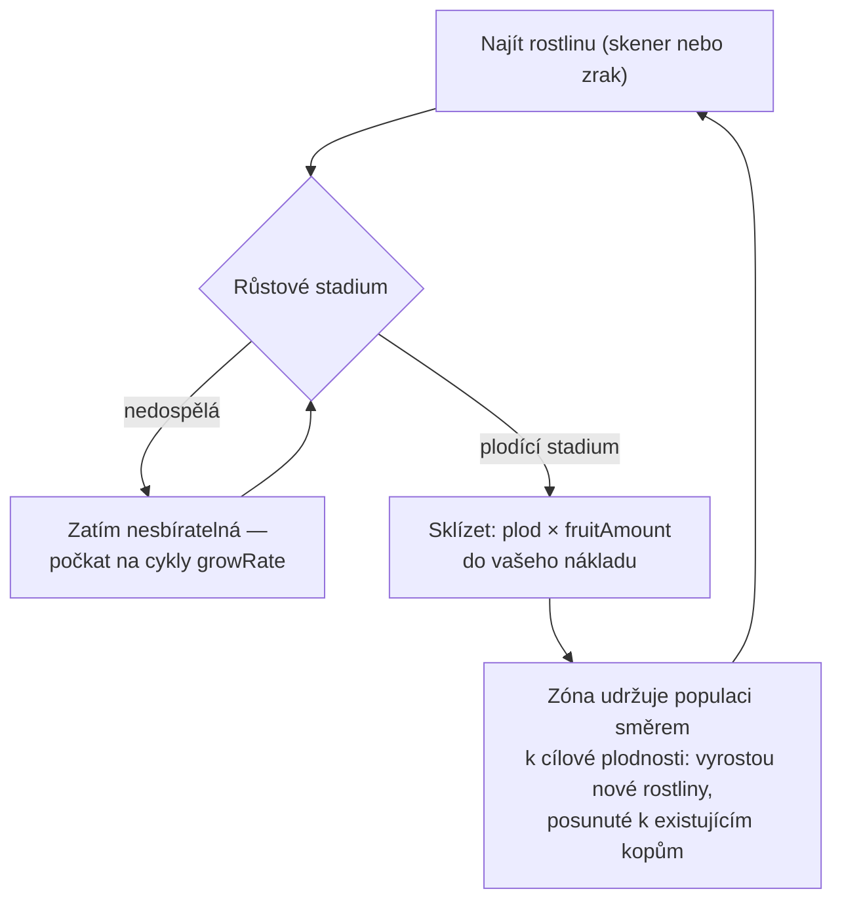
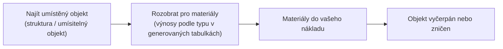

# Sběr a skenování

Zdroje ve hře pocházejí ze tří zdrojů v zóně: **ložisek rud**, **rostlin**
a **umístěných objektů**. Tato stránka vysvětluje, jak každý z nich funguje a jak probíhá
cyklus sběru.

> Umístění v UI naleznete v [přehledu UI klienta](/cs/features/ui/): akce skenování a sběru
> se nacházejí v seznamu **akcí mimo dok** (vpravo nahoře, když jste v zóně). Výnosy
> podle typu zdroje jsou v generovaných tabulkách: [Obsah → Rudy](/content/ores/) a
> [Obsah → Rostliny](/content/plants/). Mechaniky níže jsou potvrzeny podle
> serverové implementace.

## Základní cyklus

1. **Odpoutat se** a přesunout se do zóny (viz [pohyb](/cs/features/movement/)).
2. **Skenovat** oblast skenerovým modulem vašeho robota.
3. **Sbírat** — těžit rudy, sklízet plody rostlin nebo rozobírat umístěné objekty.
4. **Přistát** a předat náklad do kontejneru základny.

## Ložiska rud

- Ruda se v zemi vyskytuje jako **ložiska (uzly)** roztroušená po celé zóně.
- K jejich nalezení a zaznamenání potřebujete **geoskenovací modul** nainstalovaný
  na vašem aktivním robotovi. Sken vytvoří **výsledek skenování**, který poté
  **nahrajete** — tím se uloží do vašeho osobního seznamu minerálních skenů.
- Vaše uložené výsledky skenování můžete **zobrazit, přesunout, smazat nebo převést
  na předměty** (předměty „minerální sken" používané pro zpracování/výrobu).

- Ložiska jsou **konečná**: každý uzel obsahuje omezené celkové množství. Když je uzel
  vytěžen pod svůj prah, je odstraněn a zóna **s časem regeneruje nové uzly**
  až do svého nastaveného maxima. Jak se uzly umísťují a jak se udržují populace
  rostlin — s reálnými zónami jako příklady — je popsáno v
  [Zóny → Generování](/zones/generation/).
- **Tuhé vs. kapalná ruda.** Tuhé rudy se vyčerpávají dlaždice po dlaždicích —
  cílíte a těžíte každý políček pole, dokud není prázdný. Kapalná ruda se čerpá
  z celého pole, takže váš těžař může běžet nepřetržitě, dokud máte náklad.
  Tato snadnost je přesně důvodem, proč kapalná ruda bývá méně hodnotná:
  vyžaduje méně dovedností a pozornosti.

### Přehled statistik rostlin a rud

Chování rud a rostlin řídí pravidlová data pro každý typ. Pole, která se hráči
dotýkají:

| Pole | Co znamená ve hře |
|---|---|
| `fertility` | Jak běžný je daný typ — vyšší hodnota = zóna se snaží udržet více tohoto typu |
| `growRate` | Kolik cyklů růstu musí rostlina strávit v každém stadiu, než postoupí (vyšší = pomalejší) |
| `spreading` | zda typ roste v kopech (skupinách) nebo roztroušeně |
| `killDistance` | Minimální rozestup mezi dvěma rostlinami stejného typu |
| `slope` / `minSlope` | Sklon terénu, na kterém rostlina roste |
| `allowedAltitudeLow/High` | Nadmořská výška, kde může rostlina růst |
| `allowedWaterLevelLow/High` | Pás vzdálenosti od břehu (tvorí pobřežní vegetaci) |
| `fruitingState` | Které růstové stadium musí rostlina dosáhnout, než začne plodit (je sbíratelná) |
| `fruitDefinition` / `fruitAmount` | Co rostlina vydává a základní množství |
| `maxAmount` | Omezení, kolik kusů tohoto typu existuje v zpracovatelské oblasti |
| `health` | Životy za růstové stadium (vyšší stadia mohou být odolnější) |
| `damageScale` | Odolnost rostliny vůči poškození |
| `playerSeeded` | Rostlina existuje pouze tam, kde ji hráč vysadil |
| `onlyOnUnprotectedZone` | Roste pouze na nechráněných (beta/gamma třída) zónách |

Úplný pole-po-poli referenční průvodce (typy, výchozí hodnoty, ukládání a jak je
používá tick zóny) najdete v [Formáty → Pole rostlin](/cs/formats/plant-fields/).

## Rostliny

- Rostliny **rostou s časem** přes sérii stádií. Každé stadium trvá určitý počet
  cyklů růstu (`growRate`), než rostlina náhodně postoupí.
- Rostlina **plodí až dosáhne svého plodícího stadia** — nedospělé rostliny
  nejsou sbíratelné.
- Zóna udržuje populace rostlin směrem k **cílové plodnosti**: pokud je plocha
  podvyznamená pro svou úroveň plodnosti, vyrostou nové rostliny; výběr typu
  zvažuje `fertility` každého druhu a `spreading` posouvá nový růst směrem
  k existujícím kopům.

- Některé rostliny jsou **vysazované hráči** (existují pouze v zahradách hráčů)
  a některé jsou **výhradně pro nechráněné zóny**.
- Rostliny lze **poškodit a zabít**; jejich `health` a `damageScale` určují,
  jak těžké to je.

## Umístěné objekty

Umístěné objekty jsou objekty umístěné v zóně (viz [Výkonové základny](/cs/features/pbs/)
pro stranu struktur). Některé lze **rozobrat** pro materiály. Pravidla rozobírání
a výnosy podle typu jsou v generovaných tabulkách: [Obsah → Rudy](/content/ores/)
a [Obsah → Rostliny](/content/plants/).

## Kiosky

**Kiosk** je struktura související s misemi: do něj **podáváte předměty**
(v dosahu) jako součást mise. Samotným zdrojem sběru není — viz [mise](/cs/features/missions/).

## Praktické poznámky

- **Skenování vyžaduje modul** — bez nainstalovaného geoskenovacího modulu
  žádné výsledky skenování.
- **Výsledky skenování jsou vaše** — patří ke každému postavě zvlášť
  a nesdílejí se.
- **Uzly rud se obnovují, ale pomalu** — pokud je oblast prázdná, ložisko je
  pryč, ne skryté. Regenerace obnovuje počet uzlů, ale ne okamžitě.
- **Sbírejte, co je zralé** — rostliny v plodícím stadiu dávají plný výnos;
  mladší stadia nic nedají.

<!-- TODO: zbývá pouze tok UI klienta (obrazovka skenování, interakce sběru, UI nákladu) —
     vyžaduje běžícího klienta. Výnosy rud podle typu jsou na /content/ores/ a definice
     plodů rostlin na /content/plants/ (generováno z živé DB).
     Poznámky pro vývojáře: Zone/ZoneUploadScanResult.cs (vyžadován GeoScannerModule);
     MineralScanResult*.cs (repozitář na postavu);
     Zones/Terrains/Materials/Plants/PlantRule.cs (všechna pole pravidel rostlin);
     Zones/Terrains/NatureCube.cs (GrowPlants, logika fertility/spreading/killDistance);
     Zones/Terrains/Materials/Minerals/MineralLayer.cs (životní cyklus uzlů rud);
     Zone/UseItem.cs + UseItemVisitor.cs (cesta sběru IUsableItem);
     Zone/KioskSubmitItem.cs (podávání předmětů mise, omezeno dosahem). -->