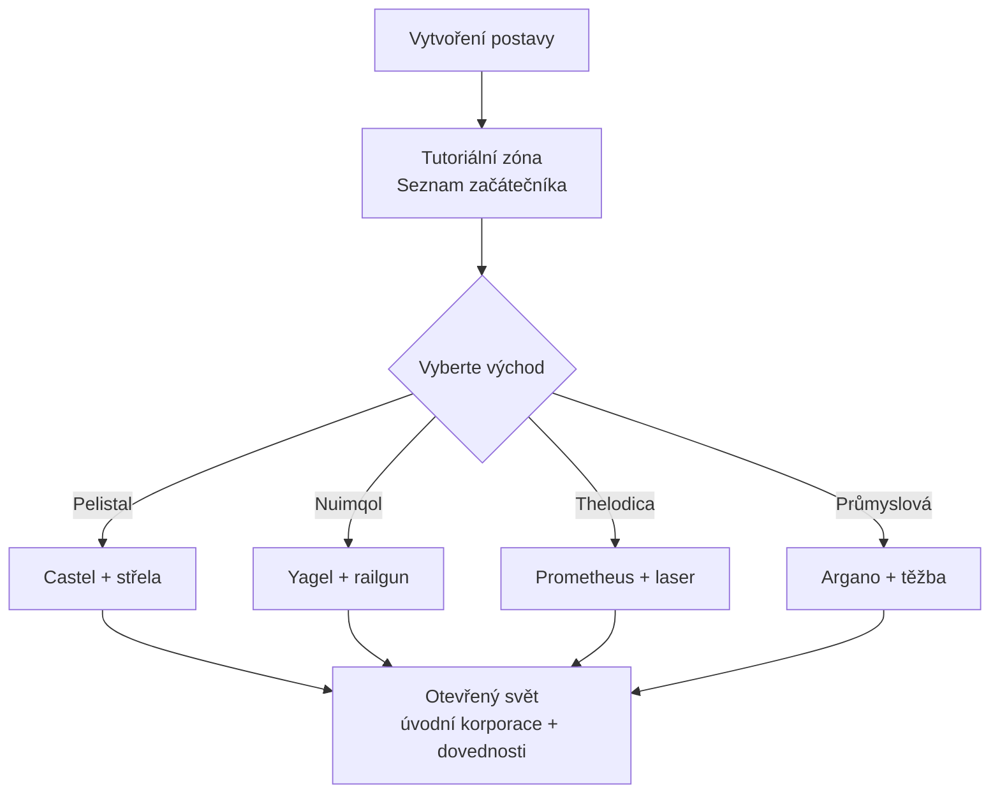

# Začínáme

Tato stránka pokrývá první kroky: vytvoření postavy, získání prvního robota
a nastavení na úrovni postavy, se kterými se seznámíte brzy.

> Umístění v UI odpovídá [přehledu uživatelského rozhraní klienta](/cs/features/ui/). Mechaniky níže jsou potvrzeny
> podle serverové implementace.

## Získání hry

Perpetuum je zdarma na [Steam](https://store.steampowered.com/app/223410/Perpetuum/).

  <a class="steam-card-link" href="https://store.steampowered.com/app/223410/Perpetuum/" target="_blank" rel="noopener">
    
    Perpetuum na Steamu — hra zdarma
  </a>

## Nejdřív se podívejte

Průvodci od projektu Open Perpetuum. Klikněte na kartu a přehrajte ji zde.

  

    
    &#9654;
    
Perpetuum Online Tutorial Walkthrough. + Extension Advice and lots more.

  

  

    
    &#9654;
    
Syndicate Careers Help — Artifacting

  

  

    
    &#9654;
    
Open Perpetuum Tutorial — How to run multiple clients

  

## Vytvoření postavy

- Před vytvořením můžete **zkontrolovat, zda je jméno volné** (`characterCheckNick`).
- **Vytvořte postavu** — je přiřazena k vašemu účtu. Účet může obsahovat více
  postav; hrajete jednu najednou.
- **Vyberte postavu** pro hru. Přepnutí postavy zruší výběr aktuální.
- Postavu můžete později **přejmenovat** (jméno musí být volné).
- Postavu, kterou již nepoužíváte, můžete **smazat**.

## Váš první robot

- Pokud jste **dokovaný na základně**, můžete **požádat o úvodního robota** (zařízení
  základny — viz [přehled uživatelského rozhraní klienta](/cs/features/ui/) pro umístění akcí základny).
  - Základna musí mít úvodní roboty na skladě — na populárních základnách se
    může stát, že se vyčerpají, v takovém případě žádost selže.
  - Mezi žádostmi o úvodního robota je **5minutová pauza** na postavu.
  - Nový robot je dodán do veřejného kontejneru základny.

- Pokud jste dokovaný, můžete také **požádat o „nekonečnou krabici"**: speciální
  kontejner přidaný do vašeho inventáře za **poplatek 5 000 kreditů**. Jedná se
  o pohodlný kontejner, ne o zdroj bezplatných zdrojů.

## Nastavení postavy

- **Avatar** — vzhled vaší postavy.
- **Statusová zpráva** — krátký text zobrazovaný ostatním hráčům.
- **Soukromá poznámka** — poznámka, kterou vidíte pouze vy na jedné ze svých postav.
- **Domovská základna** — nastavte nebo zrušte svou domovskou základnu; je to vaše
  výchozí dokovací místo, když hra potřebuje umístit někde bezpečně.
- **Nastavení** — preference pro každou postavu (získat/nastavit).
- **Zablokovat obchody** — zapnout nebo vypnout obchodování pro postavu.
- **Kredity** — přenos kreditů mezi vašimi postavami; zobrazení historie transakcí.
- **Úroveň účtu** — změna e-mailu/hesla relace, zobrazení historie transakcí účtu
  a historie EP za aktivitu.

## Odhlášení / návrat

- **Odhlásit** ukončí relaci; **vybrat postavu** ji znovu spustí.
- Pokud vás server odhodí (např. nucený návrat na základnu), znovu se objevíte
  dokovaní — viz [pohyb](/cs/features/movement/).

## Tutoriál

Nové postavy začínají v tréninkové zóně se **Seznamem začátečníka** — dokončete ho:
pokrývá základy a odmění několik robotů s moduly a municí. Můžete ho přeskočit
(oddokovat a jít k východu frakce), ale ztratíte odměny a do tréninkové zóny
se později nevrátíte. Co vám čtyři východy frakcí nabízejí, najdete v
[FAQ](/cs/features/faq/).

## Přžití

Perpetuum je sandbox s rizikem a odměnou, a když váš robot zemře, ztratíte ho —
dokovaný nebo ne, zabitý hráčem nebo NPC — a znovu se objevíte na své
[domovské základně](#nastaveni-postavy) (pokud přijdete prázdných, můžete tam
požádat o bezplatného úvodního robota). Některá pravidla, která ztráty udržují
v přžitelných mezích:

- **Rizikujte pouze tím, co si můžete dovolit nahradit.** Odkování je sázka:
  pokud robot padne, on i jeho nasazené moduly jsou pryč (nebo kořist). Před
  startem se ujistěte, že je ztráta přžitelná.
- **Znáte zóny.** Ochranné (PvE) ostrovy jsou bezpečné před hráči; otevřené
  PvP ostrovy jsou volný souboj bez systému trestů. Viz [zóny](/zones/) pro mapu.
- **Znáte NPC.** Oranžové značky útočí pouze při provokaci; červené značky
  útočí při přiblížení. Běhejte a přerušte linii viditelnosti pro snížení
  agrese. Viz [NPC a PvE lov](/cs/features/npcs/).
- **Riziko zmírňujte, ne jen akceptujte.** Jít na otevřený PvP ostrov ve svém
  nejlepší T4 vybaveném mechovi je způsob, jak mechy umírají. Levnější,
  nahraditelné vybavení, které se vyplatí za pár cest, je lepší než drahý bot,
  který se vyplatí za dvacet.
- **Vytvořte udržitelný cyklus.** Ať děláte cokoliv — mise, sběr, lov, produkce,
  přeprava — někdo za to platí NIC. Mějte záložní aktiva, aby jeden špatný den
  nezrušil váš příjem.

## Co dělat dál

1. Vyberte si úvodního robota a naučte se obrazovku [hangár a vybavení](/cs/features/robots/).
2. Odkujte se a pohybujte se po zóně — viz [pohyb](/cs/features/movement/).
3. Naskenujte terén a začněte sbírat zdroje — viz [sběr](/cs/features/gathering/).
4. Výzkumte své první rozšíření — viz [výzkum](/cs/features/research/).
5. Vyberte kariéru — v [FAQ](/cs/features/faq/) najdete přehled.

<!-- TODO(Phase 1): verify client UI flow (account creation screen, character wizard).
     UI model: see features/ui.md (EVE-style, project-provided).
     Developer notes: Perpetuum.RequestHandlers.Characters/* (CharacterCreate,
     CharacterSelect, CharacterRename, CharacterSetHomeBase, ...);
     RequestStarterRobot (5-minute cooldown, base stock), RequestInfiniteBox
     (5000 credits, docked-only). -->