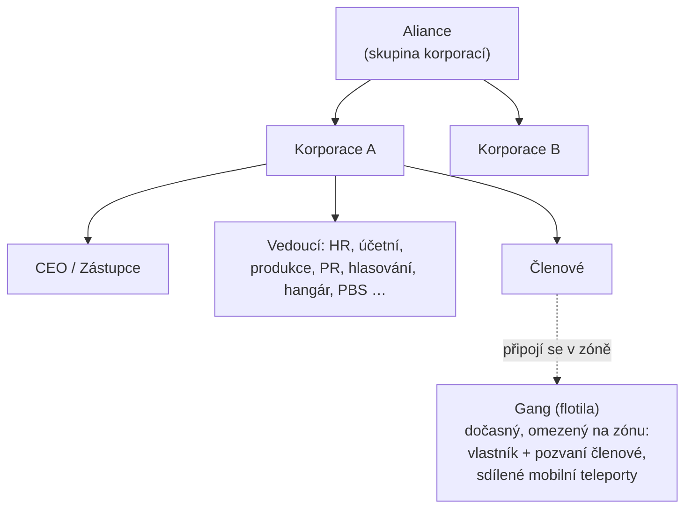

# Skupiny

Existují tři typy skupin: **korporace** (vaše hlavní organizace), **aliance** (skupiny
korporací) a **gangy** (dočasné flotily pro hru v zónách).

> Umístění v UI odpovídá [přehledu uživatelského rozhraní klienta](/cs/features/ui/) (tlačítko
> **Korporace** v levém horním rohu; kategorie **Úložiště korporace**; gangy mají vlastní
> okno). Mechaniky níže byly ověřeny proti serveru.

## Korporace

### Vstup a odchod
- **Vytvořit** korporaci — vyžaduje základní rozšíření pro správu korporace
  (úroveň 1) a zakládací poplatek **250 000 NIC**. Zvolíte oficiální název,
  **zkratku** (max. 6 znaků, zobrazovanou na terénu pro identifikaci vašich členů)
  a **sazbu daně** — podíl ze zárminků členů (zejména odměn za mise), který se
  automaticky převádí na účet korporace.
- **Hlásit se** do korporace, nebo **pozvat** postavu.
- **Přijmout žádost** / **zobrazit seznam žádostí** (vedoucí).
- **Odpovědět** na pozvánku, kterou jste obdrželi.
- **Opustit** korporaci, nebo **zrušit** čekající odchod.
- **Odebrat člena**, **nastavit roli člena**, **odebrat si vlastní role** nebo nastavit
  členy na neutrální.

### Role
Korporace mají hierarchii rolí. Role určují, co můžete dělat — např. odemykání
uzlů technologického stromu korporace, správa hangáru nebo úprava PBS (viz
[pbs](/cs/features/pbs/)). Role definované serverem (`CorporationRole`):

- **CEO** — plná kontrola.
- **Zástupce CEO** — druhý velení.
- **HR manažer** — členství (žádosti/pozvánky/odebrání).
- **Délégu korporace** / **Délégu aliance** — jednání jménem organizace.
- **Účetní** — peníze korporace.
- **Produkcí manažer** — produkce korporace.
- **Správce hlasování** — hlasování.
- **PR manažer** — vztahy s veřejností / zprávní deska.
- **Přístup do hangáru (nízký / střední / vysoký / zabezpečený)** — stupňovaná oprávnění
  pro hangár, s odpovídajícími stupni **odebrání z hangáru** a rolí **operátor hangáru**.
- **zobrazit PBS / upravit PBS** — zobrazení nebo úprava PBS struktur korporace.
- **Seznam technologického stromu / odemknutí** — zobrazení nebo odemknutí technologického
  stromu korporace.

Několik typických omezení: akce s členstvím (žádosti/pozvánky/odebrání, nastavení rolí)
vyžadují **CEO / zástupce / HR manažer**; zprávní deska a PR vyžadují **CEO / zástupce /
PR manažer**; peníze korporace a vylepšení zařízení vyžadují **CEO / zástupce / účetní**
(produkce přidává **produkcího manažera**); nasazení PBS vyžaduje **CEO / zástupce /
upravit PBS**.

Můžete si prohlédnout **historii rolí** pro sebe i pro členy. Místo v hangáru se
pronajímá (výchozí konfigurace serveru: 50 000 kreditů za 7denní období).

### Informace a vyhledávání
- **Informace o korporaci / moje informace** — podrobnosti a vaše členství.
- **Vyhledávání** korporací.
- **Prestíž / reputace** — prestíž a reputace vaší korporace.
- **Délégu** — postavy jednající jménem korporace.

### Peníze
- **Přispět** do peněženky korporace.
- **Výplatit** z ní.
- **Převést** mezi peněženkami.

### Vzhled a profil
- **Přejmenovat**, **nastavit barvu**, **nastavit informace** (veřejný profil).
- **Logo** — až 5 symbolů z pevné sady, každý editovatelný (velikost, průhlednost,
  vrstvení); pouze oprávnění členové ho mohou vytvořit nebo změnit.
- **Historie názvů** — dřívější názvy.

### CEO
- **Nabídnout se jako CEO**, nebo zkontrolovat **stav převzetí CEO**.
- **Převzetí v praxi**: jakmile je CEO offline po dobu **30 dnů**, zástupce může
  zahájit převzetí — spustí se **48hodinový odpočet**, oznámený v okně korporace.
  CEO nebo jiný zástupce ho může okamžitě **veto** (veto nezastaví další pokus,
  pokud se CEO stále nepřihlásí). Pokud odpočet dosáhne nuly, zástupce se stane
  CEO s plnými oprávněními.

### Hlasování
Korporace mohou konat **hlasování**:
- **Zahájit** hlasování, **nastavit jeho téma**, **zobrazit seznam** hlasování,
  **oddat** hlas, **smazat** hlasování.

## Zprávní deska
Zprávní deska spravovaná korporací:
- **Zahájit** ji, **zobrazit** položky, zobrazit **nové položky**, **zveřejnit**
  položku, **moderovat** (upravit/smazat cizí položky) a zobrazit **podrobnosti**.

## Hangár korporace (úložiště)
Sdílené úložiště korporace na základnách:
- **Pronajmout** sekci hangáru, **zaplatit nájem**, zkontrolovat **cenu nájmu**,
  **zavřít** ji.
- **Zobrazit obsah** (vše, nebo na konkrétní základně).
- **Složky** — vytvořit/smazat podsložky.
- **Nastavit přístup** (kdo ho může používat) a **nastavit název**.
- **Protokoly** — zobrazit, nastavit a vymazat protokol přístupu do hangáru.

Poznámka: z hangáru korporace **nemůžete vybrat robota** jako svého aktivního robota
(viz [roboti](/cs/features/robots/)).

## Dokumenty korporace
Sdílený systém verzovaných textových dokumentů pro korporaci. Existují dva typy
dokumentů:

- **Plán PBS** — plán/kresba pro PBS síť korporace.
- **Projekt teraformace** — záznam projektu úpravy terénu.

Operace: **vytvořit**, **zobrazit seznam**, **otevřít**, **aktualizovat obsah**
(verzované), **smazat**, **převést** vlastnictví, **pronajmout** (prodloužit
platnost), **monitorovat** / **zrušit monitorování** (dostávat oznámení o změnách)
a **seznam registrovaných** (až 25 členů), který určuje, kdo může na dokumentu
pracovat.

## Aliance

Aliance sdružuje korporace:
- **Informace o mé alianci**, **výchozí aliance** a **historie rolí aliance**.
- Prestíž může cílit na aliance (viz [sociální](/cs/features/social/)).

## Gangy (flotily)

**Gang** je dočasná skupina pro hru v zónách (např. pro sdílení mobilního teleportu
nebo společný boj):
- **Vytvořit**, **smazat**, **informace**.
- **Pozvat**, **odpovědět** na pozvánku, **vyhodit**, **opustit**.
- **Nastavit vůdce**, **nastavit roli**.

Členství v gang má vliv na **mobilní teleporty** — může je použít pouze vlastník
nebo člen gang (viz [pohyb](/cs/features/movement/)).

## Praktické poznámky

- **Role určují moc** — většina akcí vedoucích (žádosti, hangár, PBS, hlasování)
  vyžaduje správnou roli.
- **Technologie korporace jsou sdílené** — odemykání pro korporaci používá sdílené
  body a násobič (viz [výzkum](/cs/features/research/)).
- **Hangár je úložiště, ne startovací rampa** — nemůžete z něj odpojit robota.
- **Gangy jsou efemerní** — používejte je pro zónovou relaci, ne jako trvalou
  organizaci.
- **Prestíž sleduje vaši korporaci** — prestíž vaší korporace ovlivňuje, jak vás
  vesmír zachází (viz [sociální](/cs/features/social/)).

<!-- TODO: zbývá pouze UI korporace (rozložení okna, výběr role).
     Potvrzeno: enum CorporationRole (21 rolí včetně stupňů přístupu/odebrání z hangáru
     nízký/střední/vysoký/zabezpečený, viewPBS/editPBS, TechTreeList/TechTreeUnlock,
     délégu); omezení oprávnění vzorkovaná z handlerů (členství CEO/Deputy/HRManager;
     zprávní deska CEO/Deputy/PRManager; peníze+vylepšení zařízení CEO/Deputy/Accountant;
     produkce +ProductionManager; PBS CEO/Deputy/editPBS); dokumenty = pbsPlan(1) +
     terraformProject(2) (CorporationDocumentType.cs), verzované, pronájem prodlužuje
     platnost, monitor pro oznámení o změnách, seznam registrovaných max 25
     (MAX_REGISTERED_MEMBERS).
     Poznámky vývojářů: Corporations/* (apply/invite/accept, roles, leave, info, money,
     votes, bulletin, hangar, documents, histories, CEO); AllianceGetMyInfo.cs /
     AllianceGetDefaults.cs / AllianceRoleHistory.cs; Gangs/* (create/invite/kick/leave,
     leader/role). SelectActiveRobot.cs zakazuje roboty z hangáru korporace. -->