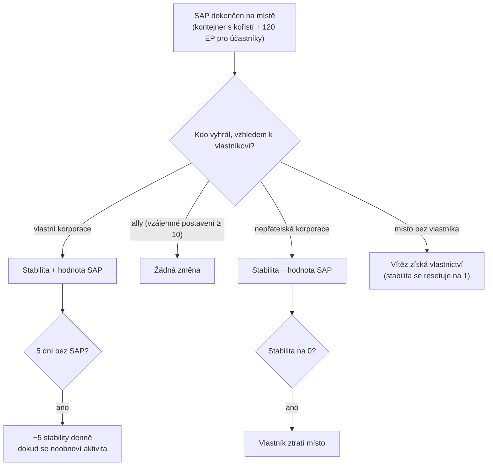

# Vniknutí

**Vniknutí** je režim postavený kolem **míst NPC** — míst spravovaných hráči nebo dostupných k obsazení, která mají **stabilitu**, **obranu** a **zařízení**. Investujete položky, zvyšujete obranu a vylepšujete zařízení, abyste místo ovládali a ziskovali.

> Název „vniknutí" v klientu by měl být potvrzen. Umístění v UI naleznete v
> [přehledu UI klienta](/cs/features/ui/). Mechaniky níže jsou potvrzeny na serveru.

## Místa a stabilita

- **Informace o místě** — podrobnosti o místě vniknutí.
- **Stabilita** — základní statistika místa, hodnota od **0 do 150**. Nový vlastník začíná na
  **1**. Stabilita řídí vše:
  - **Prahové hodnoty bonusů** (obsah, `intrusionsitestabilitythreshold`): bonusy zařízení
    se odemykají na stabilitě **20 / 60 / 80**; sada efektů aury (jádro vniknutí,
    detekce, geosken, sběrač, průmysl, maskování, těžba, oprava, signály — každý
    lvl1–3, plus kombinované efekty lvl4) se odemyká ve stupních na **10, 20, 40, 50, 70, 80 a
    100**; **práva na dokování** se odemykají na **50**; limit obranných uzlů se zvyšuje na **40**.
  - **Produkční body** = `stabilita / 10` (max 15) — měna pro vylepšování
    zařízení (jeden bod za úroveň).
  - **Rozpad**: pokud se za **5 dní** nepodaří žádný SAP, místo začne ztrácet
    **5 stability denně**, dokud se znovu nezasáhne.
  - **Ztráta**: když stabilita klesne na **0**, vlastník místo ztratí (stane se
    bez vlastníka).
- **Deník stability** — přehled změn stability místa.

### Kdo mění stabilitu

Změny stability pocházejí z dokončených **SAP** (viz níže) a z rozpadu systému. Efekt
závisí na *kdo* vyhraje SAP vzhledem k aktuálnímu vlastníkovi:

- **Vlastník vyhraje** → stabilita **získá** hodnotu SAP.
- **Vyhraje spojenec** (vzájemné postavení ≥ 10) → **žádná změna**.
- **Vyhraje nepřátelská korporace** → stabilita **ztratí** hodnotu SAP.
- **Místo bez vlastníka** → první vítězná hráčská korporace **získá vlastnictví** (stabilita
  se resetuje na 1).

## SAP (body útoku na místo)

**SAP** je dočasný cíl, který se objeví na místě. Jeho dokončení spustí **kontejner
s kořistí** na pozici SAP, změní stabilitu a vyplatí **120 EP** každému
účastnickému postavě. **Kultisté NPC se o SAP také přou** — pokud naplní skóre
první, SAP se počítá proti vaší straně. Existují čtyři typy SAP:

| SAP | Způsob dokončení | Hodnota stability |
|---|---|---|
| **Aktivní hackování** | použijte hackovací modul na SAP (až 120 použití modulu) | +15 |
| **Pasivní hackování** | stůjte v dosahu 5 od SAP po dobu **8 minut** | +10 |
| **Zničení** | poškoďte SAP do smrti (poškození NPC se počítá také) | +15 |
| **Zpracování vzorků** | odevzdejte **5–6 vzorků SAP** (v dávkách po 2–3, cooldown 1,5 min, dosah 7) | +15 |

- **Odevzdat položku SAP** — v zóně odevzdejte vzorek SAP pro zpracování vzorků.
- **Informace o položce SAP** — prozkoumejte data položky SAP (vaši i obecné).

Vzorky SAP jsou spotřební položky tohoto režimu; nesou také velkou hodnotu jádra, takže
slouží zároveň jako [palivo PBS reaktoru](/cs/features/pbs/).

## Obrana a efekty

- **Nastavit prahovou hodnotu obrany** — nakonfigurujte prahovou hodnotu obrany místa (kdy
  se aktivuje automatizovaná obrana místa).
- **Nastavit bonus efektu** — nastavte konfiguraci bonusu aury/efektu na místě (z sady
  aur odemčených stabilitou).
- **Vylepšit zařízení** — vylepšete zařízení místa: stojí **1 produkční bod**
  (tj. 10 stability), pouze CEO / náměstek / účetní, omezeno na maximální úroveň.
- **Nastavit zprávu místa** — nastavte veřejnou zprávu pro místo.

## Deníky

- **Můj deník vniknutí** — vaše aktivity ve vniknutí.
- **Veřejný deník** — veřejný přehled vniknutí.
- **Deník mých míst** — aktivity na vašich místech.
- **Deník stability** — změny stability (viz výše).

## Praktické poznámky

- **Stabilita je základní statistika** — určuje stupně bonusů, produkuje měnu pro
  vylepšování a je to, co nepřátelské SAP odstraňují.
- **SAP jsou sporné** — kultisté NPC s vámi soutěží; ztracený SAP vás stojí stabilitu.
- **Nenechávejte místo nečinné** — 5 dní bez úspěšného SAP spouští denní
  rozpad.
- **Deníky vyprávějí příběh** — používejte deníky (můj/veřejný/stability) k sledování toho,
  co se děje na vašich místech.

<!-- TODO: only the in-client name for "intrusion" and the UI remain.
     Confirmed: stability 0-150, start 1 (Outpost.cs constants); bonus thresholds from
     intrusionsitestabilitythreshold (facility 20/60/80; aura effects 50-74 at tiers
     10/20/40/50/70/80/100; docking rights 50; defense nodes 40); production points =
     stability/10, facility upgrade costs 1 point, CEO/Deputy/Accountant; decay -5/day
     after 5 days idle (OutpostDecay.cs); owner-win +, ally (standing>=10) 0,
     hostile -; unowned -> winner takes it; stability 0 -> ownership lost; 120 EP per
     SAP participant (EP_WINNER, EpForActivityType.Intrusion); 4 SAP types: active
     hacking (120 module uses, +15), passive (8 min in range 5, +10), destruction
     (kill it, +15), specimen processing (5-6 specimens in 2-3 batches, 1.5 min cd,
     range 7, +15; siegeitems table: def_specimen_sap_item 2-3); SAP increase values
     from entitydefaults #increase option; NPC sap guard/invade units contest SAPs.
     Developer notes: Intrusion/IntrusionSAPSubmitItem.cs (SpecimenProcessingSAP,
     zone submit), IntrusionSAPGetItemInfo.cs / IntrusionSapItemInfo.cs,
     IntrusionSetDefenseThreshold.cs, IntrusionSiteSetEffectBonus.cs,
     IntrusionUpgradeFacility.cs, SetIntrusionSiteMessage.cs; GetIntrusionSiteInfo.cs,
     GetIntrusionLog.cs / GetIntrusionPublicLog.cs / GetIntrusionMySitesLog.cs /
     GetIntrusionStabilityLog.cs, GetStabilityBonusThresholds.cs;
     EventProcessors/AffectOutpostStability.cs; Zones/Intrusion/Outpost.cs,
     OutpostDecay.cs, SAP.cs + *SAP.cs subclasses. -->