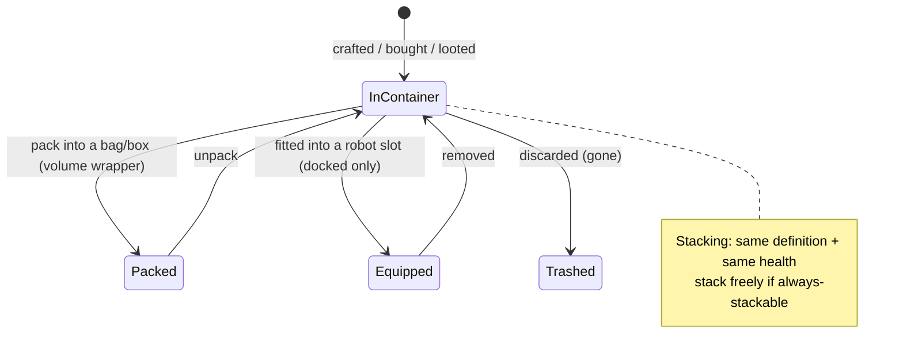

# Položky a inventář

Váš **inventář** je sada **kontejnerů** (veřejný kontejner základny, kontejner vašeho robota, tašky/krabice atd.). Tato stránka popisuje manipulaci s položkami uvnitř nich.

> Umístění v UI odpovídá [přehledu uživatelského rozhraní klienta](/cs/features/ui/). Mechaniky níže jsou potvrzeny na serveru.

## Kontejnery

- **Vypsat kontejner** — zobrazení jeho obsahu.
- **Přesunout položky** — přesun položek mezi kontejnery, ke kterým máte přístup.

Platí pravidla přístupu: některé kontejnery (hangár korporace, inventář robota, systémové kontejnery) jsou omezené — viz [roboti](/cs/features/robots/) a [skupiny](/cs/features/groups/).

## Balení a rozbalování

- **Zabalit položky** — umístění položek do tašky/krabice (kontejner typu „objemový obal") pro kompaktní přenos.
- **Rozbalit položky** — vyjmutí položek zpět z tašky/krabice.

Balení je také způsob, jak se **robot** zkomprimuje pro skladování/transport: server odstraní jeho dynamický stav a komponenty a označí ho jako *zabalěný*. Robot lze zabalit pouze tehdy, je-li **nepoškozený**, **nevybraný**, **nepojištěný** a má **prázdný inventář**. Rozbalování robot znovu sestaví a opraví. Zabalit lze pouze položky označené jako *zabalitelné* v obsahu; zabalěný robot nelze vybrat ani nasadit, dokud není rozbalen (viz [roboti](/cs/features/robots/)).

## Skládání do hromad

Mnoho položek lze skládat do hromad. Operace se skládáním:

- **Složit položky** / **složit do** / **složit výběr** — sloučení položek stejného typu do hromady (nebo přesun hromady na jinou).
- **Rozdělit množství** — oddělení konkrétního množství z hromady.

Server slučuje pouze položky se **stejnou definicí a stejným zdravím**. Položky označené jako *vždy skládatelné* (rudy, munice, většina surovin) se skládají volně; položky označené jako *neskládatelné* se nikdy neskládají; vše ostatní se může skládat **pouze v zabalěném stavu** — rozbalené, poškozené vybývání zůstává jednotlivé.

## Přejmenování a použití

- **Přejmenovat položku** — přiřazení položce vlastního názvu.
- **Použít položku** — aktivace použitelné položky (závisí na kontextu; v zóně může také interagovat s objekty zóny — viz [sběr](/cs/features/gathering/)).
- **Použít loterní položku** — otevření/aktivace loterní položky.

## Smazání a náhrada

- **Smazat položky** — zahodit položky (trvalé smazání).
- **Nahradit položku** — proces náhrady pro staff/administrátory: vytvoří položku a předá ji postavě, zapsané do transakčního logu. Hráči toto nepoužívají přímo.

## Speciální položky

- **Vyměnitelné položky** — vypsat, **vyměnit** nebo **aktivovat** vyměnitelné položky (kódy/dary).
- **Dárkové balíčky** — vypsat a **vyměnit** dárkové balíčky (sady položek).
- **Otevřít dárek** — dárek obsahuje jednu **náhodnou** položku vylosovanou z celoserverového fondu lupů (munice, surové rudy, plazma, výzkumné sady, moduly, kapsle, barvy, boostery — 221 možných definic, každá se svým rozsahem množství).

## Praktické poznámky

- **Přístup je vázán na kontejner** — můžete manipulovat pouze s kontejnery, které vlastníte nebo ke kterým máte oprávnění.
- **Zabalením přeneseš více** — tašky/krabice umožňují kompaktní přenos velkého množství položek.
- **Hromady šetří místo** — sloučte stejné položky; rozdělte, abyste vyjali přesně tolik, kolik potřebujete.
- **Smazání je trvalé** — smazané položky jsou pryč.
- **Vyměnitelné položky/dárkové balíčky jsou jednorázové** — výměna spotřebuje kód/položku.
- **Zabalení roboti jsou nečinní** — rozbalte je před výběrem nebo nasazením.
- **Skládají se pouze zabalené položky** — pokud se stejné položky neslučují, nejprve je zabalte (nebo opravte).

<!-- TODO: only the inventory UI remains.
     Confirmed: stacking rules (Item.cs CanStackTo: same ED + same health; AttributeFlags
     alwaysStackable/nonStackable; others must be repackaged); pack rules (ItemPacker.cs:
     robot must be undamaged, not selected, not insured, empty inventory; repackable
     flag); unpack rebuilds + repairs (ItemUnpacker.cs); gifts = random draw from
     giftloots (221 defs: ammo x1500-2000, epriton/fluxore x600-1000, reactor plasma
     x10-20k, research kits, paints, capsules, named3 modules, boosters, respec tokens);
     goodie packs are campaign-based (GoodiePackRedeem: campaignID + indy selection);
     ReimburseItem = admin tool (opp_reimburselog). AttributeFlags bit positions:
     nonStackable=10, alwaysStackable=11, repackable, consumable=24, deployable=23.
     Developer notes: ListContainer.cs; RelocateItems.cs; PackItems.cs / UnpackItems.cs;
     StackTo.cs / StackSelection.cs / UnstackAmount.cs; SetItemName.cs; UseItem.cs /
     UseLotteryItem.cs; TrashItems.cs; ReimburseItem.cs (PbsReimburseRequestHander.cs);
     RedeemableItemList.cs / RedeemableItemRedeem.cs / RedeemableItemActivate.cs;
     GoodiePackList.cs / GoodiePackRedeem.cs; GiftOpen.cs. Container access:
     ContainerAccess / ContainerAccessChecker.cs. -->