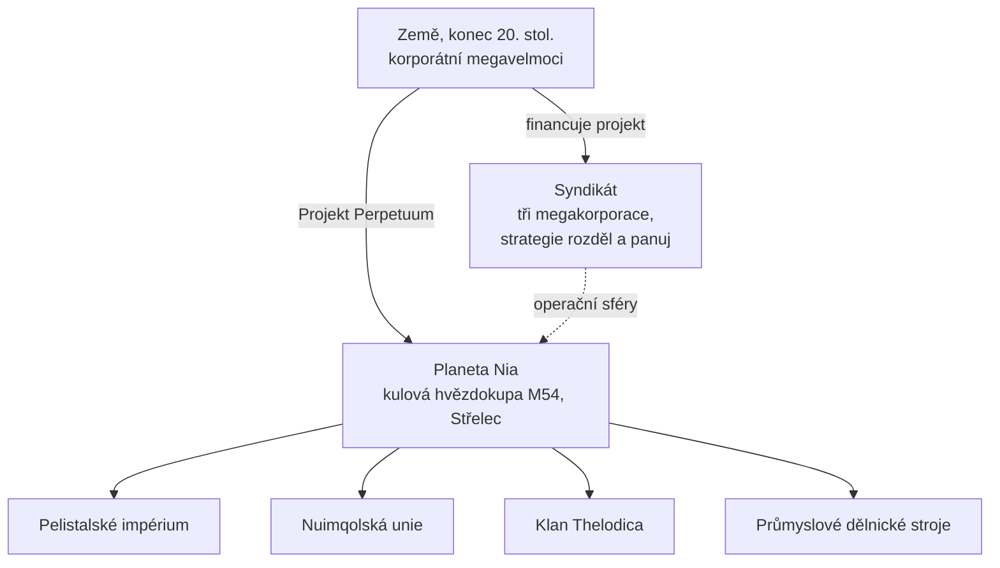

# Lore

## Objev planety Nia

Technologický boom na Zemi koncem 20. století — internet, fúze lékařství a IT, výzkum vesmíru — prolomil staré fyzické i mentální hranice. Komunikace a obchod se zrychlily a zlevnily, a velké korporace se staly de facto vládami svých regionů.

Do tohoto světa přišel objev **planety Nia** v kulové hvězdokupě M54 v souhvězdí Střelce (odtud pochází logo projektu). Nia obíhá kolem jedné z dvojice hvězd — je to čtvrtá planeta tohoto páru — a je pozoruhodně podobná Zemi: průměrná povrchová teplota se pohybuje kolem 19 °C a atmosférická hustota se blíží té pozemské. Odlišují ji dvě zvláštnosti. Její oceány jsou nepřekonatelnou překážkou pro cokoli poháněného elektřinou — husté jádro planety a její rychlá rotace je udržují neustále nabité — a pouze zhruba 17 % povrchu tvoří pevnina, kterou rychlá desková tektonika neustále trhá na ostrovy. Na této souši však život vzkvétá.

## Niané

Obyvatelé Nie bourají obvyklou definici pojmu „forma života“: jde o syntetický druh, který se svou stavbou podobá našim robotům, avšak je organizován do samostatných, technologicky vyspělých **společností** — z nichž každá má vlastní průmysl, armádu a kulturu. Úspěchem, na kterém energeticky vyčerpané Zemi záleží nejvíce, je jejich **technologie výroby energie**.

O konečné vítězství na ostrovních řetězcích svých domén bojují tři mimozemské rasy — **Pelistalské impérium**, **Nuimqolská unie** a **Klan Thelodica** — s roztroušenou populací **průmyslových** dělnických strojů mezi nimi (jde o stejné čtyři skupiny, se kterými se setkáváte jako s [NPC](/cs/features/npcs/)).

## Syndikát

Hlavním investorem Projektu Perpetuum je **Syndikát** — aliance tří nejmocnějších pozemských megakorporací, z nichž každá spravuje svou vlastní sféru operací na povrchu:

| Korporace | Doména |
|---|---|
| **Truhold-Markson** | Severoamerický gigant spotřebního průmyslu; proniká do upadající domény **Pelistalu**. |
| **ICS — Institute of Corporate Security** | Evropsko-ruské sdružení; operuje uvnitř rebelské domény **Nuimqolu**. |
| **Asintec** | Asijský průmyslový hegemon se svými high-tech sousedy; vede rozsáhlou ofenzívu proti **Klanu Thelodica**. |

Strategií je staré známé *rozděl a panuj*: udržování rovnováhy mezi těmito třemi sférami zajišťuje, že mimozemské mocnosti bojují mezi sebou, místo aby se spojily. Lidští „Agenti“ pracují na povrchu — těží energetické zdroje Nianů, studují jejich technologie a dohlížejí na mír podle představ Syndikátu.

A zde přicházíte na scénu vy.

<!--
Vývojářské poznámky: přepsáno v roce 2026 v originální próze podle kanonického zasazení.
Dřívější verze byla převzata z komunitní wiki Open Perpetuum
(perpetuum.miraheze.org: Discovery of Nia, Nia, Syndicate); tento text byl zcela
nahrazen, nikoli znovu použit.
Konzistence s backendem: tři mimozemské rasy + Industrial odpovídají NPC rasám
(viz /cs/features/npcs/); názvy korporací odpovídají zkratkám zón
(zone_ICS, zone_ASI, zone_TM — zóny beta-tieru v /zones/ jsou pojmenovány podle svých megakorporací).
-->
