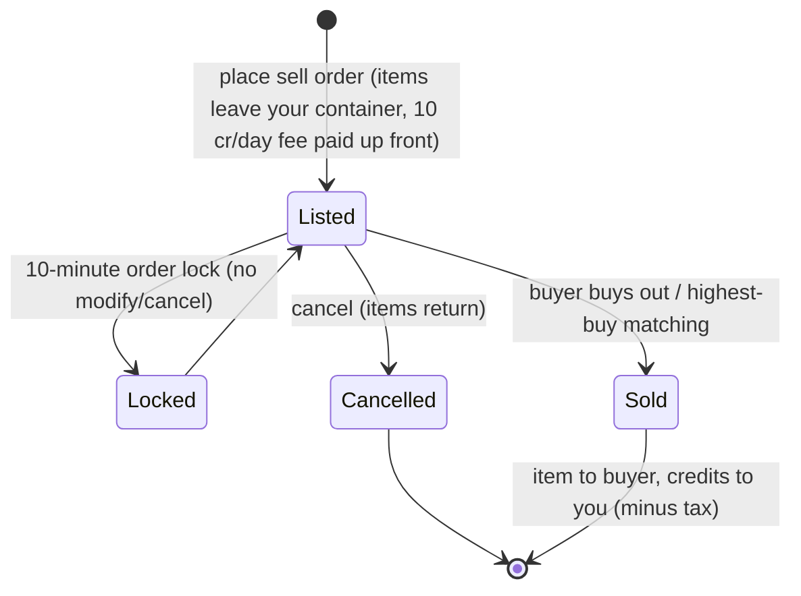

# Tržnice a obchod

**Tržnice** je místo, kde na základně kupujete a prodáváte předměty. Všechny tržní akce jsou
**pouze při dokování** (obchodujete na základně, ke které jste dokovaní).

> Umístění v rozhraní odpovídá [přehledu rozhraní klienta](/cs/features/ui/) (kategorie **Tržnice** na horní
> liště). Mechaniky níže jsou potvrzeny na serveru.

## Tržní objednávky

Na tržnici své aktuální základny můžete zadat dva typy objednávek:

### Prodejní objednávky
Vystavte předměty k prodeji.
- Vyberte **předmět**, **množství**, **cenu za kus** a **trvání** v dnech
  (minimum 1).
- Předmět je odebrán z vašeho kontejneru (pokud prodáváte část hromady, je rozbalena).
- **Poplatek za inzerát** — platíte `10 kreditů × trvání` předem (snížitelné rozšířením
  *poplatek za tržní transakce*); poplatek putuje do centrální banky základny (zónový
  ziskový fond).
- **Ochrana ceny** — pokud je zapnuta, vaše cena musí být v rozmezí **±30 %** od
  **14denní průměrné ceny** předmětu; ceny mimo toto pásmo jsou odmítnuty. *(Tato ochrana je
  na tomto serveru momentálně **vypnutá**.)*
- **Zamknutí objednávky** — objednávku nelze upravit ani zrušit po dobu **10 minut**
  od jejího zadání.
- **Počet objednávek** — můžete mít otevřeno 1 + (rozšíření *tržní expert prodejní objednávky*) prodejních
  objednávek (koupní objednávky mají vlastní počítadlo).
- **Pro mou korporaci** — můžete omezit prodejní objednávku pouze na členy
  vlastní korporace (pouze pro nedefaultní korporace).
- Platíte z **osobní** nebo **korporátní** peněženky dle situace.

### Koupní objednávky
Zadejte trvalou objednávku na nákup předmětu za danou cenu.
- Tržnice ji splní, jakmile se objeví odpovídající prodej.

### Správa objednávek
- **Upravit objednávku** — změnit cenu/množství/trvání.
- **Zrušit předmět / objednávku** — stáhnout ji (předmět se vrátí do vašeho kontejneru).
- **Moje předměty** — zobrazit své otevřené objednávky.
- **Dopadnutí na nejvyšší koupní cenu** — prodej může být směrován na existující koupní objednávku.

## Přímý nákup

- **Koupit předmět** — okamžitě koupit předmět, který je na tržnici (bez trvalé objednávky).

## Prohlížení tržnice

- **Seznam předmětů / dostupné předměty / předměty v dosahu** — prohledat, co je k prodeji.
- **Informace o tržnici** — podrobnosti o tržnici základny.
- **Průměrné ceny** — tržní průměr, průměr podle definice a **globální** průměr.
  Tyto hodnoty jsou základem pro ochranu ceny.

## Tržní daň

- **Změnit tržní daň** — nastavit sazbu daně na tržnici. Pouze **tržnice PBS základny**
  jsou řízeny hráči; všude jinde platí pevná výchozí sazba.
- **Deník daně** — prohledat změny daně.

Daň se odečítá od částky, kterou **prodávající** obdrží při tržním prodeji. Výchozí sazba je
**12 %** (prodávající dostane 88 % prodejní ceny); sazbu lze snížit rozšířením *tržní
transakční daň* a na hráči řízených tržnicích také nastavením vlastní sazby vlastníkem PBS.

## Přímé obchody mezi hráči

**Obchod** je přímá výměna mezi dvěma dokovanými postavami:

- **Začít obchod** — spustit seanci s jiným hráčem.
- **Nastavit / stáhnout svou nabídku** — umístit předměty/kredity na svou stranu.
- **Přijmout** — obě strany přijmou a výměna se dokončí atomicky.
- **Zrušit** — přerušit obchod.
- **Obchod dokončen / stav** — dokončení a aktuální stav.

Postava si může **blokovat obchody** (viz [základní návod](/cs/features/getting-started/)).

## Obchod s předměty

**Obchod s předměty** je prodejce s pevnými cenami na základně (nerízený hráči). Úplný
katalog (každý předmět, množství, cena za měnu, požadovaný standing) je generován v
[Obchod s předměty](/content/shop/).

- **Seznam** — zobrazit, co obchod prodává.
- **Koupit** — koupit předmět za kredity.

## Převádění kreditů

- **Převést kredity** mezi vlastními postavami (viz [základní návod](/cs/features/getting-started/)).

## Praktické poznámky

- **Vše je pouze při dokování** — v zóně nelze obchodovat.
- **Započítejte 12% daň do svého ceníku** — prodávající obdrží výchozí 88 % uvedené ceny
  (na PBS tržnicích s vysokou daní méně).
- **Poplatek za inzerát se platí předem** — dlouhodobý inzerát stojí více, i když se prodá
  už první den.
- **Objednávky pouze pro korporaci** jsou způsobem, jak přesouvat zboží uvnitř korporace
  bez veřejné expozice.
- **Obchody jsou atomické** — obě strany musí přijmout, jinak se nic nepohne.
- **Změny daně ovlivňují efektivní náklady** — započítejte tržní daň do svého ceníku.

<!-- TODO: only the client UI remains (market and trade screen flows).
     Confirmed: MarketInfoService(0.3, 10, false) registered in
     PerpetuumBootstrapper.cs -> margin +-30% vs 14-day average (MARKET_AVERAGE_DAYSBACK
     14), fee 10 credits/day (Market.MARKET_FEE), CheckAveragePrice=false on this
     server; DEFAULT_MARKET_TAX = 0.12 (seller gets 88%), player-controlled tax only on
     PBSDockingBase markets (MarketTaxHelper); order modify/cancel locked 10 min after
     submit (MARKET_CANCEL_TIME); order count = 1 + expert extension bonus;
     fee paid up front to the base's central bank. -->
     Developer notes: Markets/MarketCreateSellOrder.cs (docked, price guard vs average
     price, corp-only, unstack, corp wallet), MarketCreateBuyOrder.cs,
     MarketModifyOrder.cs, MarketCancelItem.cs, MarketBuyItem.cs, MarketItemList.cs,
     MarketAvailableItems.cs, MarketItemsInRange.cs, MarketGetMyItems.cs,
     MarketGetAveragePrices.cs / MarketGetDefinitionAveragePrice.cs /
     MarketGlobalAveragePrices.cs, MarketTaxChange.cs / MarketTaxLogList.cs;
     Trade*.cs (begin/offer/accept/cancel, atomic); ItemShopList.cs / ItemShopBuy.cs;
     CharacterTransferCredit.cs. -->