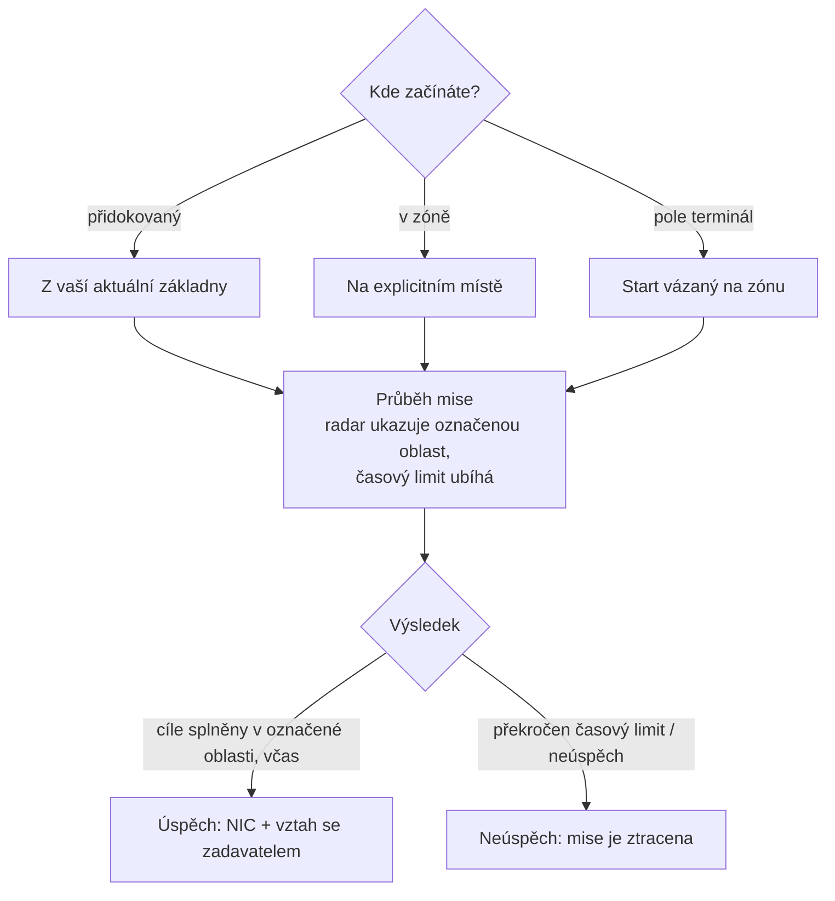

# Mise

**Mise** jsou strukturované cíle, které přijímáte v zóně — doručování předmětů, zásahy na cíle,
používání struktur. Jsou způsobem, jakým postupujete, získáváte odměny a poháníte velkou část
obsahu zón (alarmy, kiosky a některé PBS/transportní háčky jsou s misemi spojené).

> Umístění v UI odpovídá [přehledu uživatelského rozhraní klienta](/cs/features/ui/). Mechaniky níže
> jsou potvrzeny na serveru.

## Spuštění mise

Misi spustíte výběrem **kategorie** a **úrovně** (úrovně jsou omezeny na
platný rozsah) na **místě**:

- Pokud jste **přidokovaný**, mise se spustí z místa vaší aktuální základny.
- Pokud jste **v zóně**, místo zadáte explicitně.
- Mise se mohou spustit také **přímo z zóny** (start vázaný na zónu) nebo **z pole
  terminálu**.

Ne každá kategorie/úroveň je k dispozici všude — dostupnost je řízena obsahem.
Úplný seznam misí (typ, kategorie, úroveň, doba trvání, odměnný poplatek a odměnové předměty)
je generován v [Mise](/content/missions/).

## K čemu mise slouží

Mise slouží současně dvěma účelům: vyplácejí NIC a budují váš **vztah**
s vydávající (zadavatelskou) korporací. Lepší vztah je klíčovým faktorem pro
získání **vyššího poměru kapacit** na terminálech dané korporace — výroba a
jiné provozní akce se pro vás stanou levnějšími a rychlejšími. Vztahy se mohou také *zhoršovat*:
některé mise jsou v rozporu s zájmy jiné korporace a v úkolu je uvedeno,
kdy vám to bude stát postavení.

- **Tréninkové mise** — snadné, zvýrazněné pro začátečníky; splňte je všechny, odměny
  jsou příjemný raný přívod.
- **Pravidelné mise** se dělí do tří typů:
  - *Bojové* — průzkum (naskenujte nepřátelské roboty), lov odměn (zabijte cíle v označeném
    kruhu), zničení a záchranu (zabití + záchran + doručení), průzkum a záchranu, speciální
    odměny (těžko dostupné cíle).
  - *Průmyslové* — geologie (naskenujte minerál s vhodným nábojem), těžba, těžba minerálů,
    odborná těžba (strážená těžební místa — přiveďte ozbrojenou pomoc).
  - *Logistické* — přeprava (doručte balík mezi terminály) a záchranu
    (velký balík přes nebezpečné území — doprovodte ho).
- Neexistuje taková věc jako **bezpečná mise**: pokud na trase vidíte nepřátele a
  nemáte vybavení na obranu, požádejte o pomoc, než ztratíte vše po cestě.
- **Cíle se počítají pouze v označené oblasti** — mapa mise ji označuje
  červeným kruhem na radaru; zabití a skeny jinde se nepočítají. Překročením časového limitu
  mise okamžitě selže.
- **Soukromé přepravní smlouvy** — systém provozovaný Syndikátem (druhá záložka okna mise),
  kde hráči zadávají kontejnery pro přepravu mezi terminály jinými hráči,
  s pevnou odměnou a **záložou**, kterou přepravce vsadí (vrácena při úspěchu, ztracena,
  pokud je kontejner zničen; přerušení na cestě vrátí pouze polovinu). Udržujte kontejnery
  dostatečně malé, aby je někdo skutečně mohl nést.

## Data mise a možnosti

- **Data mise** — podrobnosti mise.
- **Možnosti mise** — dostupné volby/varianty mise.
- **Vybavení mise** — zásoby, které mise zahrnuje.
- **Startovní předměty** — předměty, s nimiž mise začíná.

## Průběh mise

- **Seznam aktivních misí** — co právě děláte.
- **Přerušit** — zrušit misi, kterou právě plníte.
- **Přidat účastníka** — přineste dalšího postava do mise (misi více hráčů).
- **Deník mise** — protokol událostí mise.

## Doručování

- **Doručit** — dokončit doručovací cíl. To lze provést **přidokovaný** (na základně) nebo
  **v zóně** (na konkrétním místě/eid), v závislosti na misi.

## Agenti

- **Seznam agentů** — dostupní agenti mise (NPC/frakce, které vydávají mise).

## Pole terminály

- **Informace o pole terminálu** — prozkoumejte pole terminál v zóně (struktura, která může
  spouštět nebo obsluhovat mise).

## Praktické poznámky

- **Mise jsou spojovací tkání** — alarmy, kiosky a některé struktury jsou
  objekty mise (viz [sběr](/cs/features/gathering/) a [boj](/cs/features/combat/)).
- **Více hráčů** — můžete přidat účastníky pro spolupráci na misi.
- **Kontext doručování má význam** — některá doručování vyžadují, abyste byli přidokovaný,
  jiná vyžadují, abyste byli na místě v zóně.
- **Úroveň je omezena** — požadování úrovně mimo rozsah je korigováno, nejde o chybu.
- **Přerušení je váš východ** — pokud mise zhorší, přerušte ji.

## Struktury mise

Mise jsou ukotveny v zónách pomocí **struktur**. Server implementuje tyto typy:

| Struktura | Co dělá |
|---|---|
| **Jednoduchý přepínač** | okamžitá interakce — přiblížte se a cíl mise se dokončí |
| **Alarmový přepínač** | časovaná úloha — zůstaňte v dosahu po určitou dobu (z možností mise), kontrolováno každé 2 s |
| **Dodávka předmětů** | časovaná jako alarmový přepínač, poté **vytvoří předměty do kontejneru vašeho robota** |
| **Kiosku** | bod **odezdání předmětů** — předáte misi požadované předměty |

<!-- TODO: the full mission list, categories, level ranges and rewards are generated at
     /content/missions/. Verified: mission structure types
     (MissionEngine/MissionStructures: SimpleSwitch, AlarmSwitch, ItemSupply, Kiosk);
     verify the mission UI.
     Developer notes: Missions/MissionStart.cs (category, level clamp, docked vs zone
     location), Missions/MissionDeliver.cs (docked vs zone delivery), MissionAbort.cs,
     MissionData.cs / MissionGetOptions.cs / MissionGetSupply.cs / MissionStartItems.cs,
     MissionListRunning.cs / MissionListAgents.cs / MissionLogList.cs,
     MissionPlayerAddsParticipant.cs, FieldTerminalInfo.cs, MissionStartFromZone.cs;
     Services/MissionEngine/* (MissionProcessor, mission structures incl. AlarmSwitch,
     Kiosk). -->