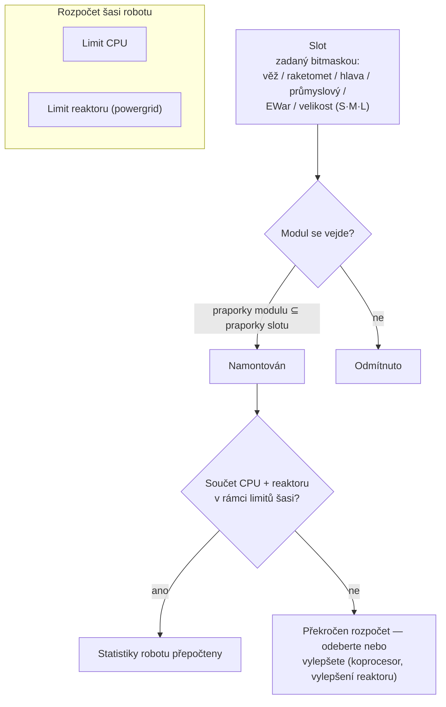

# Moduly a sestavení

„Koupi robotu získáte jen šasi." Vybavení moduly je to, co z robotu dělá to, co potřebujete. *Sestavení* znamená jak výbavu modulů („pošli mi své sestavení"), tak i rozpočet CPU/reaktoru, který spotřebuje.

## Sloty a zdroje

Šasi robotu má pevně daný soubor **slotů**, definovaný jeho šasi. Každý slot je typován bitmaskou — věž, raketomet, hlava, průmyslový, EWar/inženýrský, velikost (malý / střední / velký) — a modul se vejde do slotu pouze tehdy, když je jeho vlastní typová maska podmnožinou masky slotu. Slot věže na casteru tak přijme malý, střední *nebo* velký modul věže, ale raketomet se nikdy nevejde do slotu věže. Moduly hlavy (koprocesory, ladicí moduly) a moduly šasi/nohou (pancéřové desky, rámy) obsazují své vlastní dedikované sloty.

Každý modul čerpá **CPU** a **reaktor** (powergrid) ze šasi — součet všeho namontovaného musí zůstat pod oběma limity, a některé moduly navíc čerpají **akumulátor** (jádro) za cyklus. Zbývající kapacita je *dostupný výstup* zobrazený v okně sestavení. Přibližná škála šasi (příklady T1/T2/T3):

| Třída šasi | CPU | Reaktor | Příklad |
|---|---:|---:|---|
| Malý crawler | ~250 | ~140 | Castel |
| Lehký mech | ~480 | ~300 | Waspish |
| Těžký mech | ~1 100 | ~1 000 | Tyrannos |
| Walker | ~3 200+ | ~1 100+ | Gropho |

Když vám chybí kapacita: **CPU** — koprocesorové moduly (např. T3 koprocesor dává +20 % CPU) nebo T2 varianty modulů (nižší odběr). **Reaktor** — vylepšení reaktoru (např. T3 dává +20 % výstupu reaktoru) nebo utěsnění reaktoru (sníží radiaci, což vás také chrání před EnWar — viz níže).

## Rodiny modulů

Čísla pro jednotlivé modely najdete v [katalogu předmětů](/content/) a v [referenci formátů](/cs/formats/); toto je mapa rodin.

### Zbraně a munice

Čtyři technologie zbraní, každá se svou municí a profilem dosahu:

| Zbraň | Munice | Profil dosahu | Poznámky |
|---|---|---|---|
| **Palné zbraně** | Střely | Krátký optimální dosah, velký úbytek | Projektil, který *nikdy netrefí vedle* — ale jeho „přesnost" funguje jako poloměr oblasti, takže malé cíle stále dostávají snížené poškození od širokých salv. |
| **Magnetické (drakotry)** | Granáty | Střední dosah, ostrý úbytek | Vysoká dopadová rychlost; velký energetický odběr. |
| **Lazery** | Energetické buňky | Dálkový dosah | Největší energetický odběr; soustředěné paprsky. |
| **Rakety** | Rakety | Dálkový dosah | Trefa nebo meška je rozhodnuta statistikou *trefnosti robotu*, ne vzdáleností. Poškození škáluje podle velikosti cíle vzhledem k poloměru exploze — velké rakety na malé cíle trefí za mnohem méně. |

Poškození klesá s vzdáleností podle hladké kosinové křivky: plné poškození v optimálním dosahu, nula v optimálním + úbytek (viz [úbytek poškození](/cs/features/combat/#typy-poskozeni)).

Munice je to, čím ladíte poškození: primární + sekundární typy poškození umožňují jemné doladění proti cíli (viz [typy poškození](/cs/features/combat/#typy-poskozeni)) — na úkor trochu celkového poškození oproti čistě primární munici.

Věže se dělí na malé/střední/velké; **přizpůsobte velikost robotu** (malí boti používají malé moduly, mechy a těžké střední/velké).

### Obrana

- **Pancéřové desky** — hlavní pool životů; když brnění klesne na nulu, robot exploduje. **LWF** (lehký rám) desky obětují odolnost za rychlost: T2 LWF deska násobí brnění ~0,73, ale dává +19 % rychlosti, −0,2 signatury a −0,2 hmotnosti.
- **Generátor štítu** — bariéra napájená akumulátorem, která pohlcuje poškození před brněním. Štít spotřebuje *váš vlastní jádrový zdroj* k pohlcování: zásah, který by způsobil 100 poškození na 2× štítu, čerpá 50 jádra místo 100 brnění. Zatímco je štít aktivní, vaše vlastní zbraně nemohou střílet. Kvalita pohlcování škáluje podle poloměru štítu vzhledem k vaší signatuře — velké štíty na malých šasích fungují nejlépe.
- **Oprava brnění** — aktivní opravné moduly (malé/střední/velké); **vzdálená oprava brnění** dosáhne na zamčený cíl (spolubojovníci, nebo PBS), ale má krátký dosah a delší cyklus.
- **Zpevňovače brnění** — pasivní body odolnosti pro každý typ poškození (chemické / kinetické / tepelné / výbušné varianty).
- **Adaptivní slitina** — pasivní modul, který *učí se* mixu poškození, které dostává, a přerozděluje pevný pool bodů odolnosti směrem k tomu, čím jste nejčastěji trefeni.
- **Vyhybání / manévrování** — moduly snižující signaturu a NEXUS (viz níže) zmenšují cíl: méně poškození z plošných efektů a těžší zamčení.

### Energie

- **Reaktor** — limit udržitelného výstupu; vylepšení reaktoru jej zvyšují, utěsnění reaktoru snižuje radiaci (méně EnWar poškození, za malou cenu reaktoru).
- **Akumulátor (jádro)** — zásoba výbušné energie, která napájí cykly modulů. Nabíjí se v čase (šasi `core_recharge_time`, ~120 ms na T1 crawleru); **nabíječe akumulátoru** zrychlí nabíjení.
- **Energetické injektory (zesilovače jádra)** — spotřebují náboj a okamžitě doplní akumulátor.
- **Přenosníky energie** — paprskují jádro z vašeho robotu na zamčeného spojence (hráči nemohou paprskovat NPC).

### Elektronika

- **Zesilovač senzorů** — pasivní, vlastní: zkracuje váš čas zamčení a prodlužuje dosah zamčení.
- **Vzdálený zesilovač senzorů** — aktivní, cíl: stejné posílení aplikované na zamčeného spojence po ~10,5 s.
- **Koprocesory** — zvyšují limit CPU šasi (T1 +10 % … T3 +20 %).
- **Stabilizátory zbraní** — zlepšují přesnost zbraní (menší efektivní poloměr oblasti) a trochu snižují hmotnost.
- **Ladicí moduly** (sloty hlavy) — plošné bonusy pro konkrétní rodiny: moduly poškození (+25 % poškození za rodinu zbraní na T3), vylepšení těžby (+10 % těžba a sběr na T3), vylepšení opravářů (+16 % oprava, −8 % cyklus na T3).

### Elektronická válka (EWar)

Zneviditelněte a zneuchatněte nepřítele:

- **Tlumič senzorů** — dálkový debuff: prodlužuje čas zamčení cíle a krátí jeho dosah zamčení po ~5,5 s. Zafunguje jen tehdy, když vaše ECM síla porazí (randomizovanou) sílu senzorů cíle.
- **Rušička senzorů** — okamžitá: při úspěšném ECM testu resetuje *všechny* zámky cíle.
- **ECCM** — vlastní buff na 20 s: zvyšuje sílu senzorů a odolnost proti zamčení, a *vyléčí* ECM-zranitelné debuffy (tlumiče, sítě).
- **Neuralyzér** — resetuje zámky **všech** hráčů v dosahu ~1,65 km. Tlačítko paniky.

Protihra: síla senzorů (šasi), ECCM a udržování vzdálenosti.

### Skrytost a detekce

- **Modul skrytosti** — ~10,5 s skrytosti; odběr škáluje podle poloměru vaší signatury (větší šasi, rychlejší spotřeba jádra).
- **Označovač cílů** — debuff na ~10,5 s, který odejme cíli sílu skrytosti.
- **Detekční modul** — pasivní posílení vaší síly detekce.

Síla detekce vs. síla skrytosti rozhoduje, zda vůbec můžete vidět (a zamknout) skrytý cíl — viz [detekce a maskování](/cs/features/combat/#detekce-maskovani-a-rychlost).

### Energetická válka (EnWar)

Odsávejte nebo ořízněte energii nepřítele:

- **Odsávače (energetické upíři)** — odsávají jádro z zamčeného cíle a přidávají ho do vašeho akumulátoru.
- **Neutralizátory** — totéž, ale odsáté jádro je zničeno.
- Oba jsou oslabeny **radiací reaktoru** cíle — utěsnění je skutečná protihra.
- **Demobilizátory (sítě)** — snížení rychlosti cíle na ~5,5 s; efekt škáluje podle hmotnosti cíle (těžká šasi jsou zpomalena méně) a selže proti cílům mimo optimální dosah modulu.
- **Spalovač** — elektrická zbraň, která *řetězově* zasáhne až 5 cílů, trefuje štíty i brnění pronikavým poškozením.

### Průmyslové

- **Vrtáky** (malé / velké) a **sběrače** (malé / velké) — sběrové moduly; výnos, čas cyklu a odběr akumulátoru jsou statistiky, které se počítají. Těžba dává EP (s denním limitem a trestem za tekutiny).
- **Geoskenr** — skenuje minerální pole kolem vás s přesností sondy; výsledek je mapa toho, co je pod zemí (viz [sběr](/cs/features/gathering/)).
- **Výkopový modul** — aura modul: posiluje výnos těžby/sběru blízkých jednotek (T3: +50 %) na úkor skrytosti.
- **Terraforming** (gammové zóny) — zámky terénu, které zvedají, snižují nebo vyrovnávají zem (max. poloměr 5 m) a pěstují stěnové rostliny; viz [sekce zón](/zones/zone-gamma-z106/).
- **Vzdálené ovladače** — věže a drony na vodítku: každý ovladačový modul nese propustnost (kolik), operační dosah a životnost dronu (5–10 min podle tieru). Varianty: taktické (poškození/cyklus), útočné (poškození), podpůrné (vzdálená oprava), průmyslové (těžební/sběrové drony), lovec. Modul **vzdálený překladač příkazů** zesiluje poškození dronů, brnění, výnos těžby a výstup opravy (T3: +7,5 % každý) a může prodloužit propustnost ovladače.

### NEXUS

Networked Extension Utilization Systems: **buffy pro skupinu**. NEXUS modul vysílá aura kolem vlastního robotu, která posiluje **členy skupiny** (a jejich věže/drony) v poloměru aury — výchozí 10 m, obnovitelná každých 10 s. Pravidla:

- robot může nést maximálně **3 NEXUS aury** a maximálně **jednu každého typu**;
- aura dosáhne pouze na jednotky ve vaší **skupině**, ne na náhodné spojence.

Seznam T3 typů (13): rychlost, brnění, štít, dálkové zamčení (dosah zamčení), zesilovač zamčení (čas zamčení), kritický zásah, útok (cyklus zbraní), EW (dosah EWar), vyhybání (signatura), opravář, průmyslový (odběr akumulátoru při sběru), rychlý extraktor (cyklus sběru), nabíječka (nabíjení jádra). Každý T3 modul dává přibližně +7,5 % své statistiky; např. NEXUS rychlosti násobí maximální rychlost 1,075 pro každého spolubojovníka stojícího v dosahu 10 m.

### NOX

Kultistické protihry: **negátorové** moduly, které *znevýhodní* nepřátelské moduly uvnitř jejich poloměru — **negátor štítu** (krátí pohlcování štítu o ~90 %), **negátor opravy** (krátí výstup opravy) a **negátor teleportu** (blokuje teleportování). Každé aktivace **spotřebuje plazmu** z vašeho nákladu, a použití na otevřené (netréningové) zóně **označí vašeho postavu pro PvP**.

### Zvláštní účel

- **Obléhací hack modul** — aktivní SAP nástroj: 5 s cyklus, 3 m dosah (viz [outposty](/cs/features/outposts/)).
- **Samočinné zničení** — spustí 8sekundový odpočet; paprsek je viditelný do 600 m. Poslední možnost úklidu.
- **Detektor min** — prodlužuje dosah detekce min šasi.
- **Vysílače blobů** — nasadí vysílač, který rozšiřuje blob pole; modul modulatoru emise ladí pole (viz [boj](/cs/features/combat/)).
- **Konstrukce PBS** — modul používaný k umístění PBS struktur na gammových zónách.

## Zlatá pravidla

1. **Nemíchejte zbraně.** Magnetické + lasery + rakety na jednom botu obvykle podávají horší výkon než všechny tři samostatně; míchání krátkého a dlouhého dosahu málokdy dobře skončí.
2. **Dbejte na hmotnost.** Každá pancéřová deska a štítový modul přidává hmotnost a signaturu — někdy rychlost znamená víc než obrana.
3. **Nedělejte všechno.** Bot, který těží, skenuje a střílí, nedělá nic tak dobře jako specialista.
4. **Přizpůsobte velikost modulů** robotu a nechte trochu CPU/reaktoru na ladicí moduly, které build skutečně fungovat.
5. …a ano, některá nišová sestavení poruší všechna výše uvedená pravidla a stále fungují. Jen si to trochu promyslete.

<!--
Poznámky pro vývojáře: přepsáno 2026 z backendových zdrojů; žádný text z komunitní wiki nebyl opakován.
Ověřeno proti:
- src/Perpetuum/Robots/RobotComponent.cs (bitmaskové sestavení slotů: moduleFlagMask & slotFlagMask)
- src/Perpetuum/Modules/SlotFlags.cs (12 bitů slotových praporků)
- src/Perpetuum/Modules/Weapons/WeaponModule.cs + FirearmWeaponModule.cs +
  MissileWeaponModule.cs (přesnost: palné zbraně nikdy netrefí vedle, poloměr exploze z
  Accuracy; rakety používají ParentRobot.MissileHitChance)
- src/Perpetuum/Modules/Weapons/Damage.cs (kosinový úbytek, kritické 1,75x ±10 %,
  škálování exploze signature/explosionRadius omezeno [0,1])
- src/Perpetuum/Units/Unit.cs GetResistByDamageType (resist/(resist+100))
- src/Perpetuum/Zones/DamageProcessors/DamageProcessor.cs (štít čerpá jádro,
  elektrické = pronikavé)
- src/Perpetuum/Modules/EffectModules/ShieldGeneratorModule.cs (modifikátor pohlcování
  = poměr shieldRadius / shieldAbsorbtion; WeaponModule.cs:112 blokuje střelbu
  při HasShieldEffect)
- src/Perpetuum/Modules/EffectModules/{Webber,SensorDampener,SensorBooster,
  Stealth,TargetPainter,Eccm,Detection,AdaptiveAlloy}.cs (délky z tabulky efektů:
  tlumič/síť 5,5 s, skrytost/označení/vzdálené posílení 10,5 s, ECCM 20 s)
- src/Perpetuum/Modules/SensorJammerModule.cs + Neuralyzer.cs (reset zámků,
  NEURALYZER_RANGE=1650)
- src/Perpetuum/Modules/{EnergyVampire,EnergyNeutralizer,Scorcher,
  CoreBooster,EnergyTransferer}.cs (EnWar, modifikátor radiace reaktoru, řetězec)
- src/Perpetuum/Modules/GangModule.cs + Zones/Effects/GangEffect.cs +
  EntitiesModule.cs:532-544 (13 typů aur, pouze členové skupiny, tabulka efektů
  auraradius=10)
- src/Perpetuum/Modules/NoxModule.cs (spotřeba plazmy, PvP příznak)
- src/Perpetuum/Modules/RemoteControl/* (propustnost/dosah/životnost, zesílení
  překladačem)
- řádky entitydefaults: named1-3 pancéřové desky/zpevňovače, generátory štítů
  (absorbtion 2,0–2,3, radius 5–33), LWF (mass_reductor), vylepšení CPU/powergrid,
  ladicí moduly poškození/těžby/opraváře, hodnoty NEXUS named3, hodnoty NOX cultist,
  obléhací hack (5 s/3 m), core_max/powergrid_max šasi.
Korekce oproti importované stránce: NEXUS aury dosahují pouze na členy skupiny
(ne „všechny přátelské jednotky"); modul „ko-reaktor" neexistuje (reaktorová
vylepšení/utěsnění to dělají); efekt demobilizátoru škáluje podle hmotnosti cíle,
neexistuje „statistika odolnosti"; tlumič senzorů = tlumič senzorů (debuff 5,5 s).
-->