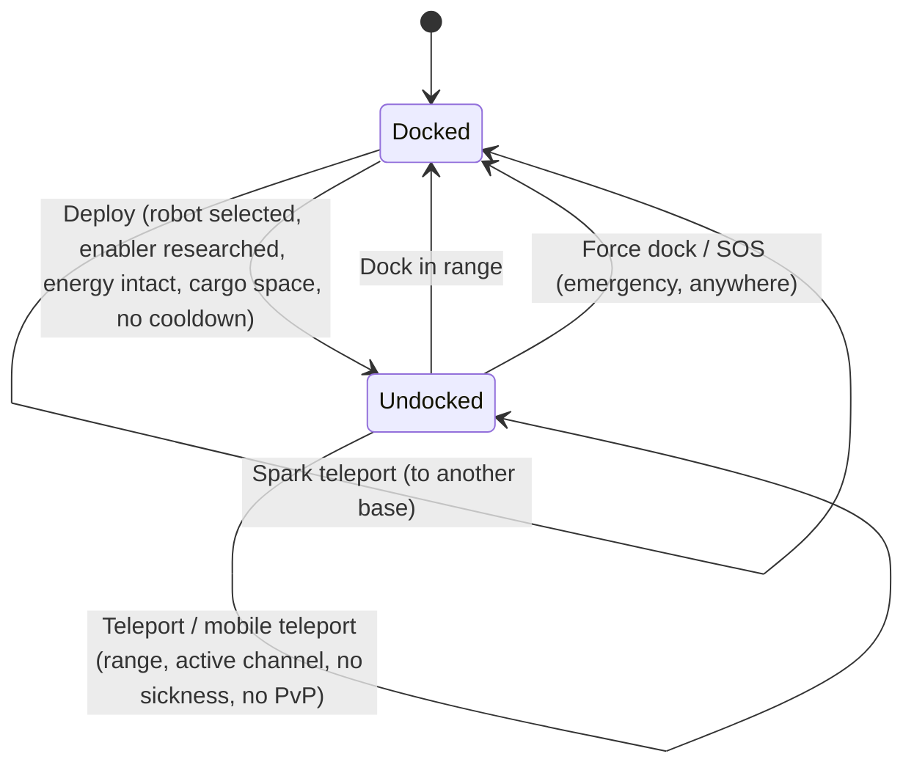

# Pohyb a zóny

Vždy se nacházíte v jednom ze dvou stavů: **zdokovaní** na bází nebo **mimo dok** v zóně, kde na dálku ovládáte svého aktivního robota. Vše na této stránce se týká přechodu mezi těmito stavy a mezi zónami.

> Umístění v uživatelském rozhraní odpovídá [přehledu UI klienta](/cs/features/ui/): **tlačítko Nasadit/Zdokovat** je přepínač uprostřed horní lišty. Mechaniky níže jsou potvrzeny na serveru.

## Zdokovaný vs. mimo dok

- **Zdokovaný** — nacházíte se na bází. Vaši roboti a předměty jsou v kontejnerech. Nemůžete
  ovládat robota, používat teleporty ani skenovat, ale můžete vyrábět, obchodovat,
  provádět výzkum a využívat zařízení báze.
- **Mimo dok** — nacházíte se v zóně a ovládáte svého aktivního robota. Můžete se pohybovat,
  skenovat,
  bojovat a
  interagovat s objekty v zóně, ale většina aktivit dostupných pouze na bází je zamčená.

## Vykročení z doku

Stiskněte **Nasadit** (uprostřed horní lišty). Server poté ověří následující:

1. Máte vybraného **aktivního robota**.
2. Třída tohoto robota má na vašem
   postavě vypracované požadované **umožňující rozšíření** (viz [výzkum](/cs/features/research/)).
3. **Energetický systém** robota je nepoškozený.
4. **Kontejner** robota má volnou kapacitu.
5. Není aktivní **cooldown vykročení** (krátký časovač po určitých událostech).

Pokud kterékoliv ověření selže, vykročení bude zamítnuto.

## Návrat do doku

- **Zdokovat** se na bází, když se nacházíte v dosahu jejího dokovacího pole.
- **Vynucené zdokování** je nouzová akce: okamžitě vás vytáhne z zóny a zdokuje na
  hlavní bází (TMA), i uprostřed boje. Použijte ji, když prohráváte souboj.
- **SOS** — nouzová akce v zóně, která vás zdokuje na aktuální bází a označí incident.

## Fronta pro vstup do zóny

Některé zóny jsou vytížené a při vykročení / vstupu používají **frontu pro vstup**:

- Zkontrolujte stav fronty (`zoneGetQueueInfo`).
- Nastavte preferovanou délku fronty (`zoneSetQueueLength`).
- Zrušte čekání, pokud si to rozmyslíte (`zoneCancelEnterQueue`).

## Teleporty

**Teleporty** jsou struktury uvnitř zóny. K jejich použití:

- Musíte se nacházet **v dosahu teleportu**.
- **Kanál** (cíl) musí být **aktivní** a platný.
- Nesmíte být pod vlivem *nemocí z teleportu* — krátkého cooldownu po každém teleportu,
  během kterého nemůžete teleportovat znovu.
- Určité efekty (např. negace *Noxu*) nebo **boj v PvP** mohou teleporty blokovat.

Teleportní kanály se dělí do tří typů:

| Typ | Efekt |
|---|---|
| **V rámci zóny** | Přesune vás na náhodný bod ve stejné zóně |
| **Do jiné zóny** | Přesune vás na náhodný bod v jiné zóně |
| **Výstup z tréninku** | Ukončí tréninkovou zónu (s možností odměnové úrovně) |

**Mobilní teleporty** jsou *vlastnické* teleportní předměty (např. mobilní teleporty pevnosti/světa).
Platí pro ně další pravidla:

- Použít je může pouze **vlastník nebo člen gangu vlastníka**.
- **Nelze je používat během PvP**.
- Každé použití aplikuje **cooldown** na daný teleport.

Můžete si vypsat teleporty a jejich kanály a dotazovat se na kanály ve světě.

## Iskraté teleporty

**Iskraté teleporty** jsou systém rychlého cestování mezi bázemi:

- Na jedné bází **nastavíte** cíl iskratého teleportu a poté ho **použijete** (vzdokovaném stavu)
  pro okamžitý skok na jinou bázi.
- Iskraté teleporty můžete **vypsat, nastavit, použít a smazat**.
- Cílová báze musí pro vás **povolovat dokování**.
- Při příjezdu server za vás vybere vhodného robota (takového, jehož umožňující rozšíření
  máte vypracovaná).
- **Počet iskratých teleportů, které můžete držet**, je omezen rozšířením
  (viz [výzkum](/cs/features/research/)); překročení limitu je zamítnuto.

## Brány

**Brány** jsou zónové struktury, které lze použít odkudkoli (na rozdíl od teleportů
nejsou omezeny dosahem). Vlastník báze si může **přejmenovat** své brány.

## Informace o bázích

Jakoukoli bázi si můžete prozkoumat:

- **Informace** — co to je a kde se nachází.
- **Vlastnictví** — kdo je vlastník.
- **Zařízení** — co nabízí (produkce, trh, obchod, …).
- **Moje předměty** — vaše předměty uložené na dané bází.
- **Práva k dokování** — vlastník báze může nastavit, kdo se tam může zdokovat.

## Co může jít špatně

| Příznak | Pravděpodobná příčina |
|---|---|
| Vykročení zamítnuto | Žádný aktivní robot, chybí umožňující rozšíření, poškozený energetický systém, plný kontejner robota nebo cooldown vykročení |
| Teleport zamítnut | Mimo dosah, neaktivní kanál, nemoc z teleportu, efekt Noxu nebo PvP |
| Mobilní teleport zamítnut | Nejste vlastník / člen gangu, nebo jste v PvP |
| Iskratý teleport zamítnut | Cílová báze zakazuje dokování, není k dispozici platný robot nebo byl dosažen limit iskratých teleportů |
| Zaseknutí ve frontě zóny | Fronta zóny — zkontrolujte stav fronty nebo ji zrušte |

<!-- TODO(Phase 1): verify client UI flow (dock/undock buttons, teleport screen).
     Developer notes: Dock.cs / Undock.cs / ForceDock.cs (TMA = baseEid 561) /
     ZoneSOS.cs; Zone/TeleportUse.cs (TeleportPlayerValidator, three
     TeleportDescriptionType strategies, mobile-teleport gang/PVP rules);
     Sparks/SparkTeleportUse.cs (docked-only, extension-count limit);
     Zone/ZoneCancelEnterQueue.cs + ZoneEnterQueueService; GateSetName.cs. -->