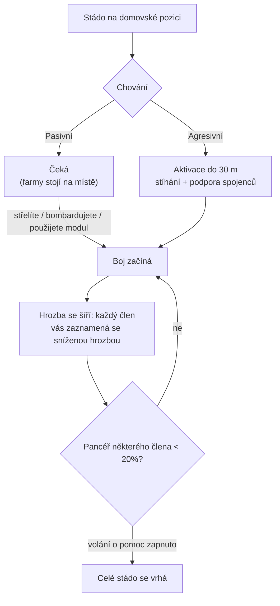

# NPC a PvE lov

NPC jsou hlavním zdrojem [reaktorového plazmatu](/content/ores/),
[jader](/cs/features/research/) a modulů a spolehlivým způsobem, jak získávat
body rozšíření na jakékoli úrovni. Existují ve **stádech**: skupinách, které
sdílejí domovskou pozici, domovské území, čas znovuvygenerování a chování.

## Kdo se tu pohybuje

NPC se dělí do čtyř ras — **Nuimqol, Pelistal, Thelodica a Industriální** —
každá s několika robotními třídami (běžci, plazi, mechové, těžké mechové)
a stupni 1–5, které škálují statistiky a kořist. Kromě běžných stupňů:

- **Goblini** — EWar strážci na chráněných ostrovech. Křehcí, ale jejich
  modifikátory zamknutí jsou extrémní (zamknou vás ~5× rychleji než obvykle,
  z ~2× větší vzdálenosti): gobliní tábor činí boj nebo těžbu v okolí
  bolestivou.
- **Elity** — vzácné varianty stupňovaných NPC s přibližně zdvojenými
  základními statistikami a lepší kořistí.
- **Observátoři** — putující, agresivní NPC (Arbalest, Baphomet, Waspish,
  Tyrannos, Artemis, Kain, Gropho, Sequer, Seth, Mesmer…). Patroly velkých
  částí ostrova a jsou výrazně těžší než stupňovaná NPC stejné třídy —
  *grand* observátoři na chráněných ostrovech a jejich varianty na otevřených
  ostrovech jsou nejsilnější běžní lovci, jaké existují.
- **Bossi** — vzácní, individuálně konfigurovaní NPC. Nikdy neutečou,
  mohou se ohlásit po celém serveru a někteří jsou vázáni na dopředné
  základny (jejich zabití posouvá [stabilitu základny](/cs/features/outposts/))
  nebo při zabití vyvolají reliktní praskliny. Slabší bosse lze porazit
  solo na chráněných ostrovech; nejsilnější vyžadují dedikovanou skupinu.
- **Výskyt Syndikátu** — speciální frakce (Syndikát se svými pojmenovanými
  NPC), která provozuje vlastní statické farmy, obvykle na chráněných a
  mělkých otevřených ostrovech.

## Pasivní vs agresivní

- **Pasivní stáda** nikdy neútočí sama od sebe — musíte je nejdřív
  vystřelit, bombardovat nebo na ně použít aktivní modul. Většina klasických
  statických farm je pasivní.
- **Agresivní stáda** se aktivují sama, když se přiblížíte do **30 m**,
  stíhají vás a podporují spojence, kteří bojují. Všichni observátoři,
  většina putujících výskytů a strážci/najeďci dopředných základní jsou
  agresivní.

Když boj začne, **hrozba se šíří stádem**: každý člen vás zaznamená se
sníženou hrozbou a pokud pancéř kteréhokoli člena klesne pod **20%**,
celá skupina se na vás vrhne (pro stáda s povoleným voláním o pomoc).
Předpokládejte, že bojujete s celým výskytem od okamžiku, kdy první bot
vystřelí.

## Výskyt a znovuvygenerování

- **Statické výskyt** stojí na pevné domovské pozici s domovským územím;
  členové se znovuvygenerují **individuálně** na vlastním časovači. Stádo,
  které bylo intenzivně farmováno, se znovuvygeneruje rychleji; čerstvé
  stádo se znovuvygeneruje pomaleji.
- **Putující výskyt** se pohybují po ostrově — jsou to observátoři a
  konvojová stáda a obvykle jsou agresivní.
- **Posily na těžebních místech** — industriální NPC pracující na
  zdrojovém uzlu mají předkonfigurované vlny posil: jak se boj protahuje,
  na uzel dorazí další vlny. Bosse také volají posily, když jsou poškozeni.
  Takže „jednorobotová" farma se může stát bojováním skupiny; zkontrolujte
  oblast, než se zapojíte.

## Co padá

Kořist je konfigurována podle typu NPC: **reaktorové plazma ras ostrova**,
**jádra** (běžná, hitech, industriální a rasově specifická), komponenty
modulů a méně často balené moduly. Vyšší stupně a speciální typy padají
více.

Každé zabití také přináší **body rozšíření**, konfigurované podle typu NPC —
a zdvojené na otevřených (beta-tier) ostrovech.

## Výhody zónových tierů

Ostrovy se dělí do tří tierů — chráněné (alpha), otevřené PvE (beta) a
otevřené PvP (gamma). Lov se stává nebezpečnějším, ale i odměňujícím,
čím hlouběji jdete:

- **Smrtonosné exploze** — na chráněných ostrovech robot při smrti
  *nevybuchne*. Na otevřených ostrovech (beta a gamma) každý zničený
  robot — hráčský i NPC — detonuje a způsobí oblastní poškození.
  Řetězové exploze činí farmování rychlejším a gank místa smrtelnějšími.
- **Zdvojené EP** — základní odměna EP za každou aktivitu je zdvojená
  na beta-tier ostrovech.
- **Lepší mise** — vyšší úrovně misí se nacházejí na otevřených ostrovech
  a jejich mise EP je také zdvojená.
- **Frakční mise mince** — mise na otevřených ostrovech platí misi minci
  dané rasu (Nuimqol / Pelistal / Thelodica mince) místo univerzální
  mince. Frakční mince jsou také přímo k dostání na terminálech otevřených
  ostrovů a univerzální mince lze koupit tam, kde frakční nejsou.

## Praktické poznámky

- **Zkontrolujte stádo, než se zapojíte** — spočítejte členy, zapište
  stupně a zda je výskyt agresivní; pasivní farma, do které jste vstoupili,
  může mít stále pět botů.
- **Vystřelte je z dálky** — statické výskyt zůstávají v domovském území;
  pozicování pro jisté dálkové střely je obvykle nejlevnější způsob, jak
  vyhrát.
- **Zdrojová místa jsou pasti** — posily na těžebních místech znamenají,
  že čím déle bojujete, tím více protivníků je.
- **Observátoři v pohybu** — pokud prozkoumáváte, hledáte artefakty nebo
  děláte dlouhý transport, agresivní observátor na vaší cestě je buď boj
  nebo objížďka.

<!--
Napsáno od nuly podle serverového backendu, 2026-09-27:
Zones/NpcSystem/Flocks/ (Flock.cs, NormalFlock.cs — skupinové znovuvygenerování,
adaptivní násobitel znovuvygenerování), AI/Behaviors/ (Pasivní vs Agresivní;
šíření hrozby při 50%, volání o pomoc při 20% pancéři v SmartCreature.cs),
AI/BodyPullThreatHelper.cs (dosah aktivace 30 m, pouze agresivní body-pull),
Reinforcements/ + npcreinforcements (vlny posil na těžebních místech a u bossů
při prahách HP), NpcSpecialType + npcbossinfo (šum znovuvygenerování bossů,
odkazy na stabilitu základny, serverové ohlášení),
entitydefaults (stupně 1–5 + varianty dps/interceptor/scout/miniboss/elite,
30 definic elit s modifikátory ~2×; 13 def_npc_roaming_* observátorů;
gobliní lancér/žralok s modifikátory 5× čas zamknutí / 2× dosah zamknutí),
npcloot (26 000 řádků: rasové plazma, běžná/hitech/industriální/rasová jádra,
moduly), NpcEp.cs + GetNpcKillEp (EP za NPC, ×2 na beta),
Unit.DoExplosion (oblastní poškození při smrti potlačeno na chráněných zónách,
aktivní na beta/gamma; poloměr ze signatury, poškození ze zbývajícího jádra),
MissionLocation.cs (rasově specifické mise mince; univerzální mince na
chráněných zónách), ZoneConfiguration (IsAlpha/IsBeta/IsGamma).
Starší verze této stránky byla přizpůsobena z komunitního wiki Open Perpetuum
(perpetuum.miraheze.org) a byla zcela přepsána z backendových zdrojů;
žádný text nebyl znovu použit.
Ingestovaná sekce „TAP" byla odstraněna: koncept teleportního atraktoru
v tomto backendu neexistuje (žádná definice, kód ani tabulka).
-->