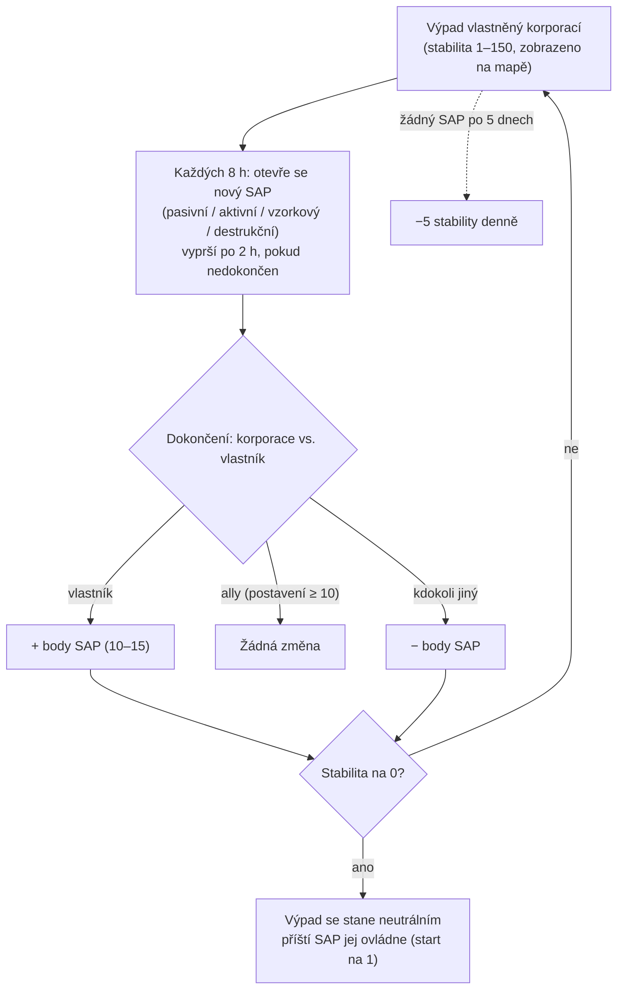

# Výpady & SAP

Na ostrovech s otevřeným PvP **mohou být výpady vlastněny hráčskými korporacemi**.
Kontrola se měří pomocí ukazatele **stability** (0–150), který se zobrazuje nad výpadem
v mapovém pohledu. Systém **SAP** (Service Access Point) určuje, jak se tento ukazatel
pohybuje — a jak výpady mění majitele.

## Pravidla

- Když **vlastní** korporace dokončí SAP, stabilita se **zvýší** o hodnotu bodů SAP.
- Když SAP dokončí **korporace spojená s vlastníkem** (vzájemné postavení +10 nebo vyšší),
  stabilita se **nepohne**.
- Když SAP dokončí **kdokoli jiný**, stabilita se **sníží** o stejnou hodnotu.
- Při **nule** výpad ztrácí vlastnictví a stává se neutrálním. Dokončení
  jakéhokoli SAP na neutrálním výpadu jej **ovládne** (dokončující korporace
  se stane vlastníkem, startuje na stabilitě 1).
- **Úbytek**: pokud se během **5 dnů** nedokončí žádný SAP, výpad začne ztrácet
  **5 stability denně**, dokud se nějaký nedokončí (ne dokud se neztratí).

## Čtyři typy SAP

Každých 8 hodin výpad vygeneruje nový SAP — jeden ze čtyř typů. Každý typ má
svou hodnotu bodů a svůj způsob dokončení:

| Typ | Jak se provádí | Body | Odměna |
|---|---|---|---|
| **Pasivní** | Stůjte uvnitř SAP paprsku po **8 minut**. Pokrok je individuální (každý hráč má svůj vlastní nepřetržitý čas v paprsku); nejvyšší individuální pokrok SAP dokončí. | +10 | Plazma frakce (měřítko dle stability), výzkumné sady, EP boostery. |
| **Aktivní** | Zamířte na SAP a nechte běžet **modul kryptolomu SAP** — přibližně 120 cyklů modulu (5 s každý), tj. ~10 minut. Pokrok přetrvá i při zastavení nebo odchodu; individuální. | +15 | Plazma, jádra, výzkumné sady a **jádra reaktoru** (výroba robotů). |
| **Vzorkový** | Přivezte **vzorkové předměty** k SAP (do 7 m) a odešlete 5–6, které požaduje. Každé odeslání má 90sekundový cooldown; pokrok je individuální. | +15 | Plazma, jádra, výzkumné sady. |
| **Destrukční** | Zničte ho: **30 000 brnění** a **150 odolnost vůči všem čtyřem typům poškození** (60 % redukce), **6 m signatura** — malé zbraně ho trefují nejlépe. Pokrok poškození je **korporátní, ne individuální**, takže celé flotily mohou útočit najednou; korporace s největším poškozením v momentě smrti SAP aplikuje výsledek. | ±15 | Frakční **PvP munice**, plazma, jádra. |

Všechny čtyři SAP **vysílají aktuální žebříček nejlepších** (top 10) všem
v okolí a **vyprší po 2 hodinách**, pokud se nedokončí.

### Zabraňte nepříteli

Protože pokrok destrukce je korporátní a znaménko změny stability závisí na tom,
kdo vyhraje, je běžnou taktikou **zadejít dostatečné poškození, abyste se dostali
na vrchol žebříčku, ale nedokončit SAP**: pokud jej pak dokončí vlastní posádka
vlastníka, *vaše* korporace je stále vítězem a změna stability dopadne
proti vlastníkovi.

## Sledování a předpověď

- **Nabíjení skeneru invaze** v geoskenru, aktivované v blízkosti výpadu,
  hlásí **čas do dalšího SAP** pro výpady v dosahu (na ostrovech s otevřeným PvP
  toto nabíjení místo toho hlásí stav posil NPC).
- SAP se blízkým hráčům oznámí krátkou dobu před otevřením.
- Vysílání žebříčku SAP znamená, že můžete **sledovat sporný SAP v reálném čase**
  a rozhodnout, zda ho budete napadat.

## Další způsoby, jak se stabilita pohybuje

- **SAP artefakty** — artefaktové objekty, které se generují 90–350 m od výpadu
  (obnovení po 4 hodinách, maximální stáří 12 hodin). Zničení jednoho okamžitě
  aplikuje **±1 stability** (pro vaši korporaci), označí vás pro PvP a odmění
  EP plus kontejner s plazmatem.
- **Strážci a najezdcové** — šéf NPC výpadu:
  - **Strážní** NPC drží pozici blízko výpadu (~35 m). Zabití jednoho **vždy
    snižuje** stabilitu o 3, bez ohledu na to, kdo ho zabije; obnovení po ~6 hodinách.
  - **Najezdcoví** NPC patrolují až ~300 m. Zabití jednoho **zvyšuje** stabilitu o
    2 pro korporaci, která ho zabila; obnovení po ~6 hodinách.

## Proč jsou výpady důležité

Vlastnictví výpadu dává korporaci její bonusy (výroba, obranná zařízení, efekty)
a je páteří teritoriální hry v otevřeném PvP — viz
[PBS](/cs/features/pbs/) pro struktury, které z výpadu dělají skutečnou
operační základnu.

<!--
Written from scratch against the server backend, 2026-09-27:
Zones/Intrusion/Outpost.cs (stability 0-150, capture at 1, ally threshold
+10, EP to participants), OutpostDecay.cs (5-day grace, -5/day), SAP.cs +
PassiveHackingSAP.cs / ActiveHackingSAP.cs / SpecimenProcessingSAP.cs /
DestructionSAP.cs (8-min passive, 120x5s active, 5-6 specimen items with 90s
cooldown, corporate destruction score, 2h expiry, top-10 broadcast),
entitydefaults options (#increase=n10/n15), siegeitems (def_specimen_sap_item
2-3 x 5-6), def_sap_destruction stats (30k armor, 150 res all types, 6m
signature), def_siege_hack_module (5s cycle), intrusionsitestabilitythreshold
+ intrusionsaps, intrusionloot (plasma/kernels/research kits/cores/PvP ammo
by stability tier), npcbossinfo + npcflock (guard -3 @ ~35m, invader +2 @
~300m, 6h respawn), OutpostRelicManager.cs + SAPRelic.cs (90-350m spawn,
4h respawn, 12h lifespan, +1 stability, PvP flag), Scanner.Intrusion.cs
(next-SAP-time scan), EntitiesModule.cs (8h SAP interval).
An earlier version of this page was adapted from the Open Perpetuum
community wiki (perpetuum.miraheze.org) and has been fully rewritten from
backend sources; no text was reused.
Note: the ingested text had several numbers this server contradicts (3-day
decay vs 5-day, 10-min passive vs 8-min, "no resistances" vs 150 all types,
3 km invader range vs 300 m).
-->